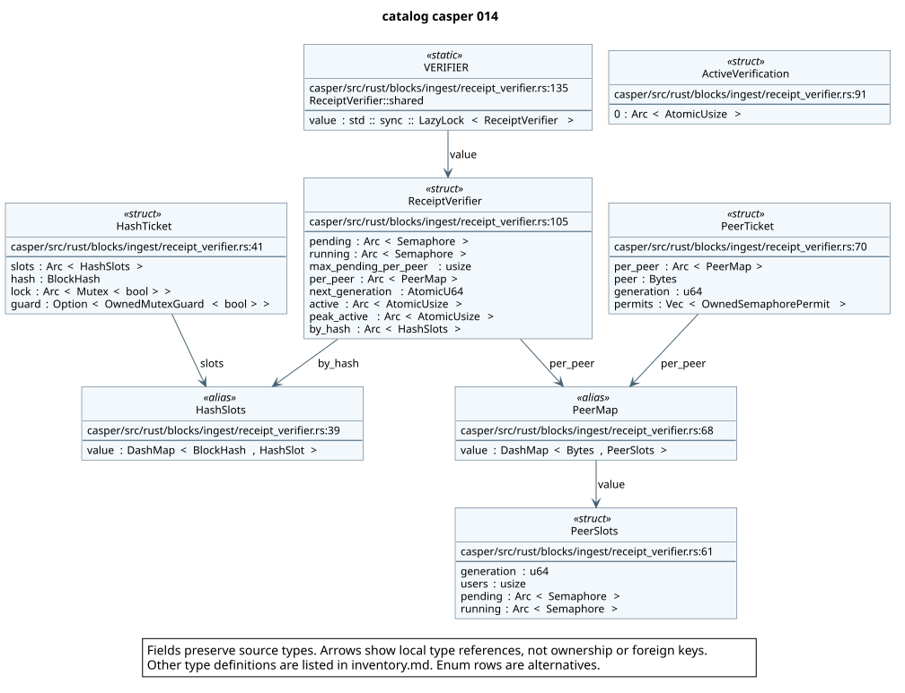

# catalog casper 014

[Inventory](inventory.md) | [PlantUML](catalog-casper-014.puml)

## Cross-Page References

- `HashSlots: value -> BlockHash [catalog-models-027.svg]`
- `HashSlots: value -> HashSlot [catalog-casper-013.svg]`
- `HashTicket: hash -> BlockHash [catalog-models-027.svg]`
