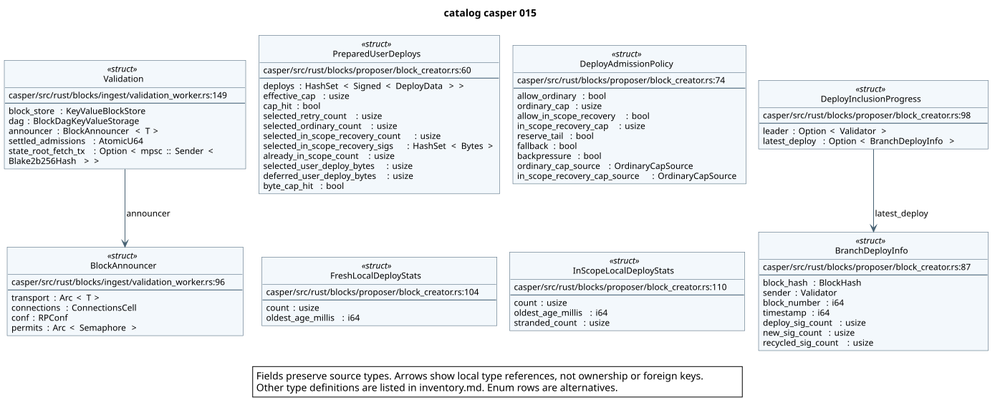

# catalog casper 015

[Inventory](inventory.md) | [PlantUML](catalog-casper-015.puml)

## Cross-Page References

- `BlockAnnouncer: conf -> RPConf [catalog-comm-004.svg]`
- `BlockAnnouncer: connections -> ConnectionsCell [catalog-comm-004.svg]`
- `BranchDeployInfo: block_hash -> BlockHash [catalog-models-027.svg]`
- `DeployAdmissionPolicy: in_scope_recovery_cap_source -> OrdinaryCapSource [catalog-casper-016.svg]`
- `DeployAdmissionPolicy: ordinary_cap_source -> OrdinaryCapSource [catalog-casper-016.svg]`
- `PreparedUserDeploys: deploys -> Signed [catalog-crypto-003.svg]`
- `Validation: block_store -> KeyValueBlockStore [catalog-block-storage-008.svg]`
- `Validation: dag -> BlockDagKeyValueStorage [catalog-block-storage-001.svg]`
- `Validation: state_root_fetch_tx -> Blake2b256Hash [catalog-rspacepp-002.svg]`
