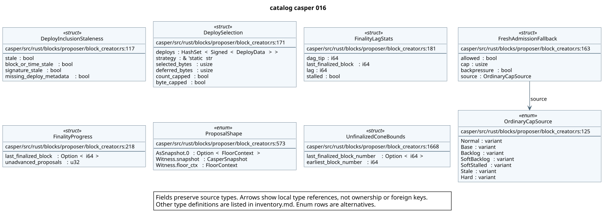

# catalog casper 016

[Inventory](inventory.md) | [PlantUML](catalog-casper-016.puml)

## Cross-Page References

- `DeploySelection: deploys -> Signed [catalog-crypto-003.svg]`
- `ProposalShape: AsSnapshot.0 -> FloorContext [catalog-casper-033.svg]`
- `ProposalShape: Witness.floor_ctx -> FloorContext [catalog-casper-033.svg]`
- `ProposalShape: Witness.snapshot -> CasperSnapshot [catalog-casper-019.svg]`
