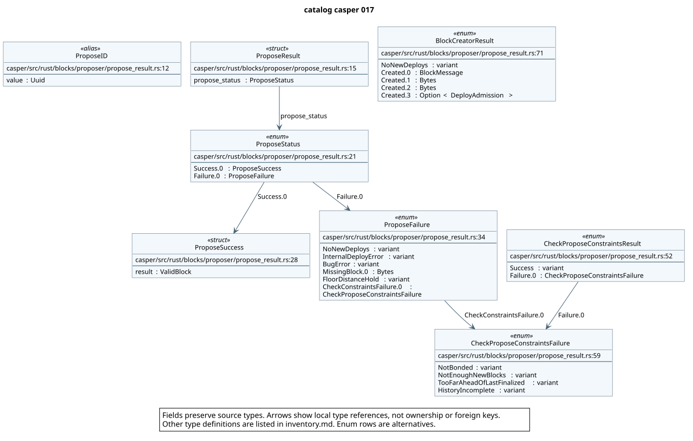

# catalog casper 017

[Inventory](inventory.md) | [PlantUML](catalog-casper-017.puml)

## Cross-Page References

- `BlockCreatorResult: Created.0 -> BlockMessage [catalog-models-031.svg]`
- `BlockCreatorResult: Created.3 -> DeployAdmission [catalog-shared-004.svg]`
- `ProposeSuccess: result -> ValidBlock [catalog-casper-006.svg]`
