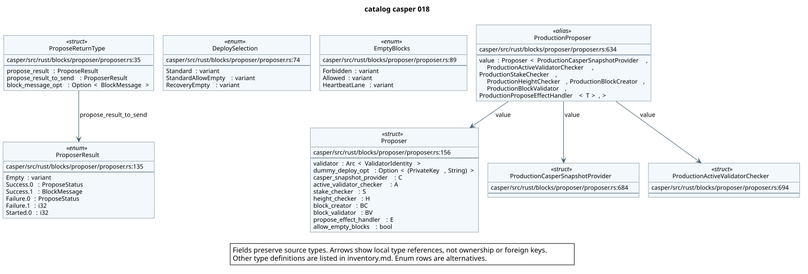

# catalog casper 018

[Inventory](inventory.md) | [PlantUML](catalog-casper-018.puml)

## Cardinality and Size

[Method, units, limits, and runtime evidence](sizing.md). These are declaration-level assessments, not measured live counts.

### ProposeReturnType

Cardinality: 0..n live values. Current count and owner-level limits are not derivable from this declaration.

Size: Sum of field inline layouts plus compiler padding, then uniquely owned allocations. repr and custom implementations can change layout.

| Field or variant | Cardinality | Inline bytes or layout | Additional storage or wire encoding |
| --- | --- | --- | --- |
| `propose_result` | 1 value | Compiler layout required | Follow the referenced declaration or external implementation. No allocation bound established. |
| `propose_result_to_send` | 1 value | Compiler layout required | Follow the referenced declaration or external implementation. No allocation bound established. |
| `block_message_opt` | 0..1 present payload | Option layout includes any tag or niche optimization. Do not assume I(T) + 1 | None when absent. Present payload: 1 value. Follow the referenced declaration or external implementation. No allocation bound established. |

### DeploySelection

Cardinality: 0..n live values. Current count and owner-level limits are not derivable from this declaration.

Size: Compiler enum layout plus allocations of the active variant only. Do not sum alternative variants.

| Field or variant | Cardinality | Inline bytes or layout | Additional storage or wire encoding |
| --- | --- | --- | --- |
| `Standard` | 1 mutually exclusive alternative | No payload. Enum discriminant layout required | None for this unit variant |
| `StandardAllowEmpty` | 1 mutually exclusive alternative | No payload. Enum discriminant layout required | None for this unit variant |
| `RecoveryEmpty` | 1 mutually exclusive alternative | No payload. Enum discriminant layout required | None for this unit variant |

### EmptyBlocks

Cardinality: 0..n live values. Current count and owner-level limits are not derivable from this declaration.

Size: Compiler enum layout plus allocations of the active variant only. Do not sum alternative variants.

| Field or variant | Cardinality | Inline bytes or layout | Additional storage or wire encoding |
| --- | --- | --- | --- |
| `Forbidden` | 1 mutually exclusive alternative | No payload. Enum discriminant layout required | None for this unit variant |
| `Allowed` | 1 mutually exclusive alternative | No payload. Enum discriminant layout required | None for this unit variant |
| `HeartbeatLane` | 1 mutually exclusive alternative | No payload. Enum discriminant layout required | None for this unit variant |

### ProposerResult

Cardinality: 0..n live values. Current count and owner-level limits are not derivable from this declaration.

Size: Compiler enum layout plus allocations of the active variant only. Do not sum alternative variants.

| Field or variant | Cardinality | Inline bytes or layout | Additional storage or wire encoding |
| --- | --- | --- | --- |
| `Empty` | 1 mutually exclusive alternative | No payload. Enum discriminant layout required | None for this unit variant |
| `Success.0` | 1 value when this variant is active | Compiler layout required | Follow the referenced declaration or external implementation. No allocation bound established. |
| `Success.1` | 1 value when this variant is active | Compiler layout required | Follow the referenced declaration or external implementation. No allocation bound established. |
| `Failure.0` | 1 value when this variant is active | Compiler layout required | Follow the referenced declaration or external implementation. No allocation bound established. |
| `Failure.1` | 1 scalar when this variant is active | 4 B | None |
| `Started.0` | 1 scalar when this variant is active | 4 B | None |

### Proposer

Cardinality: 0..n live values. Current count and owner-level limits are not derivable from this declaration.

Size: Sum of field inline layouts plus compiler padding, then uniquely owned allocations. repr and custom implementations can change layout.

| Field or variant | Cardinality | Inline bytes or layout | Additional storage or wire encoding |
| --- | --- | --- | --- |
| `validator` | 1 shared strong reference | Pointer or fat pointer, depending on target type | One shared allocation holds the target, counters and alignment. Count it once across all handles |
| `dummy_deploy_opt` | 0..1 present payload | Option layout includes any tag or niche optimization. Do not assume I(T) + 1 | None when absent. Present payload: 2 component values. Sum of component-owned allocations |
| `casper_snapshot_provider` | 1 value | Compiler layout required | Follow the referenced declaration or external implementation. No allocation bound established. |
| `active_validator_checker` | 1 value | Compiler layout required | Follow the referenced declaration or external implementation. No allocation bound established. |
| `stake_checker` | 1 value | Compiler layout required | Follow the referenced declaration or external implementation. No allocation bound established. |
| `height_checker` | 1 value | Compiler layout required | Follow the referenced declaration or external implementation. No allocation bound established. |
| `block_creator` | 1 value | Compiler layout required | Follow the referenced declaration or external implementation. No allocation bound established. |
| `block_validator` | 1 value | Compiler layout required | Follow the referenced declaration or external implementation. No allocation bound established. |
| `propose_effect_handler` | 1 value | Compiler layout required | Follow the referenced declaration or external implementation. No allocation bound established. |
| `allow_empty_blocks` | 1 scalar | 1 B | None |

### ProductionProposer

Cardinality: Alias, not a separate allocation. Count values of the target type.

Size: Same layout and allocations as target. Do not add alias bytes again.

| Field or variant | Cardinality | Inline bytes or layout | Additional storage or wire encoding |
| --- | --- | --- | --- |
| `value` | 1 value | Compiler layout required | Follow the referenced declaration or external implementation. No allocation bound established. |

### ProductionCasperSnapshotProvider

Cardinality: 0..n live values. Current count and owner-level limits are not derivable from this declaration.

Size: Sum of field inline layouts plus compiler padding, then uniquely owned allocations. repr and custom implementations can change layout.

| Field or variant | Cardinality | Inline bytes or layout | Additional storage or wire encoding |
| --- | --- | --- | --- |
| No declared fields | 0 field payloads | Compiler layout required | No field-owned allocations |

### ProductionActiveValidatorChecker

Cardinality: 0..n live values. Current count and owner-level limits are not derivable from this declaration.

Size: Sum of field inline layouts plus compiler padding, then uniquely owned allocations. repr and custom implementations can change layout.

| Field or variant | Cardinality | Inline bytes or layout | Additional storage or wire encoding |
| --- | --- | --- | --- |
| No declared fields | 0 field payloads | Compiler layout required | No field-owned allocations |

## Cross-Page References

- `ProductionProposer: value -> ProductionBlockCreator [catalog-casper-019.svg]`
- `ProductionProposer: value -> ProductionBlockValidator [catalog-casper-019.svg]`
- `ProductionProposer: value -> ProductionHeightChecker [catalog-casper-019.svg]`
- `ProductionProposer: value -> ProductionProposeEffectHandler [catalog-casper-019.svg]`
- `ProductionProposer: value -> ProductionStakeChecker [catalog-casper-019.svg]`
- `ProposeReturnType: block_message_opt -> BlockMessage [catalog-models-031.svg]`
- `ProposeReturnType: propose_result -> ProposeResult [catalog-casper-017.svg]`
- `Proposer: dummy_deploy_opt -> PrivateKey [catalog-crypto-001.svg]`
- `Proposer: validator -> ValidatorIdentity [catalog-casper-058.svg]`
- `ProposerResult: Failure.0 -> ProposeStatus [catalog-casper-017.svg]`
- `ProposerResult: Success.0 -> ProposeStatus [catalog-casper-017.svg]`
- `ProposerResult: Success.1 -> BlockMessage [catalog-models-031.svg]`
