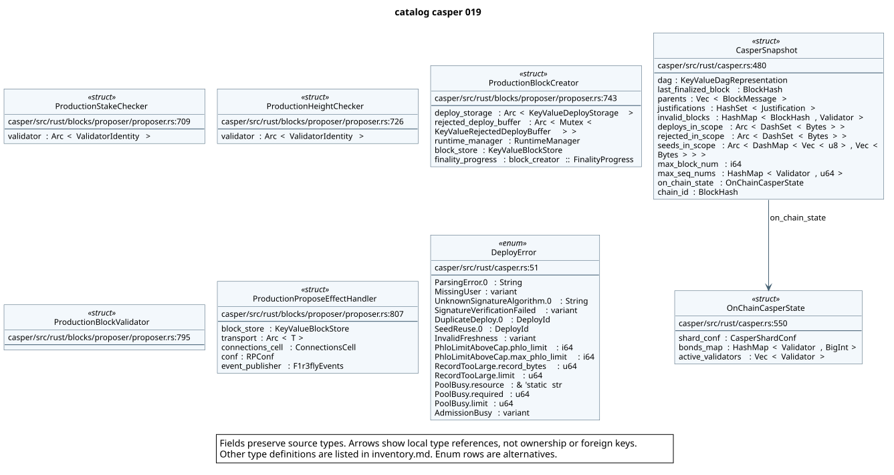

# catalog casper 019

[Inventory](inventory.md) | [PlantUML](catalog-casper-019.puml)

## Cross-Page References

- `CasperSnapshot: chain_id -> BlockHash [catalog-models-027.svg]`
- `CasperSnapshot: dag -> KeyValueDagRepresentation [catalog-block-storage-001.svg]`
- `CasperSnapshot: invalid_blocks -> BlockHash [catalog-models-027.svg]`
- `CasperSnapshot: justifications -> Justification [catalog-models-031.svg]`
- `CasperSnapshot: last_finalized_block -> BlockHash [catalog-models-027.svg]`
- `CasperSnapshot: parents -> BlockMessage [catalog-models-031.svg]`
- `DeployError: DuplicateDeploy.0 -> DeployId [catalog-block-storage-001.svg]`
- `DeployError: SeedReuse.0 -> DeployId [catalog-block-storage-001.svg]`
- `OnChainCasperState: shard_conf -> CasperShardConf [catalog-casper-020.svg]`
- `ProductionBlockCreator: block_store -> KeyValueBlockStore [catalog-block-storage-008.svg]`
- `ProductionBlockCreator: deploy_storage -> KeyValueDeployStorage [catalog-block-storage-008.svg]`
- `ProductionBlockCreator: rejected_deploy_buffer -> KeyValueRejectedDeployBuffer [catalog-block-storage-008.svg]`
- `ProductionBlockCreator: runtime_manager -> RuntimeManager [catalog-casper-056.svg]`
- `ProductionHeightChecker: validator -> ValidatorIdentity [catalog-casper-058.svg]`
- `ProductionProposeEffectHandler: block_store -> KeyValueBlockStore [catalog-block-storage-008.svg]`
- `ProductionProposeEffectHandler: conf -> RPConf [catalog-comm-004.svg]`
- `ProductionProposeEffectHandler: connections_cell -> ConnectionsCell [catalog-comm-004.svg]`
- `ProductionProposeEffectHandler: event_publisher -> F1r3flyEvents [catalog-shared-005.svg]`
- `ProductionStakeChecker: validator -> ValidatorIdentity [catalog-casper-058.svg]`
