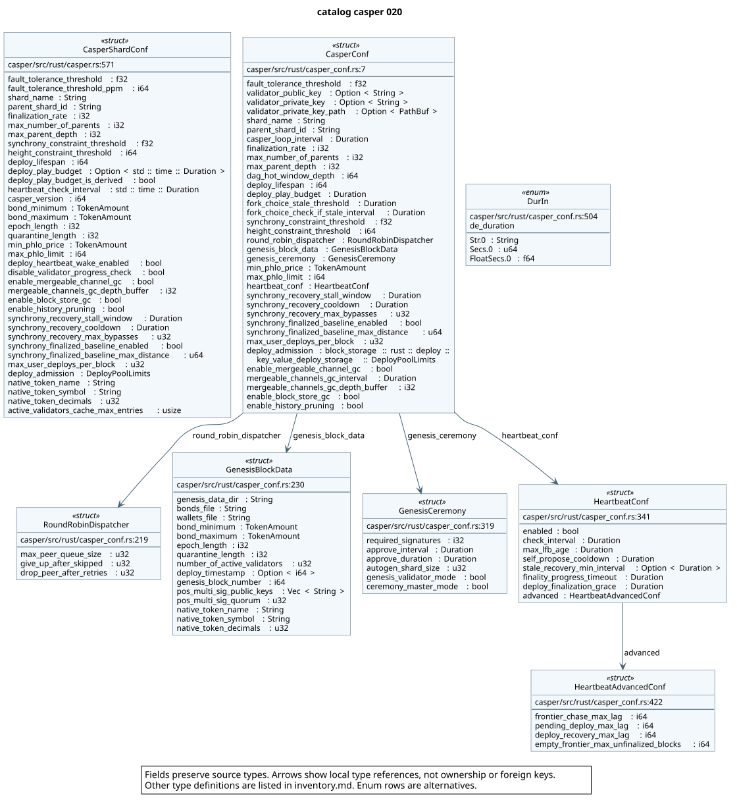

# catalog casper 020

[Inventory](inventory.md) | [PlantUML](catalog-casper-020.puml)

## Cardinality and Size

[Method, units, limits, and runtime evidence](sizing.md). These are declaration-level assessments, not measured live counts.

### CasperShardConf

Cardinality: 0..n live values. Current count and owner-level limits are not derivable from this declaration.

Size: Sum of field inline layouts plus compiler padding, then uniquely owned allocations. repr and custom implementations can change layout.

| Field or variant | Cardinality | Inline bytes or layout | Additional storage or wire encoding |
| --- | --- | --- | --- |
| `fault_tolerance_threshold` | 1 scalar | 4 B | None |
| `fault_tolerance_threshold_ppm` | 1 scalar | 8 B | None |
| `shard_name` | 0..n UTF-8 bytes | 24 B. String header on the generator target | capacity() bytes, excluding allocator overhead. UTF-8 byte length is not character count |
| `parent_shard_id` | 0..n UTF-8 bytes | 24 B. String header on the generator target | capacity() bytes, excluding allocator overhead. UTF-8 byte length is not character count |
| `finalization_rate` | 1 scalar | 4 B | None |
| `max_number_of_parents` | 1 scalar | 4 B | None |
| `max_parent_depth` | 1 scalar | 4 B | None |
| `synchrony_constraint_threshold` | 1 scalar | 4 B | None |
| `height_constraint_threshold` | 1 scalar | 8 B | None |
| `deploy_lifespan` | 1 scalar | 8 B | None |
| `deploy_play_budget` | 0..1 present payload | Option layout includes any tag or niche optimization. Do not assume I(T) + 1 | None when absent. Present payload: 1 value. Follow the referenced declaration or external implementation. No allocation bound established. |
| `deploy_play_budget_is_derived` | 1 scalar | 1 B | None |
| `heartbeat_check_interval` | 1 value | Compiler layout required | Follow the referenced declaration or external implementation. No allocation bound established. |
| `casper_version` | 1 scalar | 8 B | None |
| `bond_minimum` | 1 value | Compiler layout required | Follow the referenced declaration or external implementation. No allocation bound established. |
| `bond_maximum` | 1 value | Compiler layout required | Follow the referenced declaration or external implementation. No allocation bound established. |
| `epoch_length` | 1 scalar | 4 B | None |
| `quarantine_length` | 1 scalar | 4 B | None |
| `min_phlo_price` | 1 value | Compiler layout required | Follow the referenced declaration or external implementation. No allocation bound established. |
| `max_phlo_limit` | 1 scalar | 8 B | None |
| `deploy_heartbeat_wake_enabled` | 1 scalar | 1 B | None |
| `disable_validator_progress_check` | 1 scalar | 1 B | None |
| `enable_mergeable_channel_gc` | 1 scalar | 1 B | None |
| `mergeable_channels_gc_depth_buffer` | 1 scalar | 4 B | None |
| `enable_block_store_gc` | 1 scalar | 1 B | None |
| `enable_history_pruning` | 1 scalar | 1 B | None |
| `synchrony_recovery_stall_window` | 1 value | Compiler layout required | Follow the referenced declaration or external implementation. No allocation bound established. |
| `synchrony_recovery_cooldown` | 1 value | Compiler layout required | Follow the referenced declaration or external implementation. No allocation bound established. |
| `synchrony_recovery_max_bypasses` | 1 scalar | 4 B | None |
| `synchrony_finalized_baseline_enabled` | 1 scalar | 1 B | None |
| `synchrony_finalized_baseline_max_distance` | 1 scalar | 8 B | None |
| `max_user_deploys_per_block` | 1 scalar | 4 B | None |
| `deploy_admission` | 1 value | Compiler layout required | Follow the referenced declaration or external implementation. No allocation bound established. |
| `native_token_name` | 0..n UTF-8 bytes | 24 B. String header on the generator target | capacity() bytes, excluding allocator overhead. UTF-8 byte length is not character count |
| `native_token_symbol` | 0..n UTF-8 bytes | 24 B. String header on the generator target | capacity() bytes, excluding allocator overhead. UTF-8 byte length is not character count |
| `native_token_decimals` | 1 scalar | 4 B | None |
| `active_validators_cache_max_entries` | 1 scalar | 8 B | None |

### CasperConf

Cardinality: 0..n live values. Current count and owner-level limits are not derivable from this declaration.

Size: Sum of field inline layouts plus compiler padding, then uniquely owned allocations. repr and custom implementations can change layout.

| Field or variant | Cardinality | Inline bytes or layout | Additional storage or wire encoding |
| --- | --- | --- | --- |
| `fault_tolerance_threshold` | 1 scalar | 4 B | None |
| `validator_public_key` | 0..1 present payload | Option layout includes any tag or niche optimization. Do not assume I(T) + 1 | None when absent. Present payload: 0..n UTF-8 bytes. capacity() bytes, excluding allocator overhead. UTF-8 byte length is not character count |
| `validator_private_key` | 0..1 present payload | Option layout includes any tag or niche optimization. Do not assume I(T) + 1 | None when absent. Present payload: 0..n UTF-8 bytes. capacity() bytes, excluding allocator overhead. UTF-8 byte length is not character count |
| `validator_private_key_path` | 0..1 present payload | Option layout includes any tag or niche optimization. Do not assume I(T) + 1 | None when absent. Present payload: 1 value. Follow the referenced declaration or external implementation. No allocation bound established. |
| `shard_name` | 0..n UTF-8 bytes | 24 B. String header on the generator target | capacity() bytes, excluding allocator overhead. UTF-8 byte length is not character count |
| `parent_shard_id` | 0..n UTF-8 bytes | 24 B. String header on the generator target | capacity() bytes, excluding allocator overhead. UTF-8 byte length is not character count |
| `casper_loop_interval` | 1 value | Compiler layout required | Follow the referenced declaration or external implementation. No allocation bound established. |
| `finalization_rate` | 1 scalar | 4 B | None |
| `max_number_of_parents` | 1 scalar | 4 B | None |
| `max_parent_depth` | 1 scalar | 4 B | None |
| `dag_hot_window_depth` | 1 scalar | 8 B | None |
| `deploy_lifespan` | 1 scalar | 8 B | None |
| `deploy_play_budget` | 1 value | Compiler layout required | Follow the referenced declaration or external implementation. No allocation bound established. |
| `fork_choice_stale_threshold` | 1 value | Compiler layout required | Follow the referenced declaration or external implementation. No allocation bound established. |
| `fork_choice_check_if_stale_interval` | 1 value | Compiler layout required | Follow the referenced declaration or external implementation. No allocation bound established. |
| `synchrony_constraint_threshold` | 1 scalar | 4 B | None |
| `height_constraint_threshold` | 1 scalar | 8 B | None |
| `round_robin_dispatcher` | 1 value | Compiler layout required | Follow the referenced declaration or external implementation. No allocation bound established. |
| `genesis_block_data` | 1 value | Compiler layout required | Follow the referenced declaration or external implementation. No allocation bound established. |
| `genesis_ceremony` | 1 value | Compiler layout required | Follow the referenced declaration or external implementation. No allocation bound established. |
| `min_phlo_price` | 1 value | Compiler layout required | Follow the referenced declaration or external implementation. No allocation bound established. |
| `max_phlo_limit` | 1 scalar | 8 B | None |
| `heartbeat_conf` | 1 value | Compiler layout required | Follow the referenced declaration or external implementation. No allocation bound established. |
| `synchrony_recovery_stall_window` | 1 value | Compiler layout required | Follow the referenced declaration or external implementation. No allocation bound established. |
| `synchrony_recovery_cooldown` | 1 value | Compiler layout required | Follow the referenced declaration or external implementation. No allocation bound established. |
| `synchrony_recovery_max_bypasses` | 1 scalar | 4 B | None |
| `synchrony_finalized_baseline_enabled` | 1 scalar | 1 B | None |
| `synchrony_finalized_baseline_max_distance` | 1 scalar | 8 B | None |
| `max_user_deploys_per_block` | 1 scalar | 4 B | None |
| `deploy_admission` | 1 value | Compiler layout required | Follow the referenced declaration or external implementation. No allocation bound established. |
| `enable_mergeable_channel_gc` | 1 scalar | 1 B | None |
| `mergeable_channels_gc_interval` | 1 value | Compiler layout required | Follow the referenced declaration or external implementation. No allocation bound established. |
| `mergeable_channels_gc_depth_buffer` | 1 scalar | 4 B | None |
| `enable_block_store_gc` | 1 scalar | 1 B | None |
| `enable_history_pruning` | 1 scalar | 1 B | None |

### RoundRobinDispatcher

Cardinality: 0..n live values. Current count and owner-level limits are not derivable from this declaration.

Size: Sum of field inline layouts plus compiler padding, then uniquely owned allocations. repr and custom implementations can change layout.

| Field or variant | Cardinality | Inline bytes or layout | Additional storage or wire encoding |
| --- | --- | --- | --- |
| `max_peer_queue_size` | 1 scalar | 4 B | None |
| `give_up_after_skipped` | 1 scalar | 4 B | None |
| `drop_peer_after_retries` | 1 scalar | 4 B | None |

### GenesisBlockData

Cardinality: 0..n live values. Current count and owner-level limits are not derivable from this declaration.

Size: Sum of field inline layouts plus compiler padding, then uniquely owned allocations. repr and custom implementations can change layout.

| Field or variant | Cardinality | Inline bytes or layout | Additional storage or wire encoding |
| --- | --- | --- | --- |
| `genesis_data_dir` | 0..n UTF-8 bytes | 24 B. String header on the generator target | capacity() bytes, excluding allocator overhead. UTF-8 byte length is not character count |
| `bonds_file` | 0..n UTF-8 bytes | 24 B. String header on the generator target | capacity() bytes, excluding allocator overhead. UTF-8 byte length is not character count |
| `wallets_file` | 0..n UTF-8 bytes | 24 B. String header on the generator target | capacity() bytes, excluding allocator overhead. UTF-8 byte length is not character count |
| `bond_minimum` | 1 value | Compiler layout required | Follow the referenced declaration or external implementation. No allocation bound established. |
| `bond_maximum` | 1 value | Compiler layout required | Follow the referenced declaration or external implementation. No allocation bound established. |
| `epoch_length` | 1 scalar | 4 B | None |
| `quarantine_length` | 1 scalar | 4 B | None |
| `number_of_active_validators` | 1 scalar | 4 B | None |
| `deploy_timestamp` | 0..1 present payload | Option layout includes any tag or niche optimization. Do not assume I(T) + 1 | None when absent. Present payload: 1 scalar. None |
| `genesis_block_number` | 1 scalar | 8 B | None |
| `pos_multi_sig_public_keys` | 0..n elements | 24 B. Vec header on the generator target | capacity * I(element), plus live element-owned allocations. Zero-sized elements need no backing allocation. Element: capacity() bytes, excluding allocator overhead. UTF-8 byte length is not character count |
| `pos_multi_sig_quorum` | 1 scalar | 4 B | None |
| `native_token_name` | 0..n UTF-8 bytes | 24 B. String header on the generator target | capacity() bytes, excluding allocator overhead. UTF-8 byte length is not character count |
| `native_token_symbol` | 0..n UTF-8 bytes | 24 B. String header on the generator target | capacity() bytes, excluding allocator overhead. UTF-8 byte length is not character count |
| `native_token_decimals` | 1 scalar | 4 B | None |

### GenesisCeremony

Cardinality: 0..n live values. Current count and owner-level limits are not derivable from this declaration.

Size: Sum of field inline layouts plus compiler padding, then uniquely owned allocations. repr and custom implementations can change layout.

| Field or variant | Cardinality | Inline bytes or layout | Additional storage or wire encoding |
| --- | --- | --- | --- |
| `required_signatures` | 1 scalar | 4 B | None |
| `approve_interval` | 1 value | Compiler layout required | Follow the referenced declaration or external implementation. No allocation bound established. |
| `approve_duration` | 1 value | Compiler layout required | Follow the referenced declaration or external implementation. No allocation bound established. |
| `autogen_shard_size` | 1 scalar | 4 B | None |
| `genesis_validator_mode` | 1 scalar | 1 B | None |
| `ceremony_master_mode` | 1 scalar | 1 B | None |

### HeartbeatConf

Cardinality: 0..n live values. Current count and owner-level limits are not derivable from this declaration.

Size: Sum of field inline layouts plus compiler padding, then uniquely owned allocations. repr and custom implementations can change layout.

| Field or variant | Cardinality | Inline bytes or layout | Additional storage or wire encoding |
| --- | --- | --- | --- |
| `enabled` | 1 scalar | 1 B | None |
| `check_interval` | 1 value | Compiler layout required | Follow the referenced declaration or external implementation. No allocation bound established. |
| `max_lfb_age` | 1 value | Compiler layout required | Follow the referenced declaration or external implementation. No allocation bound established. |
| `self_propose_cooldown` | 1 value | Compiler layout required | Follow the referenced declaration or external implementation. No allocation bound established. |
| `stale_recovery_min_interval` | 0..1 present payload | Option layout includes any tag or niche optimization. Do not assume I(T) + 1 | None when absent. Present payload: 1 value. Follow the referenced declaration or external implementation. No allocation bound established. |
| `finality_progress_timeout` | 1 value | Compiler layout required | Follow the referenced declaration or external implementation. No allocation bound established. |
| `deploy_finalization_grace` | 1 value | Compiler layout required | Follow the referenced declaration or external implementation. No allocation bound established. |
| `advanced` | 1 value | Compiler layout required | Follow the referenced declaration or external implementation. No allocation bound established. |

### HeartbeatAdvancedConf

Cardinality: 0..n live values. Current count and owner-level limits are not derivable from this declaration.

Size: Sum of field inline layouts plus compiler padding, then uniquely owned allocations. repr and custom implementations can change layout.

| Field or variant | Cardinality | Inline bytes or layout | Additional storage or wire encoding |
| --- | --- | --- | --- |
| `frontier_chase_max_lag` | 1 scalar | 8 B | None |
| `pending_deploy_max_lag` | 1 scalar | 8 B | None |
| `deploy_recovery_max_lag` | 1 scalar | 8 B | None |
| `empty_frontier_max_unfinalized_blocks` | 1 scalar | 8 B | None |

### DurIn

Cardinality: 0..n live values. Current count and owner-level limits are not derivable from this declaration.

Size: Compiler enum layout plus allocations of the active variant only. Do not sum alternative variants.

| Field or variant | Cardinality | Inline bytes or layout | Additional storage or wire encoding |
| --- | --- | --- | --- |
| `Str.0` | 0..n UTF-8 bytes when this variant is active | 24 B. String header on the generator target | capacity() bytes, excluding allocator overhead. UTF-8 byte length is not character count |
| `Secs.0` | 1 scalar when this variant is active | 8 B | None |
| `FloatSecs.0` | 1 scalar when this variant is active | 8 B | None |

## Cross-Page References

- `CasperConf: deploy_admission -> DeployPoolLimits [catalog-block-storage-007.svg]`
- `CasperConf: min_phlo_price -> TokenAmount [catalog-shared-009.svg]`
- `CasperShardConf: bond_maximum -> TokenAmount [catalog-shared-009.svg]`
- `CasperShardConf: bond_minimum -> TokenAmount [catalog-shared-009.svg]`
- `CasperShardConf: deploy_admission -> DeployPoolLimits [catalog-block-storage-007.svg]`
- `CasperShardConf: min_phlo_price -> TokenAmount [catalog-shared-009.svg]`
- `GenesisBlockData: bond_maximum -> TokenAmount [catalog-shared-009.svg]`
- `GenesisBlockData: bond_minimum -> TokenAmount [catalog-shared-009.svg]`
