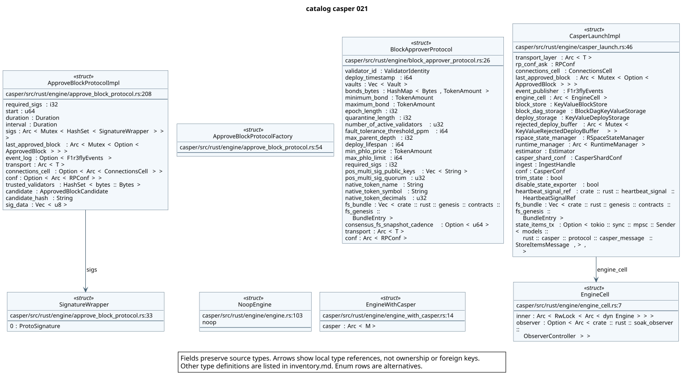

# catalog casper 021

[Inventory](inventory.md) | [PlantUML](catalog-casper-021.puml)

## Cross-Page References

- `ApproveBlockProtocolImpl: candidate -> ApprovedBlockCandidate [catalog-models-029.svg]`
- `ApproveBlockProtocolImpl: conf -> RPConf [catalog-comm-004.svg]`
- `ApproveBlockProtocolImpl: connections_cell -> ConnectionsCell [catalog-comm-004.svg]`
- `ApproveBlockProtocolImpl: event_log -> F1r3flyEvents [catalog-shared-005.svg]`
- `ApproveBlockProtocolImpl: last_approved_block -> ApprovedBlock [catalog-models-030.svg]`
- `BlockApproverProtocol: bonds_bytes -> TokenAmount [catalog-shared-009.svg]`
- `BlockApproverProtocol: conf -> RPConf [catalog-comm-004.svg]`
- `BlockApproverProtocol: fs_bundle -> BundleEntry [catalog-casper-034.svg]`
- `BlockApproverProtocol: maximum_bond -> TokenAmount [catalog-shared-009.svg]`
- `BlockApproverProtocol: min_phlo_price -> TokenAmount [catalog-shared-009.svg]`
- `BlockApproverProtocol: minimum_bond -> TokenAmount [catalog-shared-009.svg]`
- `BlockApproverProtocol: validator_id -> ValidatorIdentity [catalog-casper-058.svg]`
- `BlockApproverProtocol: vaults -> Vault [catalog-casper-036.svg]`
- `CasperLaunchImpl: block_dag_storage -> BlockDagKeyValueStorage [catalog-block-storage-001.svg]`
- `CasperLaunchImpl: block_store -> KeyValueBlockStore [catalog-block-storage-008.svg]`
- `CasperLaunchImpl: casper_shard_conf -> CasperShardConf [catalog-casper-020.svg]`
- `CasperLaunchImpl: conf -> CasperConf [catalog-casper-020.svg]`
- `CasperLaunchImpl: connections_cell -> ConnectionsCell [catalog-comm-004.svg]`
- `CasperLaunchImpl: deploy_storage -> KeyValueDeployStorage [catalog-block-storage-008.svg]`
- `CasperLaunchImpl: estimator -> Estimator [catalog-casper-031.svg]`
- `CasperLaunchImpl: event_publisher -> F1r3flyEvents [catalog-shared-005.svg]`
- `CasperLaunchImpl: fs_bundle -> BundleEntry [catalog-casper-034.svg]`
- `CasperLaunchImpl: heartbeat_signal_ref -> HeartbeatSignalRef [catalog-casper-036.svg]`
- `CasperLaunchImpl: ingest -> IngestHandle [catalog-casper-007.svg]`
- `CasperLaunchImpl: last_approved_block -> ApprovedBlock [catalog-models-030.svg]`
- `CasperLaunchImpl: rejected_deploy_buffer -> KeyValueRejectedDeployBuffer [catalog-block-storage-008.svg]`
- `CasperLaunchImpl: rp_conf_ask -> RPConf [catalog-comm-004.svg]`
- `CasperLaunchImpl: rspace_state_manager -> RSpaceStateManager [catalog-rspacepp-018.svg]`
- `CasperLaunchImpl: runtime_manager -> RuntimeManager [catalog-casper-056.svg]`
- `CasperLaunchImpl: state_items_tx -> StoreItemsMessage [catalog-models-033.svg]`
- `EngineCell: observer -> ObserverController [catalog-casper-045.svg]`
