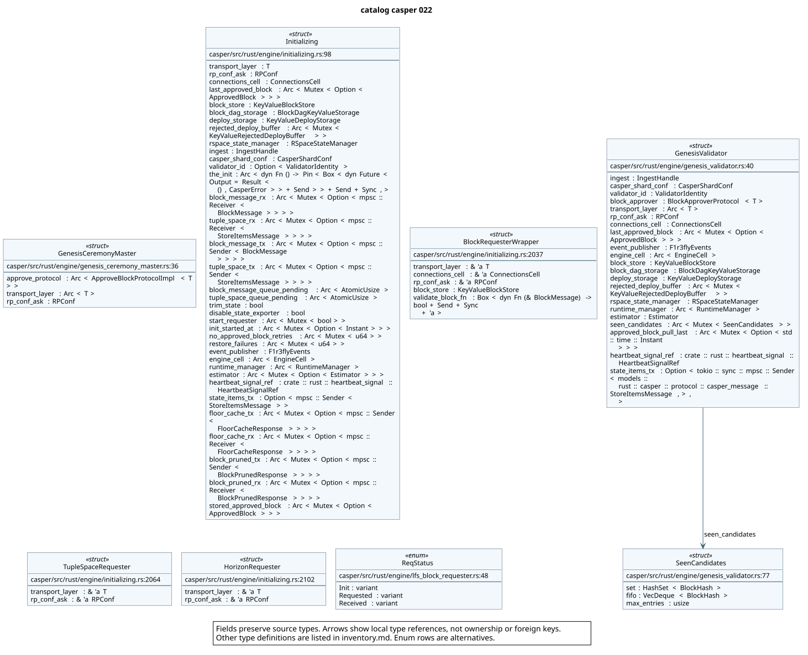

# catalog casper 022

[Inventory](inventory.md) | [PlantUML](catalog-casper-022.puml)

## Cross-Page References

- `BlockRequesterWrapper: block_store -> KeyValueBlockStore [catalog-block-storage-008.svg]`
- `BlockRequesterWrapper: connections_cell -> ConnectionsCell [catalog-comm-004.svg]`
- `BlockRequesterWrapper: rp_conf_ask -> RPConf [catalog-comm-004.svg]`
- `BlockRequesterWrapper: validate_block_fn -> BlockMessage [catalog-models-031.svg]`
- `GenesisCeremonyMaster: approve_protocol -> ApproveBlockProtocolImpl [catalog-casper-021.svg]`
- `GenesisCeremonyMaster: rp_conf_ask -> RPConf [catalog-comm-004.svg]`
- `GenesisValidator: block_approver -> BlockApproverProtocol [catalog-casper-021.svg]`
- `GenesisValidator: block_dag_storage -> BlockDagKeyValueStorage [catalog-block-storage-001.svg]`
- `GenesisValidator: block_store -> KeyValueBlockStore [catalog-block-storage-008.svg]`
- `GenesisValidator: casper_shard_conf -> CasperShardConf [catalog-casper-020.svg]`
- `GenesisValidator: connections_cell -> ConnectionsCell [catalog-comm-004.svg]`
- `GenesisValidator: deploy_storage -> KeyValueDeployStorage [catalog-block-storage-008.svg]`
- `GenesisValidator: engine_cell -> EngineCell [catalog-casper-021.svg]`
- `GenesisValidator: estimator -> Estimator [catalog-casper-031.svg]`
- `GenesisValidator: event_publisher -> F1r3flyEvents [catalog-shared-005.svg]`
- `GenesisValidator: heartbeat_signal_ref -> HeartbeatSignalRef [catalog-casper-036.svg]`
- `GenesisValidator: ingest -> IngestHandle [catalog-casper-007.svg]`
- `GenesisValidator: last_approved_block -> ApprovedBlock [catalog-models-030.svg]`
- `GenesisValidator: rejected_deploy_buffer -> KeyValueRejectedDeployBuffer [catalog-block-storage-008.svg]`
- `GenesisValidator: rp_conf_ask -> RPConf [catalog-comm-004.svg]`
- `GenesisValidator: rspace_state_manager -> RSpaceStateManager [catalog-rspacepp-018.svg]`
- `GenesisValidator: runtime_manager -> RuntimeManager [catalog-casper-056.svg]`
- `GenesisValidator: state_items_tx -> StoreItemsMessage [catalog-models-033.svg]`
- `GenesisValidator: validator_id -> ValidatorIdentity [catalog-casper-058.svg]`
- `HorizonRequester: rp_conf_ask -> RPConf [catalog-comm-004.svg]`
- `Initializing: block_dag_storage -> BlockDagKeyValueStorage [catalog-block-storage-001.svg]`
- `Initializing: block_message_rx -> BlockMessage [catalog-models-031.svg]`
- `Initializing: block_message_tx -> BlockMessage [catalog-models-031.svg]`
- `Initializing: block_pruned_rx -> BlockPrunedResponse [catalog-models-028.svg]`
- `Initializing: block_pruned_tx -> BlockPrunedResponse [catalog-models-028.svg]`
- `Initializing: block_store -> KeyValueBlockStore [catalog-block-storage-008.svg]`
- `Initializing: casper_shard_conf -> CasperShardConf [catalog-casper-020.svg]`
- `Initializing: connections_cell -> ConnectionsCell [catalog-comm-004.svg]`
- `Initializing: deploy_storage -> KeyValueDeployStorage [catalog-block-storage-008.svg]`
- `Initializing: engine_cell -> EngineCell [catalog-casper-021.svg]`
- `Initializing: estimator -> Estimator [catalog-casper-031.svg]`
- `Initializing: event_publisher -> F1r3flyEvents [catalog-shared-005.svg]`
- `Initializing: floor_cache_rx -> FloorCacheResponse [catalog-models-030.svg]`
- `Initializing: floor_cache_tx -> FloorCacheResponse [catalog-models-030.svg]`
- `Initializing: heartbeat_signal_ref -> HeartbeatSignalRef [catalog-casper-036.svg]`
- `Initializing: ingest -> IngestHandle [catalog-casper-007.svg]`
- `Initializing: last_approved_block -> ApprovedBlock [catalog-models-030.svg]`
- `Initializing: rejected_deploy_buffer -> KeyValueRejectedDeployBuffer [catalog-block-storage-008.svg]`
- `Initializing: rp_conf_ask -> RPConf [catalog-comm-004.svg]`
- `Initializing: rspace_state_manager -> RSpaceStateManager [catalog-rspacepp-018.svg]`
- `Initializing: runtime_manager -> RuntimeManager [catalog-casper-056.svg]`
- `Initializing: state_items_tx -> StoreItemsMessage [catalog-models-033.svg]`
- `Initializing: stored_approved_block -> ApprovedBlock [catalog-models-030.svg]`
- `Initializing: the_init -> CasperError [catalog-casper-030.svg]`
- `Initializing: tuple_space_rx -> StoreItemsMessage [catalog-models-033.svg]`
- `Initializing: tuple_space_tx -> StoreItemsMessage [catalog-models-033.svg]`
- `Initializing: validator_id -> ValidatorIdentity [catalog-casper-058.svg]`
- `SeenCandidates: fifo -> BlockHash [catalog-models-027.svg]`
- `SeenCandidates: set -> BlockHash [catalog-models-027.svg]`
- `TupleSpaceRequester: rp_conf_ask -> RPConf [catalog-comm-004.svg]`
