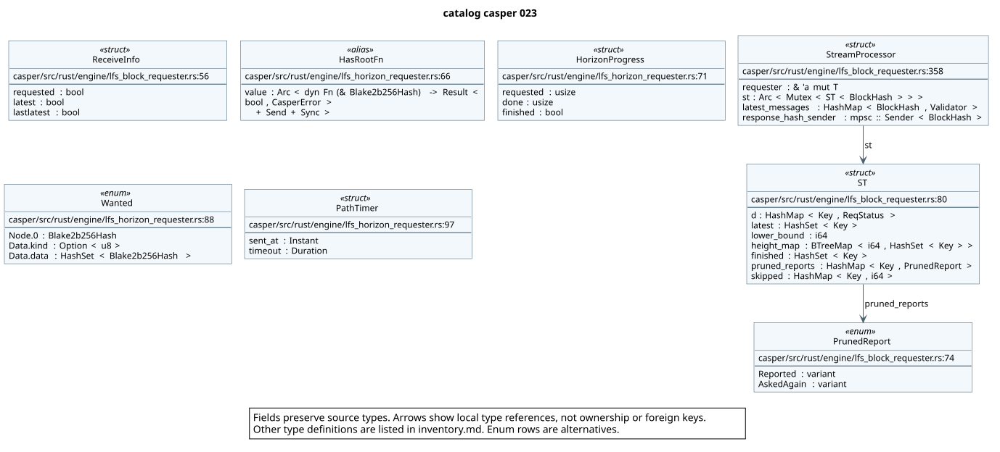

# catalog casper 023

[Inventory](inventory.md) | [PlantUML](catalog-casper-023.puml)

## Cardinality and Size

[Method, units, limits, and runtime evidence](sizing.md). These are declaration-level assessments, not measured live counts.

### ReceiveInfo

Cardinality: 0..n live values. Current count and owner-level limits are not derivable from this declaration.

Size: Sum of field inline layouts plus compiler padding, then uniquely owned allocations. repr and custom implementations can change layout.

| Field or variant | Cardinality | Inline bytes or layout | Additional storage or wire encoding |
| --- | --- | --- | --- |
| `requested` | 1 scalar | 1 B | None |
| `latest` | 1 scalar | 1 B | None |
| `lastlatest` | 1 scalar | 1 B | None |

### PrunedReport

Cardinality: 0..n live values. Current count and owner-level limits are not derivable from this declaration.

Size: Compiler enum layout plus allocations of the active variant only. Do not sum alternative variants.

| Field or variant | Cardinality | Inline bytes or layout | Additional storage or wire encoding |
| --- | --- | --- | --- |
| `Reported` | 1 mutually exclusive alternative | No payload. Enum discriminant layout required | None for this unit variant |
| `AskedAgain` | 1 mutually exclusive alternative | No payload. Enum discriminant layout required | None for this unit variant |

### ST

Cardinality: 0..n live values. Current count and owner-level limits are not derivable from this declaration.

Size: Sum of field inline layouts plus compiler padding, then uniquely owned allocations. repr and custom implementations can change layout.

| Field or variant | Cardinality | Inline bytes or layout | Additional storage or wire encoding |
| --- | --- | --- | --- |
| `d` | 0..n key/value pairs | Container and hasher implementation required | n keys and n values, their owned allocations, spare capacity, buckets or tree nodes, and control bytes. No type-level count cap |
| `latest` | 0..n distinct elements | Container and hasher implementation required | Element storage, owned allocations, spare capacity and index overhead. No type-level count cap |
| `lower_bound` | 1 scalar | 8 B | None |
| `height_map` | 0..n key/value pairs | Container and hasher implementation required | n keys and n values, their owned allocations, spare capacity, buckets or tree nodes, and control bytes. No type-level count cap |
| `finished` | 0..n distinct elements | Container and hasher implementation required | Element storage, owned allocations, spare capacity and index overhead. No type-level count cap |
| `pruned_reports` | 0..n key/value pairs | Container and hasher implementation required | n keys and n values, their owned allocations, spare capacity, buckets or tree nodes, and control bytes. No type-level count cap |
| `skipped` | 0..n key/value pairs | Container and hasher implementation required | n keys and n values, their owned allocations, spare capacity, buckets or tree nodes, and control bytes. No type-level count cap |

### StreamProcessor

Cardinality: 0..n live values. Current count and owner-level limits are not derivable from this declaration.

Size: Sum of field inline layouts plus compiler padding, then uniquely owned allocations. repr and custom implementations can change layout.

| Field or variant | Cardinality | Inline bytes or layout | Additional storage or wire encoding |
| --- | --- | --- | --- |
| `requester` | 1 borrowed reference | Pointer or fat pointer. Referent layout required | No owned allocation. Referent: 1 value |
| `st` | 1 shared strong reference | Pointer or fat pointer, depending on target type | One shared allocation holds the target, counters and alignment. Count it once across all handles |
| `latest_messages` | 0..n key/value pairs | Container and hasher implementation required | n keys and n values, their owned allocations, spare capacity, buckets or tree nodes, and control bytes. No type-level count cap |
| `response_hash_sender` | 1 value | Compiler layout required | Follow the referenced declaration or external implementation. No allocation bound established. |

### HasRootFn

Cardinality: Alias, not a separate allocation. Count values of the target type.

Size: Same layout and allocations as target. Do not add alias bytes again.

| Field or variant | Cardinality | Inline bytes or layout | Additional storage or wire encoding |
| --- | --- | --- | --- |
| `value` | 1 shared strong reference | Pointer or fat pointer, depending on target type | One shared allocation holds the target, counters and alignment. Count it once across all handles |

### HorizonProgress

Cardinality: 0..n live values. Current count and owner-level limits are not derivable from this declaration.

Size: Sum of field inline layouts plus compiler padding, then uniquely owned allocations. repr and custom implementations can change layout.

| Field or variant | Cardinality | Inline bytes or layout | Additional storage or wire encoding |
| --- | --- | --- | --- |
| `requested` | 1 scalar | 8 B | None |
| `done` | 1 scalar | 8 B | None |
| `finished` | 1 scalar | 1 B | None |

### Wanted

Cardinality: 0..n live values. Current count and owner-level limits are not derivable from this declaration.

Size: Compiler enum layout plus allocations of the active variant only. Do not sum alternative variants.

| Field or variant | Cardinality | Inline bytes or layout | Additional storage or wire encoding |
| --- | --- | --- | --- |
| `Node.0` | 1 value when this variant is active | Compiler layout required | Follow the referenced declaration or external implementation. No allocation bound established. |
| `Data.kind` | 0..1 present payload when this variant is active | Option layout includes any tag or niche optimization. Do not assume I(T) + 1 | None when absent. Present payload: 1 scalar. None |
| `Data.data` | 0..n distinct elements when this variant is active | Container and hasher implementation required | Element storage, owned allocations, spare capacity and index overhead. No type-level count cap |

### PathTimer

Cardinality: 0..n live values. Current count and owner-level limits are not derivable from this declaration.

Size: Sum of field inline layouts plus compiler padding, then uniquely owned allocations. repr and custom implementations can change layout.

| Field or variant | Cardinality | Inline bytes or layout | Additional storage or wire encoding |
| --- | --- | --- | --- |
| `sent_at` | 1 value | Compiler layout required | Follow the referenced declaration or external implementation. No allocation bound established. |
| `timeout` | 1 value | Compiler layout required | Follow the referenced declaration or external implementation. No allocation bound established. |

## Cross-Page References

- `HasRootFn: value -> Blake2b256Hash [catalog-rspacepp-002.svg]`
- `HasRootFn: value -> CasperError [catalog-casper-030.svg]`
- `ST: d -> ReqStatus [catalog-casper-022.svg]`
- `StreamProcessor: latest_messages -> BlockHash [catalog-models-027.svg]`
- `StreamProcessor: response_hash_sender -> BlockHash [catalog-models-027.svg]`
- `StreamProcessor: st -> BlockHash [catalog-models-027.svg]`
- `Wanted: Data.data -> Blake2b256Hash [catalog-rspacepp-002.svg]`
- `Wanted: Node.0 -> Blake2b256Hash [catalog-rspacepp-002.svg]`
