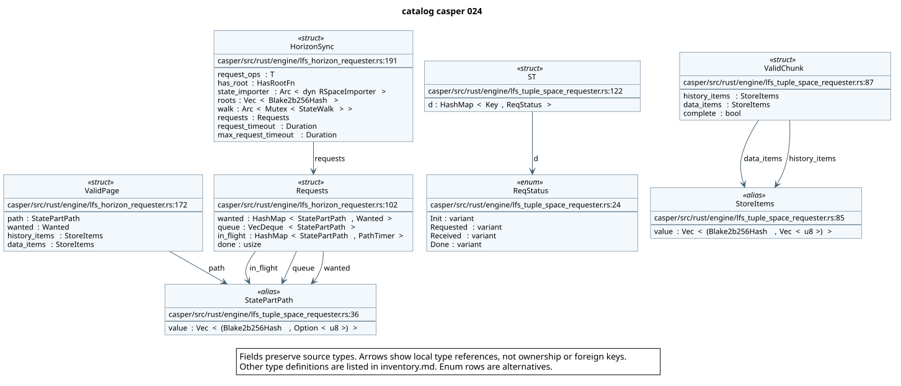

# catalog casper 024

[Inventory](inventory.md) | [PlantUML](catalog-casper-024.puml)

## Cross-Page References

- `HorizonSync: has_root -> HasRootFn [catalog-casper-023.svg]`
- `HorizonSync: roots -> Blake2b256Hash [catalog-rspacepp-002.svg]`
- `HorizonSync: walk -> StateWalk [catalog-rspacepp-018.svg]`
- `Requests: in_flight -> PathTimer [catalog-casper-023.svg]`
- `Requests: wanted -> Wanted [catalog-casper-023.svg]`
- `StatePartPath: value -> Blake2b256Hash [catalog-rspacepp-002.svg]`
- `StoreItems: value -> Blake2b256Hash [catalog-rspacepp-002.svg]`
- `ValidPage: wanted -> Wanted [catalog-casper-023.svg]`
