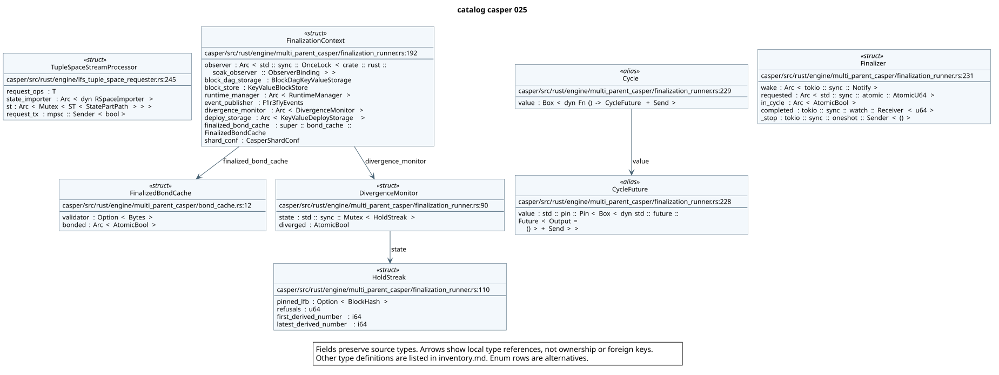

# catalog casper 025

[Inventory](inventory.md) | [PlantUML](catalog-casper-025.puml)

## Cross-Page References

- `FinalizationContext: block_dag_storage -> BlockDagKeyValueStorage [catalog-block-storage-001.svg]`
- `FinalizationContext: block_store -> KeyValueBlockStore [catalog-block-storage-008.svg]`
- `FinalizationContext: deploy_storage -> KeyValueDeployStorage [catalog-block-storage-008.svg]`
- `FinalizationContext: event_publisher -> F1r3flyEvents [catalog-shared-005.svg]`
- `FinalizationContext: observer -> ObserverBinding [catalog-casper-044.svg]`
- `FinalizationContext: runtime_manager -> RuntimeManager [catalog-casper-056.svg]`
- `FinalizationContext: shard_conf -> CasperShardConf [catalog-casper-020.svg]`
- `HoldStreak: pinned_lfb -> BlockHash [catalog-models-027.svg]`
- `TupleSpaceStreamProcessor: st -> ST [catalog-casper-024.svg]`
- `TupleSpaceStreamProcessor: st -> StatePartPath [catalog-casper-024.svg]`
