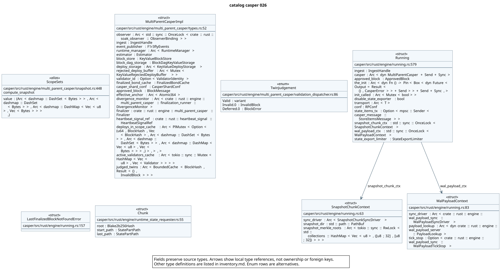

# catalog casper 026

[Inventory](inventory.md) | [PlantUML](catalog-casper-026.puml)

## Cross-Page References

- `Chunk: last_path -> StatePartPath [catalog-casper-024.svg]`
- `Chunk: root -> Blake2b256Hash [catalog-rspacepp-002.svg]`
- `Chunk: start_path -> StatePartPath [catalog-casper-024.svg]`
- `MultiParentCasperImpl: approved_block -> BlockMessage [catalog-models-031.svg]`
- `MultiParentCasperImpl: block_dag_storage -> BlockDagKeyValueStorage [catalog-block-storage-001.svg]`
- `MultiParentCasperImpl: block_store -> KeyValueBlockStore [catalog-block-storage-008.svg]`
- `MultiParentCasperImpl: casper_shard_conf -> CasperShardConf [catalog-casper-020.svg]`
- `MultiParentCasperImpl: deploy_storage -> KeyValueDeployStorage [catalog-block-storage-008.svg]`
- `MultiParentCasperImpl: deploys_in_scope_cache -> BlockHash [catalog-models-027.svg]`
- `MultiParentCasperImpl: divergence_monitor -> DivergenceMonitor [catalog-casper-025.svg]`
- `MultiParentCasperImpl: estimator -> Estimator [catalog-casper-031.svg]`
- `MultiParentCasperImpl: event_publisher -> F1r3flyEvents [catalog-shared-005.svg]`
- `MultiParentCasperImpl: finalized_bond_cache -> FinalizedBondCache [catalog-casper-025.svg]`
- `MultiParentCasperImpl: finalizer -> Finalizer [catalog-casper-025.svg]`
- `MultiParentCasperImpl: heartbeat_signal_ref -> HeartbeatSignalRef [catalog-casper-036.svg]`
- `MultiParentCasperImpl: ingest -> IngestHandle [catalog-casper-007.svg]`
- `MultiParentCasperImpl: judged_twins -> BlockHash [catalog-models-027.svg]`
- `MultiParentCasperImpl: judged_twins -> BoundedCache [catalog-casper-050.svg]`
- `MultiParentCasperImpl: judged_twins -> InvalidBlock [catalog-casper-006.svg]`
- `MultiParentCasperImpl: observer -> ObserverBinding [catalog-casper-044.svg]`
- `MultiParentCasperImpl: rejected_deploy_buffer -> KeyValueRejectedDeployBuffer [catalog-block-storage-008.svg]`
- `MultiParentCasperImpl: runtime_manager -> RuntimeManager [catalog-casper-056.svg]`
- `MultiParentCasperImpl: validator_id -> ValidatorIdentity [catalog-casper-058.svg]`
- `Running: approved_block -> ApprovedBlock [catalog-models-030.svg]`
- `Running: conf -> RPConf [catalog-comm-004.svg]`
- `Running: ingest -> IngestHandle [catalog-casper-007.svg]`
- `Running: state_export_limiter -> StateExportLimiter [catalog-casper-028.svg]`
- `Running: state_items_tx -> StoreItemsMessage [catalog-models-033.svg]`
- `Running: the_init -> CasperError [catalog-casper-030.svg]`
- `SnapshotChunkContext: sync_driver -> SnapshotChunkSyncDriver [catalog-casper-028.svg]`
- `TwinJudgement: Deferred.0 -> BlockError [catalog-casper-006.svg]`
- `TwinJudgement: Invalid.0 -> InvalidBlock [catalog-casper-006.svg]`
- `WalPayloadContext: sync_driver -> WalPayloadSyncDriver [catalog-casper-029.svg]`
- `WalPayloadContext: tick_stop -> WalPayloadTickStop [catalog-casper-030.svg]`
