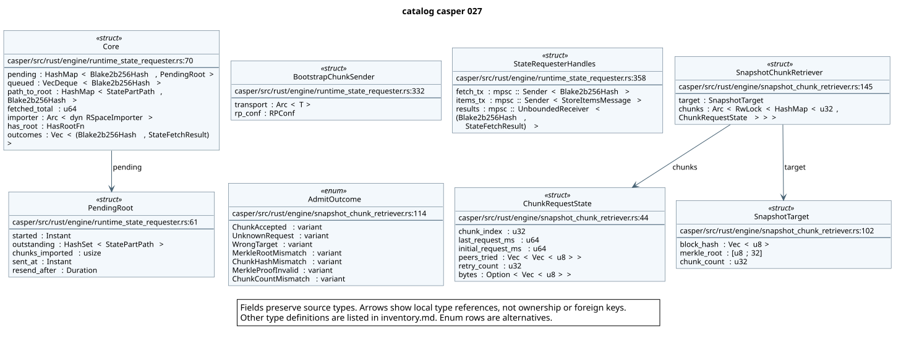

# catalog casper 027

[Inventory](inventory.md) | [PlantUML](catalog-casper-027.puml)

## Cross-Page References

- `BootstrapChunkSender: rp_conf -> RPConf [catalog-comm-004.svg]`
- `Core: has_root -> HasRootFn [catalog-casper-023.svg]`
- `Core: outcomes -> Blake2b256Hash [catalog-rspacepp-002.svg]`
- `Core: outcomes -> StateFetchResult [catalog-casper-012.svg]`
- `Core: path_to_root -> Blake2b256Hash [catalog-rspacepp-002.svg]`
- `Core: path_to_root -> StatePartPath [catalog-casper-024.svg]`
- `Core: pending -> Blake2b256Hash [catalog-rspacepp-002.svg]`
- `Core: queued -> Blake2b256Hash [catalog-rspacepp-002.svg]`
- `PendingRoot: outstanding -> StatePartPath [catalog-casper-024.svg]`
- `StateRequesterHandles: fetch_tx -> Blake2b256Hash [catalog-rspacepp-002.svg]`
- `StateRequesterHandles: items_tx -> StoreItemsMessage [catalog-models-033.svg]`
- `StateRequesterHandles: results -> Blake2b256Hash [catalog-rspacepp-002.svg]`
- `StateRequesterHandles: results -> StateFetchResult [catalog-casper-012.svg]`
