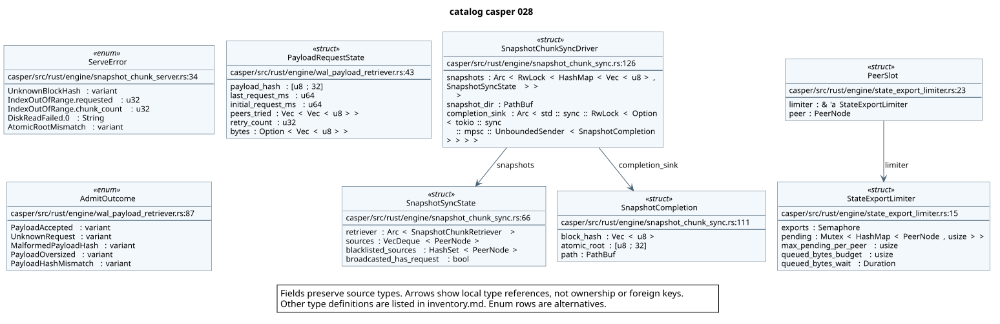

# catalog casper 028

[Inventory](inventory.md) | [PlantUML](catalog-casper-028.puml)

## Cardinality and Size

[Method, units, limits, and runtime evidence](sizing.md). These are declaration-level assessments, not measured live counts.

### ServeError

Cardinality: 0..n live values. Current count and owner-level limits are not derivable from this declaration.

Size: Compiler enum layout plus allocations of the active variant only. Do not sum alternative variants.

| Field or variant | Cardinality | Inline bytes or layout | Additional storage or wire encoding |
| --- | --- | --- | --- |
| `UnknownBlockHash` | 1 mutually exclusive alternative | No payload. Enum discriminant layout required | None for this unit variant |
| `IndexOutOfRange.requested` | 1 scalar when this variant is active | 4 B | None |
| `IndexOutOfRange.chunk_count` | 1 scalar when this variant is active | 4 B | None |
| `DiskReadFailed.0` | 0..n UTF-8 bytes when this variant is active | 24 B. String header on the generator target | capacity() bytes, excluding allocator overhead. UTF-8 byte length is not character count |
| `AtomicRootMismatch` | 1 mutually exclusive alternative | No payload. Enum discriminant layout required | None for this unit variant |

### SnapshotSyncState

Cardinality: 0..n live values. Current count and owner-level limits are not derivable from this declaration.

Size: Sum of field inline layouts plus compiler padding, then uniquely owned allocations. repr and custom implementations can change layout.

| Field or variant | Cardinality | Inline bytes or layout | Additional storage or wire encoding |
| --- | --- | --- | --- |
| `retriever` | 1 shared strong reference | Pointer or fat pointer, depending on target type | One shared allocation holds the target, counters and alignment. Count it once across all handles |
| `sources` | 0..n elements | Container implementation required | Element storage, owned allocations, spare capacity or per-node links. No type-level count cap |
| `blacklisted_sources` | 0..n distinct elements | Container and hasher implementation required | Element storage, owned allocations, spare capacity and index overhead. No type-level count cap |
| `broadcasted_has_request` | 1 scalar | 1 B | None |

### SnapshotCompletion

Cardinality: 0..n live values. Current count and owner-level limits are not derivable from this declaration.

Size: Sum of field inline layouts plus compiler padding, then uniquely owned allocations. repr and custom implementations can change layout.

| Field or variant | Cardinality | Inline bytes or layout | Additional storage or wire encoding |
| --- | --- | --- | --- |
| `block_hash` | 0..n elements | 24 B. Vec header on the generator target | capacity * I(element), plus live element-owned allocations. Zero-sized elements need no backing allocation. Element: None |
| `atomic_root` | 32 elements | 32 B. 32 * I(element), inline array | Sum of element-owned allocations. Element: None |
| `path` | 1 value | Compiler layout required | Follow the referenced declaration or external implementation. No allocation bound established. |

### SnapshotChunkSyncDriver

Cardinality: 0..n live values. Current count and owner-level limits are not derivable from this declaration.

Size: Sum of field inline layouts plus compiler padding, then uniquely owned allocations. repr and custom implementations can change layout.

| Field or variant | Cardinality | Inline bytes or layout | Additional storage or wire encoding |
| --- | --- | --- | --- |
| `snapshots` | 1 shared strong reference | Pointer or fat pointer, depending on target type | One shared allocation holds the target, counters and alignment. Count it once across all handles |
| `snapshot_dir` | 1 value | Compiler layout required | Follow the referenced declaration or external implementation. No allocation bound established. |
| `completion_sink` | 1 shared strong reference | Pointer or fat pointer, depending on target type | One shared allocation holds the target, counters and alignment. Count it once across all handles |

### StateExportLimiter

Cardinality: 0..n live values. Current count and owner-level limits are not derivable from this declaration.

Size: Sum of field inline layouts plus compiler padding, then uniquely owned allocations. repr and custom implementations can change layout.

| Field or variant | Cardinality | Inline bytes or layout | Additional storage or wire encoding |
| --- | --- | --- | --- |
| `exports` | 1 value | Compiler layout required | Follow the referenced declaration or external implementation. No allocation bound established. |
| `pending` | 1 wrapper slot | Wrapper implementation and payload layout required | Payload allocations and any lock/waiter allocations. Once and lazy payloads can be uninitialized |
| `max_pending_per_peer` | 1 scalar | 8 B | None |
| `queued_bytes_budget` | 1 scalar | 8 B | None |
| `queued_bytes_wait` | 1 value | Compiler layout required | Follow the referenced declaration or external implementation. No allocation bound established. |

### PeerSlot

Cardinality: 0..n live values. Current count and owner-level limits are not derivable from this declaration.

Size: Sum of field inline layouts plus compiler padding, then uniquely owned allocations. repr and custom implementations can change layout.

| Field or variant | Cardinality | Inline bytes or layout | Additional storage or wire encoding |
| --- | --- | --- | --- |
| `limiter` | 1 borrowed reference | Pointer or fat pointer. Referent layout required | No owned allocation. Referent: 1 value |
| `peer` | 1 value | Compiler layout required | Follow the referenced declaration or external implementation. No allocation bound established. |

### PayloadRequestState

Cardinality: 0..n live values. Current count and owner-level limits are not derivable from this declaration.

Size: Sum of field inline layouts plus compiler padding, then uniquely owned allocations. repr and custom implementations can change layout.

| Field or variant | Cardinality | Inline bytes or layout | Additional storage or wire encoding |
| --- | --- | --- | --- |
| `payload_hash` | 32 elements | 32 B. 32 * I(element), inline array | Sum of element-owned allocations. Element: None |
| `last_request_ms` | 1 scalar | 8 B | None |
| `initial_request_ms` | 1 scalar | 8 B | None |
| `peers_tried` | 0..n elements | 24 B. Vec header on the generator target | capacity * I(element), plus live element-owned allocations. Zero-sized elements need no backing allocation. Element: capacity * I(element), plus live element-owned allocations. Zero-sized elements need no backing allocation. Element: None |
| `retry_count` | 1 scalar | 4 B | None |
| `bytes` | 0..1 present payload | Option layout includes any tag or niche optimization. Do not assume I(T) + 1 | None when absent. Present payload: 0..n elements. capacity * I(element), plus live element-owned allocations. Zero-sized elements need no backing allocation. Element: None |

### AdmitOutcome

Cardinality: 0..n live values. Current count and owner-level limits are not derivable from this declaration.

Size: Compiler enum layout plus allocations of the active variant only. Do not sum alternative variants.

| Field or variant | Cardinality | Inline bytes or layout | Additional storage or wire encoding |
| --- | --- | --- | --- |
| `PayloadAccepted` | 1 mutually exclusive alternative | No payload. Enum discriminant layout required | None for this unit variant |
| `UnknownRequest` | 1 mutually exclusive alternative | No payload. Enum discriminant layout required | None for this unit variant |
| `MalformedPayloadHash` | 1 mutually exclusive alternative | No payload. Enum discriminant layout required | None for this unit variant |
| `PayloadOversized` | 1 mutually exclusive alternative | No payload. Enum discriminant layout required | None for this unit variant |
| `PayloadHashMismatch` | 1 mutually exclusive alternative | No payload. Enum discriminant layout required | None for this unit variant |

## Cross-Page References

- `PeerSlot: peer -> PeerNode [catalog-comm-003.svg]`
- `SnapshotSyncState: blacklisted_sources -> PeerNode [catalog-comm-003.svg]`
- `SnapshotSyncState: retriever -> SnapshotChunkRetriever [catalog-casper-027.svg]`
- `SnapshotSyncState: sources -> PeerNode [catalog-comm-003.svg]`
- `StateExportLimiter: pending -> PeerNode [catalog-comm-003.svg]`
