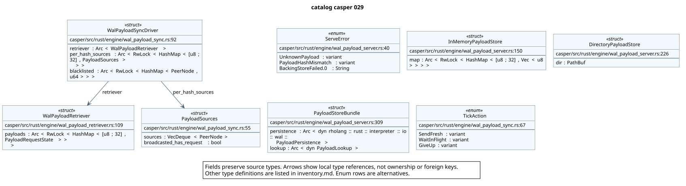

# catalog casper 029

[Inventory](inventory.md) | [PlantUML](catalog-casper-029.puml)

## Cardinality and Size

[Method, units, limits, and runtime evidence](sizing.md). These are declaration-level assessments, not measured live counts.

### WalPayloadRetriever

Cardinality: 0..n live values. Current count and owner-level limits are not derivable from this declaration.

Size: Sum of field inline layouts plus compiler padding, then uniquely owned allocations. repr and custom implementations can change layout.

| Field or variant | Cardinality | Inline bytes or layout | Additional storage or wire encoding |
| --- | --- | --- | --- |
| `payloads` | 1 shared strong reference | Pointer or fat pointer, depending on target type | One shared allocation holds the target, counters and alignment. Count it once across all handles |

### ServeError

Cardinality: 0..n live values. Current count and owner-level limits are not derivable from this declaration.

Size: Compiler enum layout plus allocations of the active variant only. Do not sum alternative variants.

| Field or variant | Cardinality | Inline bytes or layout | Additional storage or wire encoding |
| --- | --- | --- | --- |
| `UnknownPayload` | 1 mutually exclusive alternative | No payload. Enum discriminant layout required | None for this unit variant |
| `PayloadHashMismatch` | 1 mutually exclusive alternative | No payload. Enum discriminant layout required | None for this unit variant |
| `BackingStoreFailed.0` | 0..n UTF-8 bytes when this variant is active | 24 B. String header on the generator target | capacity() bytes, excluding allocator overhead. UTF-8 byte length is not character count |

### InMemoryPayloadStore

Cardinality: 0..n live values. Current count and owner-level limits are not derivable from this declaration.

Size: Sum of field inline layouts plus compiler padding, then uniquely owned allocations. repr and custom implementations can change layout.

| Field or variant | Cardinality | Inline bytes or layout | Additional storage or wire encoding |
| --- | --- | --- | --- |
| `map` | 1 shared strong reference | Pointer or fat pointer, depending on target type | One shared allocation holds the target, counters and alignment. Count it once across all handles |

### DirectoryPayloadStore

Cardinality: 0..n live values. Current count and owner-level limits are not derivable from this declaration.

Size: Sum of field inline layouts plus compiler padding, then uniquely owned allocations. repr and custom implementations can change layout.

| Field or variant | Cardinality | Inline bytes or layout | Additional storage or wire encoding |
| --- | --- | --- | --- |
| `dir` | 1 value | Compiler layout required | Follow the referenced declaration or external implementation. No allocation bound established. |

### PayloadStoreBundle

Cardinality: 0..n live values. Current count and owner-level limits are not derivable from this declaration.

Size: Sum of field inline layouts plus compiler padding, then uniquely owned allocations. repr and custom implementations can change layout.

| Field or variant | Cardinality | Inline bytes or layout | Additional storage or wire encoding |
| --- | --- | --- | --- |
| `persistence` | 1 shared strong reference | Pointer or fat pointer, depending on target type | One shared allocation holds the target, counters and alignment. Count it once across all handles |
| `lookup` | 1 shared strong reference | Pointer or fat pointer, depending on target type | One shared allocation holds the target, counters and alignment. Count it once across all handles |

### PayloadSources

Cardinality: 0..n live values. Current count and owner-level limits are not derivable from this declaration.

Size: Sum of field inline layouts plus compiler padding, then uniquely owned allocations. repr and custom implementations can change layout.

| Field or variant | Cardinality | Inline bytes or layout | Additional storage or wire encoding |
| --- | --- | --- | --- |
| `sources` | 0..n elements | Container implementation required | Element storage, owned allocations, spare capacity or per-node links. No type-level count cap |
| `broadcasted_has_request` | 1 scalar | 1 B | None |

### TickAction

Cardinality: 0..n live values. Current count and owner-level limits are not derivable from this declaration.

Size: Compiler enum layout plus allocations of the active variant only. Do not sum alternative variants.

| Field or variant | Cardinality | Inline bytes or layout | Additional storage or wire encoding |
| --- | --- | --- | --- |
| `SendFresh` | 1 mutually exclusive alternative | No payload. Enum discriminant layout required | None for this unit variant |
| `WaitInFlight` | 1 mutually exclusive alternative | No payload. Enum discriminant layout required | None for this unit variant |
| `GiveUp` | 1 mutually exclusive alternative | No payload. Enum discriminant layout required | None for this unit variant |

### WalPayloadSyncDriver

Cardinality: 0..n live values. Current count and owner-level limits are not derivable from this declaration.

Size: Sum of field inline layouts plus compiler padding, then uniquely owned allocations. repr and custom implementations can change layout.

| Field or variant | Cardinality | Inline bytes or layout | Additional storage or wire encoding |
| --- | --- | --- | --- |
| `retriever` | 1 shared strong reference | Pointer or fat pointer, depending on target type | One shared allocation holds the target, counters and alignment. Count it once across all handles |
| `per_hash_sources` | 1 shared strong reference | Pointer or fat pointer, depending on target type | One shared allocation holds the target, counters and alignment. Count it once across all handles |
| `blacklisted` | 1 shared strong reference | Pointer or fat pointer, depending on target type | One shared allocation holds the target, counters and alignment. Count it once across all handles |

## Cross-Page References

- `PayloadSources: sources -> PeerNode [catalog-comm-003.svg]`
- `WalPayloadRetriever: payloads -> PayloadRequestState [catalog-casper-028.svg]`
- `WalPayloadSyncDriver: blacklisted -> PeerNode [catalog-comm-003.svg]`
