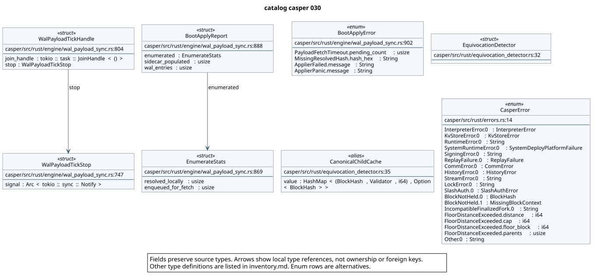

# catalog casper 030

[Inventory](inventory.md) | [PlantUML](catalog-casper-030.puml)

## Cross-Page References

- `CanonicalChildCache: value -> BlockHash [catalog-models-027.svg]`
- `CasperError: BlockNotHeld.0 -> BlockHash [catalog-models-027.svg]`
- `CasperError: BlockNotHeld.1 -> MissingBlockContext [catalog-shared-007.svg]`
- `CasperError: CommError.0 -> CommError [catalog-comm-003.svg]`
- `CasperError: HistoryError.0 -> HistoryError [catalog-rspacepp-001.svg]`
- `CasperError: InterpreterError.0 -> InterpreterError [catalog-rholang-006.svg]`
- `CasperError: KvStoreError.0 -> KvStoreError [catalog-shared-007.svg]`
- `CasperError: ReplayFailure.0 -> ReplayFailure [catalog-casper-055.svg]`
- `CasperError: SlashAuth.0 -> SlashAuthError [catalog-casper-043.svg]`
- `CasperError: SystemRuntimeError.0 -> SystemDeployPlatformFailure [catalog-casper-057.svg]`
