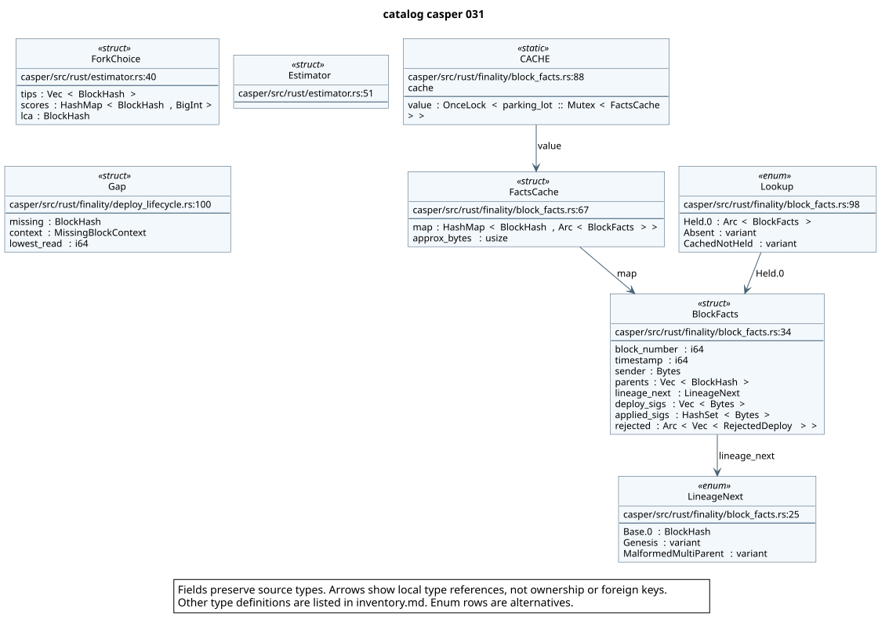

# catalog casper 031

[Inventory](inventory.md) | [PlantUML](catalog-casper-031.puml)

## Cardinality and Size

[Method, units, limits, and runtime evidence](sizing.md). These are declaration-level assessments, not measured live counts.

### ForkChoice

Cardinality: 0..n live values. Current count and owner-level limits are not derivable from this declaration.

Size: Sum of field inline layouts plus compiler padding, then uniquely owned allocations. repr and custom implementations can change layout.

| Field or variant | Cardinality | Inline bytes or layout | Additional storage or wire encoding |
| --- | --- | --- | --- |
| `tips` | 0..n elements | 24 B. Vec header on the generator target | capacity * I(element), plus live element-owned allocations. Zero-sized elements need no backing allocation. Element: Follow the referenced declaration or external implementation. No allocation bound established. |
| `scores` | 0..n key/value pairs | Container and hasher implementation required | n keys and n values, their owned allocations, spare capacity, buckets or tree nodes, and control bytes. No type-level count cap |
| `lca` | 1 value | Compiler layout required | Follow the referenced declaration or external implementation. No allocation bound established. |

### Estimator

Cardinality: 0..n live values. Current count and owner-level limits are not derivable from this declaration.

Size: Sum of field inline layouts plus compiler padding, then uniquely owned allocations. repr and custom implementations can change layout.

| Field or variant | Cardinality | Inline bytes or layout | Additional storage or wire encoding |
| --- | --- | --- | --- |
| No declared fields | 0 field payloads | Compiler layout required | No field-owned allocations |

### LineageNext

Cardinality: 0..n live values. Current count and owner-level limits are not derivable from this declaration.

Size: Compiler enum layout plus allocations of the active variant only. Do not sum alternative variants.

| Field or variant | Cardinality | Inline bytes or layout | Additional storage or wire encoding |
| --- | --- | --- | --- |
| `Base.0` | 1 value when this variant is active | Compiler layout required | Follow the referenced declaration or external implementation. No allocation bound established. |
| `Genesis` | 1 mutually exclusive alternative | No payload. Enum discriminant layout required | None for this unit variant |
| `MalformedMultiParent` | 1 mutually exclusive alternative | No payload. Enum discriminant layout required | None for this unit variant |

### BlockFacts

Cardinality: 0..n live values. Current count and owner-level limits are not derivable from this declaration.

Size: Sum of field inline layouts plus compiler padding, then uniquely owned allocations. repr and custom implementations can change layout.

| Field or variant | Cardinality | Inline bytes or layout | Additional storage or wire encoding |
| --- | --- | --- | --- |
| `block_number` | 1 scalar | 8 B | None |
| `timestamp` | 1 scalar | 8 B | None |
| `sender` | 1 value | Compiler layout required | Follow the referenced declaration or external implementation. No allocation bound established. |
| `parents` | 0..n elements | 24 B. Vec header on the generator target | capacity * I(element), plus live element-owned allocations. Zero-sized elements need no backing allocation. Element: Follow the referenced declaration or external implementation. No allocation bound established. |
| `lineage_next` | 1 value | Compiler layout required | Follow the referenced declaration or external implementation. No allocation bound established. |
| `deploy_sigs` | 0..n elements | 24 B. Vec header on the generator target | capacity * I(element), plus live element-owned allocations. Zero-sized elements need no backing allocation. Element: Follow the referenced declaration or external implementation. No allocation bound established. |
| `applied_sigs` | 0..n distinct elements | Container and hasher implementation required | Element storage, owned allocations, spare capacity and index overhead. No type-level count cap |
| `rejected` | 1 shared strong reference | Pointer or fat pointer, depending on target type | One shared allocation holds the target, counters and alignment. Count it once across all handles |

### FactsCache

Cardinality: 0..n live values. Current count and owner-level limits are not derivable from this declaration.

Size: Sum of field inline layouts plus compiler padding, then uniquely owned allocations. repr and custom implementations can change layout.

| Field or variant | Cardinality | Inline bytes or layout | Additional storage or wire encoding |
| --- | --- | --- | --- |
| `map` | 0..n key/value pairs | Container and hasher implementation required | n keys and n values, their owned allocations, spare capacity, buckets or tree nodes, and control bytes. No type-level count cap |
| `approx_bytes` | 1 scalar | 8 B | None |

### CACHE

Cardinality: One slot per linked process instance. Lazy payload can be uninitialized.

Size: Declared slot or lazy wrapper layout plus initialized owned allocations.

| Field or variant | Cardinality | Inline bytes or layout | Additional storage or wire encoding |
| --- | --- | --- | --- |
| `value` | 1 wrapper slot | Wrapper implementation and payload layout required | Payload allocations and any lock/waiter allocations. Once and lazy payloads can be uninitialized |

### Lookup

Cardinality: 0..n live values. Current count and owner-level limits are not derivable from this declaration.

Size: Compiler enum layout plus allocations of the active variant only. Do not sum alternative variants.

| Field or variant | Cardinality | Inline bytes or layout | Additional storage or wire encoding |
| --- | --- | --- | --- |
| `Held.0` | 1 shared strong reference when this variant is active | Pointer or fat pointer, depending on target type | One shared allocation holds the target, counters and alignment. Count it once across all handles |
| `Absent` | 1 mutually exclusive alternative | No payload. Enum discriminant layout required | None for this unit variant |
| `CachedNotHeld` | 1 mutually exclusive alternative | No payload. Enum discriminant layout required | None for this unit variant |

### Gap

Cardinality: 0..n live values. Current count and owner-level limits are not derivable from this declaration.

Size: Sum of field inline layouts plus compiler padding, then uniquely owned allocations. repr and custom implementations can change layout.

| Field or variant | Cardinality | Inline bytes or layout | Additional storage or wire encoding |
| --- | --- | --- | --- |
| `missing` | 1 value | Compiler layout required | Follow the referenced declaration or external implementation. No allocation bound established. |
| `context` | 1 value | Compiler layout required | Follow the referenced declaration or external implementation. No allocation bound established. |
| `lowest_read` | 1 scalar | 8 B | None |

## Cross-Page References

- `BlockFacts: parents -> BlockHash [catalog-models-027.svg]`
- `BlockFacts: rejected -> RejectedDeploy [catalog-models-031.svg]`
- `FactsCache: map -> BlockHash [catalog-models-027.svg]`
- `ForkChoice: lca -> BlockHash [catalog-models-027.svg]`
- `ForkChoice: scores -> BlockHash [catalog-models-027.svg]`
- `ForkChoice: tips -> BlockHash [catalog-models-027.svg]`
- `Gap: context -> MissingBlockContext [catalog-shared-007.svg]`
- `Gap: missing -> BlockHash [catalog-models-027.svg]`
- `LineageNext: Base.0 -> BlockHash [catalog-models-027.svg]`
