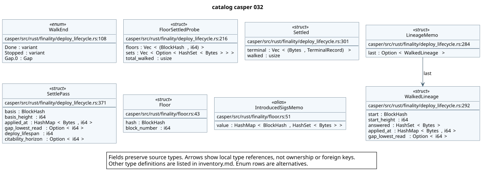

# catalog casper 032

[Inventory](inventory.md) | [PlantUML](catalog-casper-032.puml)

## Cross-Page References

- `Floor: hash -> BlockHash [catalog-models-027.svg]`
- `FloorSettledProbe: floors -> BlockHash [catalog-models-027.svg]`
- `IntroducedSigsMemo: value -> BlockHash [catalog-models-027.svg]`
- `SettlePass: basis -> BlockHash [catalog-models-027.svg]`
- `Settled: terminal -> TerminalRecord [catalog-block-storage-004.svg]`
- `WalkEnd: Gap.0 -> Gap [catalog-casper-031.svg]`
- `WalkedLineage: start -> BlockHash [catalog-models-027.svg]`
