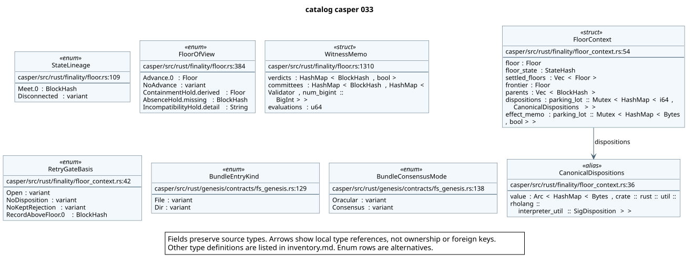

# catalog casper 033

[Inventory](inventory.md) | [PlantUML](catalog-casper-033.puml)

## Cross-Page References

- `CanonicalDispositions: value -> SigDisposition [catalog-casper-053.svg]`
- `FloorContext: floor -> Floor [catalog-casper-032.svg]`
- `FloorContext: floor_state -> StateHash [catalog-models-027.svg]`
- `FloorContext: frontier -> Floor [catalog-casper-032.svg]`
- `FloorContext: parents -> BlockHash [catalog-models-027.svg]`
- `FloorContext: settled_floors -> Floor [catalog-casper-032.svg]`
- `FloorOfView: AbsenceHold.missing -> BlockHash [catalog-models-027.svg]`
- `FloorOfView: Advance.0 -> Floor [catalog-casper-032.svg]`
- `FloorOfView: ContainmentHold.derived -> Floor [catalog-casper-032.svg]`
- `RetryGateBasis: RecordAboveFloor.0 -> BlockHash [catalog-models-027.svg]`
- `StateLineage: Meet.0 -> BlockHash [catalog-models-027.svg]`
- `WitnessMemo: committees -> BlockHash [catalog-models-027.svg]`
- `WitnessMemo: verdicts -> BlockHash [catalog-models-027.svg]`
