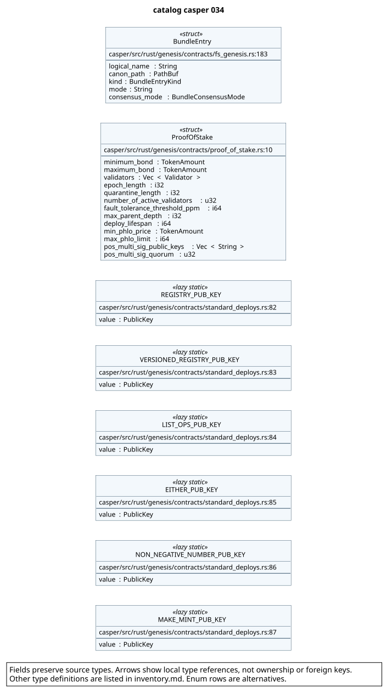

# catalog casper 034

[Inventory](inventory.md) | [PlantUML](catalog-casper-034.puml)

## Cross-Page References

- `BundleEntry: consensus_mode -> BundleConsensusMode [catalog-casper-033.svg]`
- `BundleEntry: kind -> BundleEntryKind [catalog-casper-033.svg]`
- `ProofOfStake: maximum_bond -> TokenAmount [catalog-shared-009.svg]`
- `ProofOfStake: min_phlo_price -> TokenAmount [catalog-shared-009.svg]`
- `ProofOfStake: minimum_bond -> TokenAmount [catalog-shared-009.svg]`
