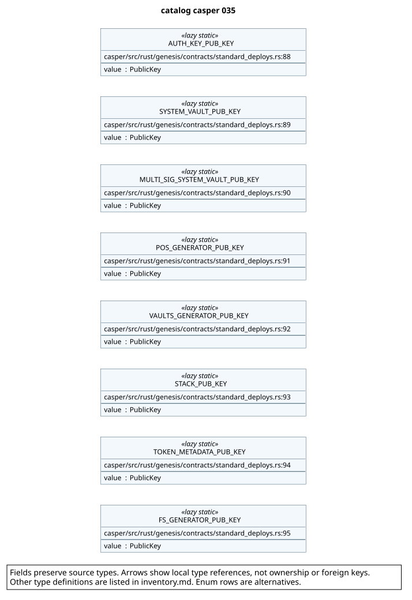

# catalog casper 035

[Inventory](inventory.md) | [PlantUML](catalog-casper-035.puml)

## Cardinality and Size

[Method, units, limits, and runtime evidence](sizing.md). These are declaration-level assessments, not measured live counts.

### AUTH_KEY_PUB_KEY

Cardinality: One slot per linked process instance. Lazy payload can be uninitialized.

Size: Declared slot or lazy wrapper layout plus initialized owned allocations.

| Field or variant | Cardinality | Inline bytes or layout | Additional storage or wire encoding |
| --- | --- | --- | --- |
| `value` | 1 value | Compiler layout required | Follow the referenced declaration or external implementation. No allocation bound established. |

### SYSTEM_VAULT_PUB_KEY

Cardinality: One slot per linked process instance. Lazy payload can be uninitialized.

Size: Declared slot or lazy wrapper layout plus initialized owned allocations.

| Field or variant | Cardinality | Inline bytes or layout | Additional storage or wire encoding |
| --- | --- | --- | --- |
| `value` | 1 value | Compiler layout required | Follow the referenced declaration or external implementation. No allocation bound established. |

### MULTI_SIG_SYSTEM_VAULT_PUB_KEY

Cardinality: One slot per linked process instance. Lazy payload can be uninitialized.

Size: Declared slot or lazy wrapper layout plus initialized owned allocations.

| Field or variant | Cardinality | Inline bytes or layout | Additional storage or wire encoding |
| --- | --- | --- | --- |
| `value` | 1 value | Compiler layout required | Follow the referenced declaration or external implementation. No allocation bound established. |

### POS_GENERATOR_PUB_KEY

Cardinality: One slot per linked process instance. Lazy payload can be uninitialized.

Size: Declared slot or lazy wrapper layout plus initialized owned allocations.

| Field or variant | Cardinality | Inline bytes or layout | Additional storage or wire encoding |
| --- | --- | --- | --- |
| `value` | 1 value | Compiler layout required | Follow the referenced declaration or external implementation. No allocation bound established. |

### VAULTS_GENERATOR_PUB_KEY

Cardinality: One slot per linked process instance. Lazy payload can be uninitialized.

Size: Declared slot or lazy wrapper layout plus initialized owned allocations.

| Field or variant | Cardinality | Inline bytes or layout | Additional storage or wire encoding |
| --- | --- | --- | --- |
| `value` | 1 value | Compiler layout required | Follow the referenced declaration or external implementation. No allocation bound established. |

### STACK_PUB_KEY

Cardinality: One slot per linked process instance. Lazy payload can be uninitialized.

Size: Declared slot or lazy wrapper layout plus initialized owned allocations.

| Field or variant | Cardinality | Inline bytes or layout | Additional storage or wire encoding |
| --- | --- | --- | --- |
| `value` | 1 value | Compiler layout required | Follow the referenced declaration or external implementation. No allocation bound established. |

### TOKEN_METADATA_PUB_KEY

Cardinality: One slot per linked process instance. Lazy payload can be uninitialized.

Size: Declared slot or lazy wrapper layout plus initialized owned allocations.

| Field or variant | Cardinality | Inline bytes or layout | Additional storage or wire encoding |
| --- | --- | --- | --- |
| `value` | 1 value | Compiler layout required | Follow the referenced declaration or external implementation. No allocation bound established. |

### FS_GENERATOR_PUB_KEY

Cardinality: One slot per linked process instance. Lazy payload can be uninitialized.

Size: Declared slot or lazy wrapper layout plus initialized owned allocations.

| Field or variant | Cardinality | Inline bytes or layout | Additional storage or wire encoding |
| --- | --- | --- | --- |
| `value` | 1 value | Compiler layout required | Follow the referenced declaration or external implementation. No allocation bound established. |

## Cross-Page References

No resolved cross-page references.
