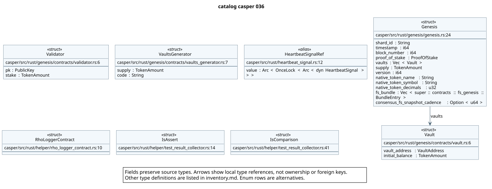

# catalog casper 036

[Inventory](inventory.md) | [PlantUML](catalog-casper-036.puml)

## Cardinality and Size

[Method, units, limits, and runtime evidence](sizing.md). These are declaration-level assessments, not measured live counts.

### Validator

Cardinality: 0..n live values. Current count and owner-level limits are not derivable from this declaration.

Size: Sum of field inline layouts plus compiler padding, then uniquely owned allocations. repr and custom implementations can change layout.

| Field or variant | Cardinality | Inline bytes or layout | Additional storage or wire encoding |
| --- | --- | --- | --- |
| `pk` | 1 value | Compiler layout required | Follow the referenced declaration or external implementation. No allocation bound established. |
| `stake` | 1 value | Compiler layout required | Follow the referenced declaration or external implementation. No allocation bound established. |

### Vault

Cardinality: 0..n live values. Current count and owner-level limits are not derivable from this declaration.

Size: Sum of field inline layouts plus compiler padding, then uniquely owned allocations. repr and custom implementations can change layout.

| Field or variant | Cardinality | Inline bytes or layout | Additional storage or wire encoding |
| --- | --- | --- | --- |
| `vault_address` | 1 value | Compiler layout required | Follow the referenced declaration or external implementation. No allocation bound established. |
| `initial_balance` | 1 value | Compiler layout required | Follow the referenced declaration or external implementation. No allocation bound established. |

### VaultsGenerator

Cardinality: 0..n live values. Current count and owner-level limits are not derivable from this declaration.

Size: Sum of field inline layouts plus compiler padding, then uniquely owned allocations. repr and custom implementations can change layout.

| Field or variant | Cardinality | Inline bytes or layout | Additional storage or wire encoding |
| --- | --- | --- | --- |
| `supply` | 1 value | Compiler layout required | Follow the referenced declaration or external implementation. No allocation bound established. |
| `code` | 0..n UTF-8 bytes | 24 B. String header on the generator target | capacity() bytes, excluding allocator overhead. UTF-8 byte length is not character count |

### Genesis

Cardinality: 0..n live values. Current count and owner-level limits are not derivable from this declaration.

Size: Sum of field inline layouts plus compiler padding, then uniquely owned allocations. repr and custom implementations can change layout.

| Field or variant | Cardinality | Inline bytes or layout | Additional storage or wire encoding |
| --- | --- | --- | --- |
| `shard_id` | 0..n UTF-8 bytes | 24 B. String header on the generator target | capacity() bytes, excluding allocator overhead. UTF-8 byte length is not character count |
| `timestamp` | 1 scalar | 8 B | None |
| `block_number` | 1 scalar | 8 B | None |
| `proof_of_stake` | 1 value | Compiler layout required | Follow the referenced declaration or external implementation. No allocation bound established. |
| `vaults` | 0..n elements | 24 B. Vec header on the generator target | capacity * I(element), plus live element-owned allocations. Zero-sized elements need no backing allocation. Element: Follow the referenced declaration or external implementation. No allocation bound established. |
| `supply` | 1 value | Compiler layout required | Follow the referenced declaration or external implementation. No allocation bound established. |
| `version` | 1 scalar | 8 B | None |
| `native_token_name` | 0..n UTF-8 bytes | 24 B. String header on the generator target | capacity() bytes, excluding allocator overhead. UTF-8 byte length is not character count |
| `native_token_symbol` | 0..n UTF-8 bytes | 24 B. String header on the generator target | capacity() bytes, excluding allocator overhead. UTF-8 byte length is not character count |
| `native_token_decimals` | 1 scalar | 4 B | None |
| `fs_bundle` | 0..n elements | 24 B. Vec header on the generator target | capacity * I(element), plus live element-owned allocations. Zero-sized elements need no backing allocation. Element: Follow the referenced declaration or external implementation. No allocation bound established. |
| `consensus_fs_snapshot_cadence` | 0..1 present payload | Option layout includes any tag or niche optimization. Do not assume I(T) + 1 | None when absent. Present payload: 1 scalar. None |

### HeartbeatSignalRef

Cardinality: Alias, not a separate allocation. Count values of the target type.

Size: Same layout and allocations as target. Do not add alias bytes again.

| Field or variant | Cardinality | Inline bytes or layout | Additional storage or wire encoding |
| --- | --- | --- | --- |
| `value` | 1 shared strong reference | Pointer or fat pointer, depending on target type | One shared allocation holds the target, counters and alignment. Count it once across all handles |

### RhoLoggerContract

Cardinality: 0..n live values. Current count and owner-level limits are not derivable from this declaration.

Size: Sum of field inline layouts plus compiler padding, then uniquely owned allocations. repr and custom implementations can change layout.

| Field or variant | Cardinality | Inline bytes or layout | Additional storage or wire encoding |
| --- | --- | --- | --- |
| No declared fields | 0 field payloads | Compiler layout required | No field-owned allocations |

### IsAssert

Cardinality: 0..n live values. Current count and owner-level limits are not derivable from this declaration.

Size: Sum of field inline layouts plus compiler padding, then uniquely owned allocations. repr and custom implementations can change layout.

| Field or variant | Cardinality | Inline bytes or layout | Additional storage or wire encoding |
| --- | --- | --- | --- |
| No declared fields | 0 field payloads | Compiler layout required | No field-owned allocations |

### IsComparison

Cardinality: 0..n live values. Current count and owner-level limits are not derivable from this declaration.

Size: Sum of field inline layouts plus compiler padding, then uniquely owned allocations. repr and custom implementations can change layout.

| Field or variant | Cardinality | Inline bytes or layout | Additional storage or wire encoding |
| --- | --- | --- | --- |
| No declared fields | 0 field payloads | Compiler layout required | No field-owned allocations |

## Cross-Page References

- `Genesis: fs_bundle -> BundleEntry [catalog-casper-034.svg]`
- `Genesis: proof_of_stake -> ProofOfStake [catalog-casper-034.svg]`
- `Genesis: supply -> TokenAmount [catalog-shared-009.svg]`
- `Validator: stake -> TokenAmount [catalog-shared-009.svg]`
- `Vault: initial_balance -> TokenAmount [catalog-shared-009.svg]`
- `Vault: vault_address -> VaultAddress [catalog-rholang-046.svg]`
- `VaultsGenerator: supply -> TokenAmount [catalog-shared-009.svg]`
