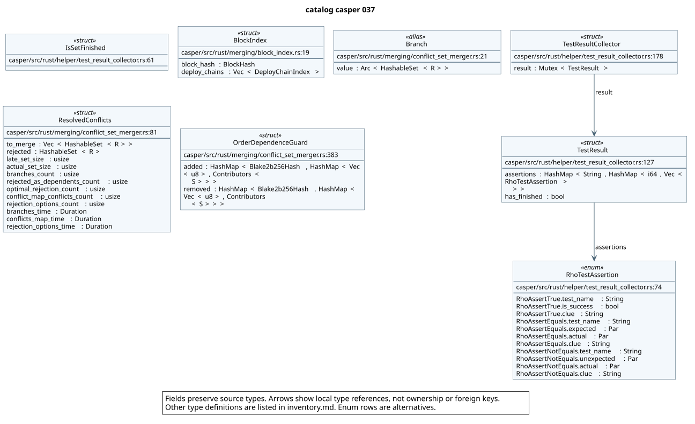

# catalog casper 037

[Inventory](inventory.md) | [PlantUML](catalog-casper-037.puml)

## Cardinality and Size

[Method, units, limits, and runtime evidence](sizing.md). These are declaration-level assessments, not measured live counts.

### IsSetFinished

Cardinality: 0..n live values. Current count and owner-level limits are not derivable from this declaration.

Size: Sum of field inline layouts plus compiler padding, then uniquely owned allocations. repr and custom implementations can change layout.

| Field or variant | Cardinality | Inline bytes or layout | Additional storage or wire encoding |
| --- | --- | --- | --- |
| No declared fields | 0 field payloads | Compiler layout required | No field-owned allocations |

### RhoTestAssertion

Cardinality: 0..n live values. Current count and owner-level limits are not derivable from this declaration.

Size: Compiler enum layout plus allocations of the active variant only. Do not sum alternative variants.

| Field or variant | Cardinality | Inline bytes or layout | Additional storage or wire encoding |
| --- | --- | --- | --- |
| `RhoAssertTrue.test_name` | 0..n UTF-8 bytes when this variant is active | 24 B. String header on the generator target | capacity() bytes, excluding allocator overhead. UTF-8 byte length is not character count |
| `RhoAssertTrue.is_success` | 1 scalar when this variant is active | 1 B | None |
| `RhoAssertTrue.clue` | 0..n UTF-8 bytes when this variant is active | 24 B. String header on the generator target | capacity() bytes, excluding allocator overhead. UTF-8 byte length is not character count |
| `RhoAssertEquals.test_name` | 0..n UTF-8 bytes when this variant is active | 24 B. String header on the generator target | capacity() bytes, excluding allocator overhead. UTF-8 byte length is not character count |
| `RhoAssertEquals.expected` | 1 value when this variant is active | Compiler layout required | Follow the referenced declaration or external implementation. No allocation bound established. |
| `RhoAssertEquals.actual` | 1 value when this variant is active | Compiler layout required | Follow the referenced declaration or external implementation. No allocation bound established. |
| `RhoAssertEquals.clue` | 0..n UTF-8 bytes when this variant is active | 24 B. String header on the generator target | capacity() bytes, excluding allocator overhead. UTF-8 byte length is not character count |
| `RhoAssertNotEquals.test_name` | 0..n UTF-8 bytes when this variant is active | 24 B. String header on the generator target | capacity() bytes, excluding allocator overhead. UTF-8 byte length is not character count |
| `RhoAssertNotEquals.unexpected` | 1 value when this variant is active | Compiler layout required | Follow the referenced declaration or external implementation. No allocation bound established. |
| `RhoAssertNotEquals.actual` | 1 value when this variant is active | Compiler layout required | Follow the referenced declaration or external implementation. No allocation bound established. |
| `RhoAssertNotEquals.clue` | 0..n UTF-8 bytes when this variant is active | 24 B. String header on the generator target | capacity() bytes, excluding allocator overhead. UTF-8 byte length is not character count |

### TestResult

Cardinality: 0..n live values. Current count and owner-level limits are not derivable from this declaration.

Size: Sum of field inline layouts plus compiler padding, then uniquely owned allocations. repr and custom implementations can change layout.

| Field or variant | Cardinality | Inline bytes or layout | Additional storage or wire encoding |
| --- | --- | --- | --- |
| `assertions` | 0..n key/value pairs | Container and hasher implementation required | n keys and n values, their owned allocations, spare capacity, buckets or tree nodes, and control bytes. No type-level count cap |
| `has_finished` | 1 scalar | 1 B | None |

### TestResultCollector

Cardinality: 0..n live values. Current count and owner-level limits are not derivable from this declaration.

Size: Sum of field inline layouts plus compiler padding, then uniquely owned allocations. repr and custom implementations can change layout.

| Field or variant | Cardinality | Inline bytes or layout | Additional storage or wire encoding |
| --- | --- | --- | --- |
| `result` | 1 wrapper slot | Wrapper implementation and payload layout required | Payload allocations and any lock/waiter allocations. Once and lazy payloads can be uninitialized |

### BlockIndex

Cardinality: 0..n live values. Current count and owner-level limits are not derivable from this declaration.

Size: Sum of field inline layouts plus compiler padding, then uniquely owned allocations. repr and custom implementations can change layout.

| Field or variant | Cardinality | Inline bytes or layout | Additional storage or wire encoding |
| --- | --- | --- | --- |
| `block_hash` | 1 value | Compiler layout required | Follow the referenced declaration or external implementation. No allocation bound established. |
| `deploy_chains` | 0..n elements | 24 B. Vec header on the generator target | capacity * I(element), plus live element-owned allocations. Zero-sized elements need no backing allocation. Element: Follow the referenced declaration or external implementation. No allocation bound established. |

### Branch

Cardinality: Alias, not a separate allocation. Count values of the target type.

Size: Same layout and allocations as target. Do not add alias bytes again.

| Field or variant | Cardinality | Inline bytes or layout | Additional storage or wire encoding |
| --- | --- | --- | --- |
| `value` | 1 shared strong reference | Pointer or fat pointer, depending on target type | One shared allocation holds the target, counters and alignment. Count it once across all handles |

### ResolvedConflicts

Cardinality: 0..n live values. Current count and owner-level limits are not derivable from this declaration.

Size: Sum of field inline layouts plus compiler padding, then uniquely owned allocations. repr and custom implementations can change layout.

| Field or variant | Cardinality | Inline bytes or layout | Additional storage or wire encoding |
| --- | --- | --- | --- |
| `to_merge` | 0..n elements | 24 B. Vec header on the generator target | capacity * I(element), plus live element-owned allocations. Zero-sized elements need no backing allocation. Element: Follow the referenced declaration or external implementation. No allocation bound established. |
| `rejected` | 1 value | Compiler layout required | Follow the referenced declaration or external implementation. No allocation bound established. |
| `late_set_size` | 1 scalar | 8 B | None |
| `actual_set_size` | 1 scalar | 8 B | None |
| `branches_count` | 1 scalar | 8 B | None |
| `rejected_as_dependents_count` | 1 scalar | 8 B | None |
| `optimal_rejection_count` | 1 scalar | 8 B | None |
| `conflict_map_conflicts_count` | 1 scalar | 8 B | None |
| `rejection_options_count` | 1 scalar | 8 B | None |
| `branches_time` | 1 value | Compiler layout required | Follow the referenced declaration or external implementation. No allocation bound established. |
| `conflicts_map_time` | 1 value | Compiler layout required | Follow the referenced declaration or external implementation. No allocation bound established. |
| `rejection_options_time` | 1 value | Compiler layout required | Follow the referenced declaration or external implementation. No allocation bound established. |

### OrderDependenceGuard

Cardinality: 0..n live values. Current count and owner-level limits are not derivable from this declaration.

Size: Sum of field inline layouts plus compiler padding, then uniquely owned allocations. repr and custom implementations can change layout.

| Field or variant | Cardinality | Inline bytes or layout | Additional storage or wire encoding |
| --- | --- | --- | --- |
| `added` | 0..n key/value pairs | Container and hasher implementation required | n keys and n values, their owned allocations, spare capacity, buckets or tree nodes, and control bytes. No type-level count cap |
| `removed` | 0..n key/value pairs | Container and hasher implementation required | n keys and n values, their owned allocations, spare capacity, buckets or tree nodes, and control bytes. No type-level count cap |

## Cross-Page References

- `BlockIndex: block_hash -> BlockHash [catalog-models-027.svg]`
- `BlockIndex: deploy_chains -> DeployChainIndex [catalog-casper-038.svg]`
- `Branch: value -> HashableSet [catalog-shared-002.svg]`
- `OrderDependenceGuard: added -> Blake2b256Hash [catalog-rspacepp-002.svg]`
- `OrderDependenceGuard: added -> Contributors [catalog-casper-038.svg]`
- `OrderDependenceGuard: removed -> Blake2b256Hash [catalog-rspacepp-002.svg]`
- `OrderDependenceGuard: removed -> Contributors [catalog-casper-038.svg]`
- `ResolvedConflicts: rejected -> HashableSet [catalog-shared-002.svg]`
- `ResolvedConflicts: to_merge -> HashableSet [catalog-shared-002.svg]`
