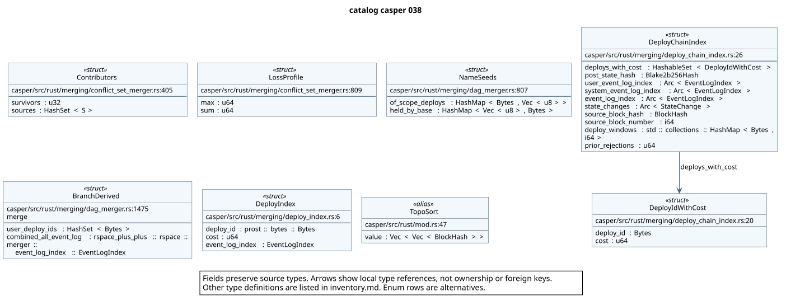

# catalog casper 038

[Inventory](inventory.md) | [PlantUML](catalog-casper-038.puml)

## Cardinality and Size

[Method, units, limits, and runtime evidence](sizing.md). These are declaration-level assessments, not measured live counts.

### Contributors

Cardinality: 0..n live values. Current count and owner-level limits are not derivable from this declaration.

Size: Sum of field inline layouts plus compiler padding, then uniquely owned allocations. repr and custom implementations can change layout.

| Field or variant | Cardinality | Inline bytes or layout | Additional storage or wire encoding |
| --- | --- | --- | --- |
| `survivors` | 1 scalar | 4 B | None |
| `sources` | 0..n distinct elements | Container and hasher implementation required | Element storage, owned allocations, spare capacity and index overhead. No type-level count cap |

### LossProfile

Cardinality: 0..n live values. Current count and owner-level limits are not derivable from this declaration.

Size: Sum of field inline layouts plus compiler padding, then uniquely owned allocations. repr and custom implementations can change layout.

| Field or variant | Cardinality | Inline bytes or layout | Additional storage or wire encoding |
| --- | --- | --- | --- |
| `max` | 1 scalar | 8 B | None |
| `sum` | 1 scalar | 8 B | None |

### NameSeeds

Cardinality: 0..n live values. Current count and owner-level limits are not derivable from this declaration.

Size: Sum of field inline layouts plus compiler padding, then uniquely owned allocations. repr and custom implementations can change layout.

| Field or variant | Cardinality | Inline bytes or layout | Additional storage or wire encoding |
| --- | --- | --- | --- |
| `of_scope_deploys` | 0..n key/value pairs | Container and hasher implementation required | n keys and n values, their owned allocations, spare capacity, buckets or tree nodes, and control bytes. No type-level count cap |
| `held_by_base` | 0..n key/value pairs | Container and hasher implementation required | n keys and n values, their owned allocations, spare capacity, buckets or tree nodes, and control bytes. No type-level count cap |

### BranchDerived

Cardinality: 0..n live values. Current count and owner-level limits are not derivable from this declaration.

Size: Sum of field inline layouts plus compiler padding, then uniquely owned allocations. repr and custom implementations can change layout.

| Field or variant | Cardinality | Inline bytes or layout | Additional storage or wire encoding |
| --- | --- | --- | --- |
| `user_deploy_ids` | 0..n distinct elements | Container and hasher implementation required | Element storage, owned allocations, spare capacity and index overhead. No type-level count cap |
| `combined_all_event_log` | 1 value | Compiler layout required | Follow the referenced declaration or external implementation. No allocation bound established. |

### DeployIdWithCost

Cardinality: 0..n live values. Current count and owner-level limits are not derivable from this declaration.

Size: Sum of field inline layouts plus compiler padding, then uniquely owned allocations. repr and custom implementations can change layout.

| Field or variant | Cardinality | Inline bytes or layout | Additional storage or wire encoding |
| --- | --- | --- | --- |
| `deploy_id` | 1 value | Compiler layout required | Follow the referenced declaration or external implementation. No allocation bound established. |
| `cost` | 1 scalar | 8 B | None |

### DeployChainIndex

Cardinality: 0..n live values. Current count and owner-level limits are not derivable from this declaration.

Size: Sum of field inline layouts plus compiler padding, then uniquely owned allocations. repr and custom implementations can change layout.

| Field or variant | Cardinality | Inline bytes or layout | Additional storage or wire encoding |
| --- | --- | --- | --- |
| `deploys_with_cost` | 1 value | Compiler layout required | Follow the referenced declaration or external implementation. No allocation bound established. |
| `post_state_hash` | 1 value | Compiler layout required | Follow the referenced declaration or external implementation. No allocation bound established. |
| `user_event_log_index` | 1 shared strong reference | Pointer or fat pointer, depending on target type | One shared allocation holds the target, counters and alignment. Count it once across all handles |
| `system_event_log_index` | 1 shared strong reference | Pointer or fat pointer, depending on target type | One shared allocation holds the target, counters and alignment. Count it once across all handles |
| `event_log_index` | 1 shared strong reference | Pointer or fat pointer, depending on target type | One shared allocation holds the target, counters and alignment. Count it once across all handles |
| `state_changes` | 1 shared strong reference | Pointer or fat pointer, depending on target type | One shared allocation holds the target, counters and alignment. Count it once across all handles |
| `source_block_hash` | 1 value | Compiler layout required | Follow the referenced declaration or external implementation. No allocation bound established. |
| `source_block_number` | 1 scalar | 8 B | None |
| `deploy_windows` | 0..n key/value pairs | Container and hasher implementation required | n keys and n values, their owned allocations, spare capacity, buckets or tree nodes, and control bytes. No type-level count cap |
| `prior_rejections` | 1 scalar | 8 B | None |

### DeployIndex

Cardinality: 0..n live values. Current count and owner-level limits are not derivable from this declaration.

Size: Sum of field inline layouts plus compiler padding, then uniquely owned allocations. repr and custom implementations can change layout.

| Field or variant | Cardinality | Inline bytes or layout | Additional storage or wire encoding |
| --- | --- | --- | --- |
| `deploy_id` | 1 value | Compiler layout required | Follow the referenced declaration or external implementation. No allocation bound established. |
| `cost` | 1 scalar | 8 B | None |
| `event_log_index` | 1 value | Compiler layout required | Follow the referenced declaration or external implementation. No allocation bound established. |

### TopoSort

Cardinality: Alias, not a separate allocation. Count values of the target type.

Size: Same layout and allocations as target. Do not add alias bytes again.

| Field or variant | Cardinality | Inline bytes or layout | Additional storage or wire encoding |
| --- | --- | --- | --- |
| `value` | 0..n elements | 24 B. Vec header on the generator target | capacity * I(element), plus live element-owned allocations. Zero-sized elements need no backing allocation. Element: capacity * I(element), plus live element-owned allocations. Zero-sized elements need no backing allocation. Element: Follow the referenced declaration or external implementation. No allocation bound established. |

## Cross-Page References

- `BranchDerived: combined_all_event_log -> EventLogIndex [catalog-rspacepp-011.svg]`
- `DeployChainIndex: deploys_with_cost -> HashableSet [catalog-shared-002.svg]`
- `DeployChainIndex: event_log_index -> EventLogIndex [catalog-rspacepp-011.svg]`
- `DeployChainIndex: post_state_hash -> Blake2b256Hash [catalog-rspacepp-002.svg]`
- `DeployChainIndex: source_block_hash -> BlockHash [catalog-models-027.svg]`
- `DeployChainIndex: state_changes -> StateChange [catalog-rspacepp-011.svg]`
- `DeployChainIndex: system_event_log_index -> EventLogIndex [catalog-rspacepp-011.svg]`
- `DeployChainIndex: user_event_log_index -> EventLogIndex [catalog-rspacepp-011.svg]`
- `DeployIndex: event_log_index -> EventLogIndex [catalog-rspacepp-011.svg]`
- `TopoSort: value -> BlockHash [catalog-models-027.svg]`
