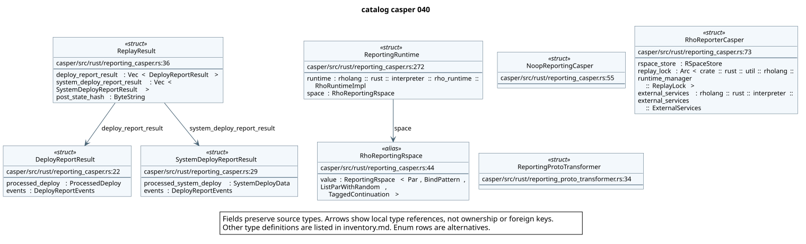

# catalog casper 040

[Inventory](inventory.md) | [PlantUML](catalog-casper-040.puml)

## Cardinality and Size

[Method, units, limits, and runtime evidence](sizing.md). These are declaration-level assessments, not measured live counts.

### DeployReportResult

Cardinality: 0..n live values. Current count and owner-level limits are not derivable from this declaration.

Size: Sum of field inline layouts plus compiler padding, then uniquely owned allocations. repr and custom implementations can change layout.

| Field or variant | Cardinality | Inline bytes or layout | Additional storage or wire encoding |
| --- | --- | --- | --- |
| `processed_deploy` | 1 value | Compiler layout required | Follow the referenced declaration or external implementation. No allocation bound established. |
| `events` | 1 value | Compiler layout required | Follow the referenced declaration or external implementation. No allocation bound established. |

### SystemDeployReportResult

Cardinality: 0..n live values. Current count and owner-level limits are not derivable from this declaration.

Size: Sum of field inline layouts plus compiler padding, then uniquely owned allocations. repr and custom implementations can change layout.

| Field or variant | Cardinality | Inline bytes or layout | Additional storage or wire encoding |
| --- | --- | --- | --- |
| `processed_system_deploy` | 1 value | Compiler layout required | Follow the referenced declaration or external implementation. No allocation bound established. |
| `events` | 1 value | Compiler layout required | Follow the referenced declaration or external implementation. No allocation bound established. |

### ReplayResult

Cardinality: 0..n live values. Current count and owner-level limits are not derivable from this declaration.

Size: Sum of field inline layouts plus compiler padding, then uniquely owned allocations. repr and custom implementations can change layout.

| Field or variant | Cardinality | Inline bytes or layout | Additional storage or wire encoding |
| --- | --- | --- | --- |
| `deploy_report_result` | 0..n elements | 24 B. Vec header on the generator target | capacity * I(element), plus live element-owned allocations. Zero-sized elements need no backing allocation. Element: Follow the referenced declaration or external implementation. No allocation bound established. |
| `system_deploy_report_result` | 0..n elements | 24 B. Vec header on the generator target | capacity * I(element), plus live element-owned allocations. Zero-sized elements need no backing allocation. Element: Follow the referenced declaration or external implementation. No allocation bound established. |
| `post_state_hash` | 1 value | Compiler layout required | Follow the referenced declaration or external implementation. No allocation bound established. |

### RhoReportingRspace

Cardinality: Alias, not a separate allocation. Count values of the target type.

Size: Same layout and allocations as target. Do not add alias bytes again.

| Field or variant | Cardinality | Inline bytes or layout | Additional storage or wire encoding |
| --- | --- | --- | --- |
| `value` | 1 value | Compiler layout required | Follow the referenced declaration or external implementation. No allocation bound established. |

### NoopReportingCasper

Cardinality: 0..n live values. Current count and owner-level limits are not derivable from this declaration.

Size: Sum of field inline layouts plus compiler padding, then uniquely owned allocations. repr and custom implementations can change layout.

| Field or variant | Cardinality | Inline bytes or layout | Additional storage or wire encoding |
| --- | --- | --- | --- |
| No declared fields | 0 field payloads | Compiler layout required | No field-owned allocations |

### RhoReporterCasper

Cardinality: 0..n live values. Current count and owner-level limits are not derivable from this declaration.

Size: Sum of field inline layouts plus compiler padding, then uniquely owned allocations. repr and custom implementations can change layout.

| Field or variant | Cardinality | Inline bytes or layout | Additional storage or wire encoding |
| --- | --- | --- | --- |
| `rspace_store` | 1 value | Compiler layout required | Follow the referenced declaration or external implementation. No allocation bound established. |
| `replay_lock` | 1 shared strong reference | Pointer or fat pointer, depending on target type | One shared allocation holds the target, counters and alignment. Count it once across all handles |
| `external_services` | 1 value | Compiler layout required | Follow the referenced declaration or external implementation. No allocation bound established. |

### ReportingRuntime

Cardinality: 0..n live values. Current count and owner-level limits are not derivable from this declaration.

Size: Sum of field inline layouts plus compiler padding, then uniquely owned allocations. repr and custom implementations can change layout.

| Field or variant | Cardinality | Inline bytes or layout | Additional storage or wire encoding |
| --- | --- | --- | --- |
| `runtime` | 1 value | Compiler layout required | Follow the referenced declaration or external implementation. No allocation bound established. |
| `space` | 1 value | Compiler layout required | Follow the referenced declaration or external implementation. No allocation bound established. |

### ReportingProtoTransformer

Cardinality: 0..n live values. Current count and owner-level limits are not derivable from this declaration.

Size: Sum of field inline layouts plus compiler padding, then uniquely owned allocations. repr and custom implementations can change layout.

| Field or variant | Cardinality | Inline bytes or layout | Additional storage or wire encoding |
| --- | --- | --- | --- |
| No declared fields | 0 field payloads | Compiler layout required | No field-owned allocations |

## Cross-Page References

- `DeployReportResult: events -> DeployReportEvents [catalog-casper-039.svg]`
- `DeployReportResult: processed_deploy -> ProcessedDeploy [catalog-models-032.svg]`
- `ReportingRuntime: runtime -> RhoRuntimeImpl [catalog-rholang-039.svg]`
- `RhoReporterCasper: external_services -> ExternalServices [catalog-rholang-006.svg]`
- `RhoReporterCasper: replay_lock -> ReplayLock [catalog-casper-055.svg]`
- `RhoReporterCasper: rspace_store -> RSpaceStore [catalog-rspacepp-014.svg]`
- `RhoReportingRspace: value -> ReportingRspace [catalog-rspacepp-013.svg]`
- `SystemDeployReportResult: events -> DeployReportEvents [catalog-casper-039.svg]`
- `SystemDeployReportResult: processed_system_deploy -> SystemDeployData [catalog-models-032.svg]`
