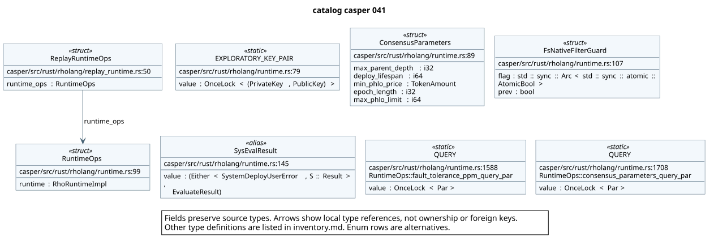

# catalog casper 041

[Inventory](inventory.md) | [PlantUML](catalog-casper-041.puml)

## Cross-Page References

- `ConsensusParameters: min_phlo_price -> TokenAmount [catalog-shared-009.svg]`
- `EXPLORATORY_KEY_PAIR: value -> PrivateKey [catalog-crypto-001.svg]`
- `RuntimeOps: runtime -> RhoRuntimeImpl [catalog-rholang-039.svg]`
- `SysEvalResult: value -> Either [catalog-rspacepp-004.svg]`
- `SysEvalResult: value -> EvaluateResult [catalog-rholang-007.svg]`
- `SysEvalResult: value -> SystemDeployUserError [catalog-casper-056.svg]`
