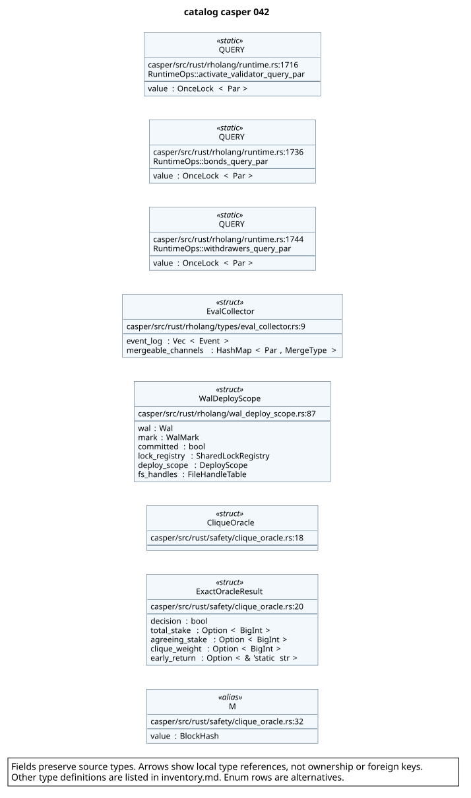

# catalog casper 042

[Inventory](inventory.md) | [PlantUML](catalog-casper-042.puml)

## Cross-Page References

- `EvalCollector: mergeable_channels -> MergeType [catalog-rspacepp-011.svg]`
- `M: value -> BlockHash [catalog-models-027.svg]`
- `WalDeployScope: deploy_scope -> DeployScope [catalog-rholang-020.svg]`
- `WalDeployScope: fs_handles -> FileHandleTable [catalog-rholang-008.svg]`
- `WalDeployScope: lock_registry -> SharedLockRegistry [catalog-rholang-022.svg]`
- `WalDeployScope: mark -> WalMark [catalog-rholang-025.svg]`
- `WalDeployScope: wal -> Wal [catalog-rholang-025.svg]`
