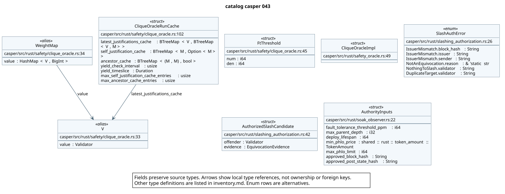

# catalog casper 043

[Inventory](inventory.md) | [PlantUML](catalog-casper-043.puml)

## Cross-Page References

- `AuthorityInputs: min_phlo_price -> TokenAmount [catalog-shared-009.svg]`
- `AuthorizedSlashCandidate: evidence -> EquivocationEvidence [catalog-models-032.svg]`
- `CliqueOracleRunCache: ancestor_cache -> M [catalog-casper-042.svg]`
- `CliqueOracleRunCache: latest_justifications_cache -> M [catalog-casper-042.svg]`
- `CliqueOracleRunCache: self_justification_cache -> M [catalog-casper-042.svg]`
