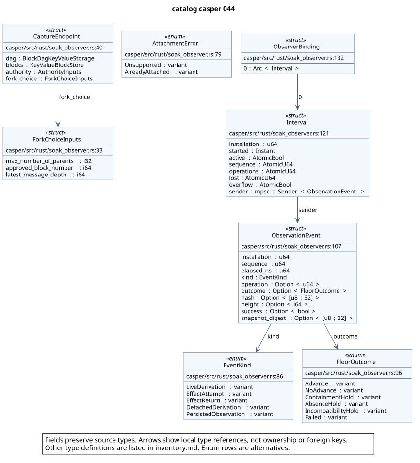

# catalog casper 044

[Inventory](inventory.md) | [PlantUML](catalog-casper-044.puml)

## Cross-Page References

- `CaptureEndpoint: authority -> AuthorityInputs [catalog-casper-043.svg]`
- `CaptureEndpoint: blocks -> KeyValueBlockStore [catalog-block-storage-008.svg]`
- `CaptureEndpoint: dag -> BlockDagKeyValueStorage [catalog-block-storage-001.svg]`
