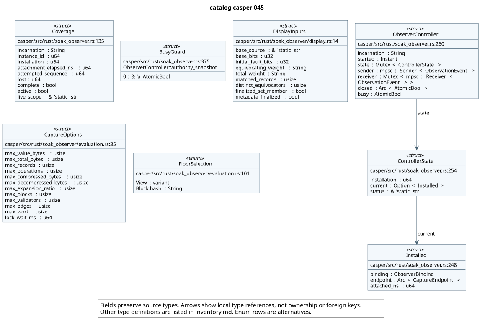

# catalog casper 045

[Inventory](inventory.md) | [PlantUML](catalog-casper-045.puml)

## Cardinality and Size

[Method, units, limits, and runtime evidence](sizing.md). These are declaration-level assessments, not measured live counts.

### Coverage

Cardinality: 0..n live values. Current count and owner-level limits are not derivable from this declaration.

Size: Sum of field inline layouts plus compiler padding, then uniquely owned allocations. repr and custom implementations can change layout.

| Field or variant | Cardinality | Inline bytes or layout | Additional storage or wire encoding |
| --- | --- | --- | --- |
| `incarnation` | 0..n UTF-8 bytes | 24 B. String header on the generator target | capacity() bytes, excluding allocator overhead. UTF-8 byte length is not character count |
| `instance_id` | 1 scalar | 8 B | None |
| `installation` | 1 scalar | 8 B | None |
| `attachment_elapsed_ns` | 1 scalar | 8 B | None |
| `attempted_sequence` | 1 scalar | 8 B | None |
| `lost` | 1 scalar | 8 B | None |
| `complete` | 1 scalar | 1 B | None |
| `active` | 1 scalar | 1 B | None |
| `live_scope` | 1 borrowed reference | Pointer or fat pointer. Referent layout required | No owned allocation. Referent: 1 value |

### Installed

Cardinality: 0..n live values. Current count and owner-level limits are not derivable from this declaration.

Size: Sum of field inline layouts plus compiler padding, then uniquely owned allocations. repr and custom implementations can change layout.

| Field or variant | Cardinality | Inline bytes or layout | Additional storage or wire encoding |
| --- | --- | --- | --- |
| `binding` | 1 value | Compiler layout required | Follow the referenced declaration or external implementation. No allocation bound established. |
| `endpoint` | 1 shared strong reference | Pointer or fat pointer, depending on target type | One shared allocation holds the target, counters and alignment. Count it once across all handles |
| `attached_ns` | 1 scalar | 8 B | None |

### ControllerState

Cardinality: 0..n live values. Current count and owner-level limits are not derivable from this declaration.

Size: Sum of field inline layouts plus compiler padding, then uniquely owned allocations. repr and custom implementations can change layout.

| Field or variant | Cardinality | Inline bytes or layout | Additional storage or wire encoding |
| --- | --- | --- | --- |
| `installation` | 1 scalar | 8 B | None |
| `current` | 0..1 present payload | Option layout includes any tag or niche optimization. Do not assume I(T) + 1 | None when absent. Present payload: 1 value. Follow the referenced declaration or external implementation. No allocation bound established. |
| `status` | 1 borrowed reference | Pointer or fat pointer. Referent layout required | No owned allocation. Referent: 1 value |

### ObserverController

Cardinality: 0..n live values. Current count and owner-level limits are not derivable from this declaration.

Size: Sum of field inline layouts plus compiler padding, then uniquely owned allocations. repr and custom implementations can change layout.

| Field or variant | Cardinality | Inline bytes or layout | Additional storage or wire encoding |
| --- | --- | --- | --- |
| `incarnation` | 0..n UTF-8 bytes | 24 B. String header on the generator target | capacity() bytes, excluding allocator overhead. UTF-8 byte length is not character count |
| `started` | 1 value | Compiler layout required | Follow the referenced declaration or external implementation. No allocation bound established. |
| `state` | 1 wrapper slot | Wrapper implementation and payload layout required | Payload allocations and any lock/waiter allocations. Once and lazy payloads can be uninitialized |
| `sender` | 1 value | Compiler layout required | Follow the referenced declaration or external implementation. No allocation bound established. |
| `receiver` | 1 wrapper slot | Wrapper implementation and payload layout required | Payload allocations and any lock/waiter allocations. Once and lazy payloads can be uninitialized |
| `closed` | 1 shared strong reference | Pointer or fat pointer, depending on target type | One shared allocation holds the target, counters and alignment. Count it once across all handles |
| `busy` | 1 atomic value | Target atomic layout required | None for the atomic value itself |

### BusyGuard

Cardinality: 0..n live values. Current count and owner-level limits are not derivable from this declaration.

Size: Sum of field inline layouts plus compiler padding, then uniquely owned allocations. repr and custom implementations can change layout.

| Field or variant | Cardinality | Inline bytes or layout | Additional storage or wire encoding |
| --- | --- | --- | --- |
| `0` | 1 borrowed reference | Pointer or fat pointer. Referent layout required | No owned allocation. Referent: 1 atomic value |

### DisplayInputs

Cardinality: 0..n live values. Current count and owner-level limits are not derivable from this declaration.

Size: Sum of field inline layouts plus compiler padding, then uniquely owned allocations. repr and custom implementations can change layout.

| Field or variant | Cardinality | Inline bytes or layout | Additional storage or wire encoding |
| --- | --- | --- | --- |
| `base_source` | 1 borrowed reference | Pointer or fat pointer. Referent layout required | No owned allocation. Referent: 1 value |
| `base_bits` | 1 scalar | 4 B | None |
| `initial_fault_bits` | 1 scalar | 4 B | None |
| `equivocating_weight` | 0..n UTF-8 bytes | 24 B. String header on the generator target | capacity() bytes, excluding allocator overhead. UTF-8 byte length is not character count |
| `total_weight` | 0..n UTF-8 bytes | 24 B. String header on the generator target | capacity() bytes, excluding allocator overhead. UTF-8 byte length is not character count |
| `matched_records` | 1 scalar | 8 B | None |
| `distinct_equivocators` | 1 scalar | 8 B | None |
| `finalized_set_member` | 1 scalar | 1 B | None |
| `metadata_finalized` | 1 scalar | 1 B | None |

### CaptureOptions

Cardinality: 0..n live values. Current count and owner-level limits are not derivable from this declaration.

Size: Sum of field inline layouts plus compiler padding, then uniquely owned allocations. repr and custom implementations can change layout.

| Field or variant | Cardinality | Inline bytes or layout | Additional storage or wire encoding |
| --- | --- | --- | --- |
| `max_value_bytes` | 1 scalar | 8 B | None |
| `max_total_bytes` | 1 scalar | 8 B | None |
| `max_records` | 1 scalar | 8 B | None |
| `max_operations` | 1 scalar | 8 B | None |
| `max_compressed_bytes` | 1 scalar | 8 B | None |
| `max_decompressed_bytes` | 1 scalar | 8 B | None |
| `max_expansion_ratio` | 1 scalar | 8 B | None |
| `max_blocks` | 1 scalar | 8 B | None |
| `max_validators` | 1 scalar | 8 B | None |
| `max_edges` | 1 scalar | 8 B | None |
| `max_work` | 1 scalar | 8 B | None |
| `lock_wait_ms` | 1 scalar | 8 B | None |

### FloorSelection

Cardinality: 0..n live values. Current count and owner-level limits are not derivable from this declaration.

Size: Compiler enum layout plus allocations of the active variant only. Do not sum alternative variants.

| Field or variant | Cardinality | Inline bytes or layout | Additional storage or wire encoding |
| --- | --- | --- | --- |
| `View` | 1 mutually exclusive alternative | No payload. Enum discriminant layout required | None for this unit variant |
| `Block.hash` | 0..n UTF-8 bytes when this variant is active | 24 B. String header on the generator target | capacity() bytes, excluding allocator overhead. UTF-8 byte length is not character count |

## Cross-Page References

- `Installed: binding -> ObserverBinding [catalog-casper-044.svg]`
- `Installed: endpoint -> CaptureEndpoint [catalog-casper-044.svg]`
- `ObserverController: receiver -> ObservationEvent [catalog-casper-044.svg]`
- `ObserverController: sender -> ObservationEvent [catalog-casper-044.svg]`
