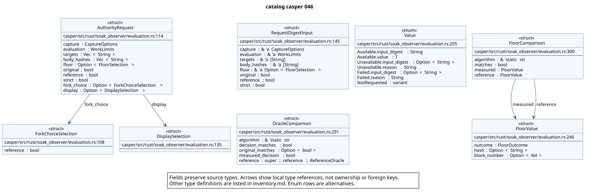

# catalog casper 046

[Inventory](inventory.md) | [PlantUML](catalog-casper-046.puml)

## Cross-Page References

- `AuthorityRequest: capture -> CaptureOptions [catalog-casper-045.svg]`
- `AuthorityRequest: evaluation -> WorkLimits [catalog-shared-001.svg]`
- `AuthorityRequest: floor -> FloorSelection [catalog-casper-045.svg]`
- `FloorValue: outcome -> FloorOutcome [catalog-casper-044.svg]`
- `OracleComparison: reference -> ReferenceOracle [catalog-casper-049.svg]`
- `RequestDigestInput: capture -> CaptureOptions [catalog-casper-045.svg]`
- `RequestDigestInput: evaluation -> WorkLimits [catalog-shared-001.svg]`
- `RequestDigestInput: floor -> FloorSelection [catalog-casper-045.svg]`
