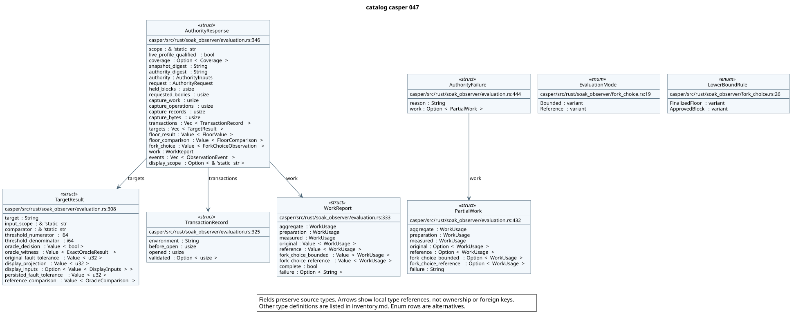

# catalog casper 047

[Inventory](inventory.md) | [PlantUML](catalog-casper-047.puml)

## Cross-Page References

- `AuthorityResponse: authority -> AuthorityInputs [catalog-casper-043.svg]`
- `AuthorityResponse: events -> ObservationEvent [catalog-casper-044.svg]`
- `AuthorityResponse: floor_comparison -> FloorComparison [catalog-casper-046.svg]`
- `AuthorityResponse: floor_comparison -> Value [catalog-casper-046.svg]`
- `AuthorityResponse: floor_result -> FloorValue [catalog-casper-046.svg]`
- `AuthorityResponse: floor_result -> Value [catalog-casper-046.svg]`
- `AuthorityResponse: fork_choice -> ForkChoiceObservation [catalog-casper-048.svg]`
- `AuthorityResponse: fork_choice -> Value [catalog-casper-046.svg]`
- `AuthorityResponse: request -> AuthorityRequest [catalog-casper-046.svg]`
- `PartialWork: aggregate -> WorkUsage [catalog-shared-001.svg]`
- `PartialWork: fork_choice_bounded -> WorkUsage [catalog-shared-001.svg]`
- `PartialWork: fork_choice_reference -> WorkUsage [catalog-shared-001.svg]`
- `PartialWork: measured -> WorkUsage [catalog-shared-001.svg]`
- `PartialWork: original -> WorkUsage [catalog-shared-001.svg]`
- `PartialWork: preparation -> WorkUsage [catalog-shared-001.svg]`
- `PartialWork: reference -> WorkUsage [catalog-shared-001.svg]`
- `TargetResult: display_inputs -> DisplayInputs [catalog-casper-045.svg]`
- `TargetResult: display_inputs -> Value [catalog-casper-046.svg]`
- `TargetResult: display_projection -> Value [catalog-casper-046.svg]`
- `TargetResult: oracle_decision -> Value [catalog-casper-046.svg]`
- `TargetResult: oracle_witness -> ExactOracleResult [catalog-casper-042.svg]`
- `TargetResult: oracle_witness -> Value [catalog-casper-046.svg]`
- `TargetResult: original_fault_tolerance -> Value [catalog-casper-046.svg]`
- `TargetResult: persisted_fault_tolerance -> Value [catalog-casper-046.svg]`
- `TargetResult: reference_comparison -> OracleComparison [catalog-casper-046.svg]`
- `TargetResult: reference_comparison -> Value [catalog-casper-046.svg]`
- `WorkReport: aggregate -> WorkUsage [catalog-shared-001.svg]`
- `WorkReport: fork_choice_bounded -> Value [catalog-casper-046.svg]`
- `WorkReport: fork_choice_bounded -> WorkUsage [catalog-shared-001.svg]`
- `WorkReport: fork_choice_reference -> Value [catalog-casper-046.svg]`
- `WorkReport: fork_choice_reference -> WorkUsage [catalog-shared-001.svg]`
- `WorkReport: measured -> WorkUsage [catalog-shared-001.svg]`
- `WorkReport: original -> Value [catalog-casper-046.svg]`
- `WorkReport: original -> WorkUsage [catalog-shared-001.svg]`
- `WorkReport: preparation -> WorkUsage [catalog-shared-001.svg]`
- `WorkReport: reference -> Value [catalog-casper-046.svg]`
- `WorkReport: reference -> WorkUsage [catalog-shared-001.svg]`
