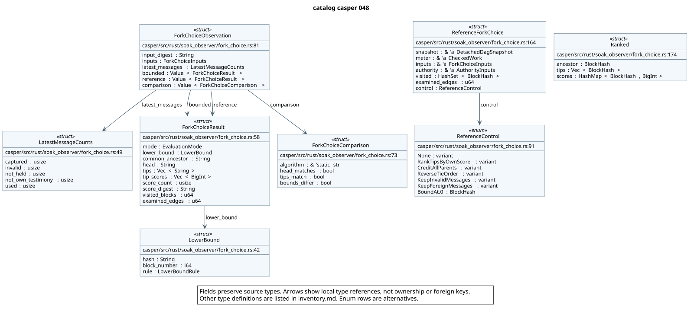

# catalog casper 048

[Inventory](inventory.md) | [PlantUML](catalog-casper-048.puml)

## Cardinality and Size

[Method, units, limits, and runtime evidence](sizing.md). These are declaration-level assessments, not measured live counts.

### LowerBound

Cardinality: 0..n live values. Current count and owner-level limits are not derivable from this declaration.

Size: Sum of field inline layouts plus compiler padding, then uniquely owned allocations. repr and custom implementations can change layout.

| Field or variant | Cardinality | Inline bytes or layout | Additional storage or wire encoding |
| --- | --- | --- | --- |
| `hash` | 0..n UTF-8 bytes | 24 B. String header on the generator target | capacity() bytes, excluding allocator overhead. UTF-8 byte length is not character count |
| `block_number` | 1 scalar | 8 B | None |
| `rule` | 1 value | Compiler layout required | Follow the referenced declaration or external implementation. No allocation bound established. |

### LatestMessageCounts

Cardinality: 0..n live values. Current count and owner-level limits are not derivable from this declaration.

Size: Sum of field inline layouts plus compiler padding, then uniquely owned allocations. repr and custom implementations can change layout.

| Field or variant | Cardinality | Inline bytes or layout | Additional storage or wire encoding |
| --- | --- | --- | --- |
| `captured` | 1 scalar | 8 B | None |
| `invalid` | 1 scalar | 8 B | None |
| `not_held` | 1 scalar | 8 B | None |
| `not_own_testimony` | 1 scalar | 8 B | None |
| `used` | 1 scalar | 8 B | None |

### ForkChoiceResult

Cardinality: 0..n live values. Current count and owner-level limits are not derivable from this declaration.

Size: Sum of field inline layouts plus compiler padding, then uniquely owned allocations. repr and custom implementations can change layout.

| Field or variant | Cardinality | Inline bytes or layout | Additional storage or wire encoding |
| --- | --- | --- | --- |
| `mode` | 1 value | Compiler layout required | Follow the referenced declaration or external implementation. No allocation bound established. |
| `lower_bound` | 1 value | Compiler layout required | Follow the referenced declaration or external implementation. No allocation bound established. |
| `common_ancestor` | 0..n UTF-8 bytes | 24 B. String header on the generator target | capacity() bytes, excluding allocator overhead. UTF-8 byte length is not character count |
| `head` | 0..n UTF-8 bytes | 24 B. String header on the generator target | capacity() bytes, excluding allocator overhead. UTF-8 byte length is not character count |
| `tips` | 0..n elements | 24 B. Vec header on the generator target | capacity * I(element), plus live element-owned allocations. Zero-sized elements need no backing allocation. Element: capacity() bytes, excluding allocator overhead. UTF-8 byte length is not character count |
| `tip_scores` | 0..n elements | 24 B. Vec header on the generator target | capacity * I(element), plus live element-owned allocations. Zero-sized elements need no backing allocation. Element: Follow the referenced declaration or external implementation. No allocation bound established. |
| `score_count` | 1 scalar | 8 B | None |
| `score_digest` | 0..n UTF-8 bytes | 24 B. String header on the generator target | capacity() bytes, excluding allocator overhead. UTF-8 byte length is not character count |
| `visited_blocks` | 1 scalar | 8 B | None |
| `examined_edges` | 1 scalar | 8 B | None |

### ForkChoiceComparison

Cardinality: 0..n live values. Current count and owner-level limits are not derivable from this declaration.

Size: Sum of field inline layouts plus compiler padding, then uniquely owned allocations. repr and custom implementations can change layout.

| Field or variant | Cardinality | Inline bytes or layout | Additional storage or wire encoding |
| --- | --- | --- | --- |
| `algorithm` | 1 borrowed reference | Pointer or fat pointer. Referent layout required | No owned allocation. Referent: 1 value |
| `head_matches` | 1 scalar | 1 B | None |
| `tips_match` | 1 scalar | 1 B | None |
| `bounds_differ` | 1 scalar | 1 B | None |

### ForkChoiceObservation

Cardinality: 0..n live values. Current count and owner-level limits are not derivable from this declaration.

Size: Sum of field inline layouts plus compiler padding, then uniquely owned allocations. repr and custom implementations can change layout.

| Field or variant | Cardinality | Inline bytes or layout | Additional storage or wire encoding |
| --- | --- | --- | --- |
| `input_digest` | 0..n UTF-8 bytes | 24 B. String header on the generator target | capacity() bytes, excluding allocator overhead. UTF-8 byte length is not character count |
| `inputs` | 1 value | Compiler layout required | Follow the referenced declaration or external implementation. No allocation bound established. |
| `latest_messages` | 1 value | Compiler layout required | Follow the referenced declaration or external implementation. No allocation bound established. |
| `bounded` | 1 value | Compiler layout required | Follow the referenced declaration or external implementation. No allocation bound established. |
| `reference` | 1 value | Compiler layout required | Follow the referenced declaration or external implementation. No allocation bound established. |
| `comparison` | 1 value | Compiler layout required | Follow the referenced declaration or external implementation. No allocation bound established. |

### ReferenceControl

Cardinality: 0..n live values. Current count and owner-level limits are not derivable from this declaration.

Size: Compiler enum layout plus allocations of the active variant only. Do not sum alternative variants.

| Field or variant | Cardinality | Inline bytes or layout | Additional storage or wire encoding |
| --- | --- | --- | --- |
| `None` | 1 mutually exclusive alternative | No payload. Enum discriminant layout required | None for this unit variant |
| `RankTipsByOwnScore` | 1 mutually exclusive alternative | No payload. Enum discriminant layout required | None for this unit variant |
| `CreditAllParents` | 1 mutually exclusive alternative | No payload. Enum discriminant layout required | None for this unit variant |
| `ReverseTieOrder` | 1 mutually exclusive alternative | No payload. Enum discriminant layout required | None for this unit variant |
| `KeepInvalidMessages` | 1 mutually exclusive alternative | No payload. Enum discriminant layout required | None for this unit variant |
| `KeepForeignMessages` | 1 mutually exclusive alternative | No payload. Enum discriminant layout required | None for this unit variant |
| `BoundAt.0` | 1 value when this variant is active | Compiler layout required | Follow the referenced declaration or external implementation. No allocation bound established. |

### ReferenceForkChoice

Cardinality: 0..n live values. Current count and owner-level limits are not derivable from this declaration.

Size: Sum of field inline layouts plus compiler padding, then uniquely owned allocations. repr and custom implementations can change layout.

| Field or variant | Cardinality | Inline bytes or layout | Additional storage or wire encoding |
| --- | --- | --- | --- |
| `snapshot` | 1 borrowed reference | Pointer or fat pointer. Referent layout required | No owned allocation. Referent: 1 value |
| `meter` | 1 borrowed reference | Pointer or fat pointer. Referent layout required | No owned allocation. Referent: 1 value |
| `inputs` | 1 borrowed reference | Pointer or fat pointer. Referent layout required | No owned allocation. Referent: 1 value |
| `authority` | 1 borrowed reference | Pointer or fat pointer. Referent layout required | No owned allocation. Referent: 1 value |
| `visited` | 0..n distinct elements | Container and hasher implementation required | Element storage, owned allocations, spare capacity and index overhead. No type-level count cap |
| `examined_edges` | 1 scalar | 8 B | None |
| `control` | 1 value | Compiler layout required | Follow the referenced declaration or external implementation. No allocation bound established. |

### Ranked

Cardinality: 0..n live values. Current count and owner-level limits are not derivable from this declaration.

Size: Sum of field inline layouts plus compiler padding, then uniquely owned allocations. repr and custom implementations can change layout.

| Field or variant | Cardinality | Inline bytes or layout | Additional storage or wire encoding |
| --- | --- | --- | --- |
| `ancestor` | 1 value | Compiler layout required | Follow the referenced declaration or external implementation. No allocation bound established. |
| `tips` | 0..n elements | 24 B. Vec header on the generator target | capacity * I(element), plus live element-owned allocations. Zero-sized elements need no backing allocation. Element: Follow the referenced declaration or external implementation. No allocation bound established. |
| `scores` | 0..n key/value pairs | Container and hasher implementation required | n keys and n values, their owned allocations, spare capacity, buckets or tree nodes, and control bytes. No type-level count cap |

## Cross-Page References

- `ForkChoiceObservation: inputs -> ForkChoiceInputs [catalog-casper-044.svg]`
- `ForkChoiceResult: mode -> EvaluationMode [catalog-casper-047.svg]`
- `LowerBound: rule -> LowerBoundRule [catalog-casper-047.svg]`
- `Ranked: ancestor -> BlockHash [catalog-models-027.svg]`
- `Ranked: scores -> BlockHash [catalog-models-027.svg]`
- `Ranked: tips -> BlockHash [catalog-models-027.svg]`
- `ReferenceControl: BoundAt.0 -> BlockHash [catalog-models-027.svg]`
- `ReferenceForkChoice: authority -> AuthorityInputs [catalog-casper-043.svg]`
- `ReferenceForkChoice: inputs -> ForkChoiceInputs [catalog-casper-044.svg]`
- `ReferenceForkChoice: meter -> CheckedWork [catalog-shared-001.svg]`
- `ReferenceForkChoice: snapshot -> DetachedDagSnapshot [catalog-block-storage-005.svg]`
- `ReferenceForkChoice: visited -> BlockHash [catalog-models-027.svg]`
