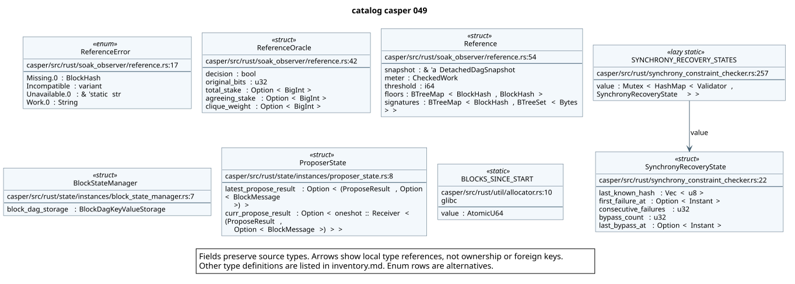

# catalog casper 049

[Inventory](inventory.md) | [PlantUML](catalog-casper-049.puml)

## Cross-Page References

- `BlockStateManager: block_dag_storage -> BlockDagKeyValueStorage [catalog-block-storage-001.svg]`
- `ProposerState: curr_propose_result -> BlockMessage [catalog-models-031.svg]`
- `ProposerState: curr_propose_result -> ProposeResult [catalog-casper-017.svg]`
- `ProposerState: latest_propose_result -> BlockMessage [catalog-models-031.svg]`
- `ProposerState: latest_propose_result -> ProposeResult [catalog-casper-017.svg]`
- `Reference: floors -> BlockHash [catalog-models-027.svg]`
- `Reference: meter -> CheckedWork [catalog-shared-001.svg]`
- `Reference: signatures -> BlockHash [catalog-models-027.svg]`
- `Reference: snapshot -> DetachedDagSnapshot [catalog-block-storage-005.svg]`
- `ReferenceError: Missing.0 -> BlockHash [catalog-models-027.svg]`
