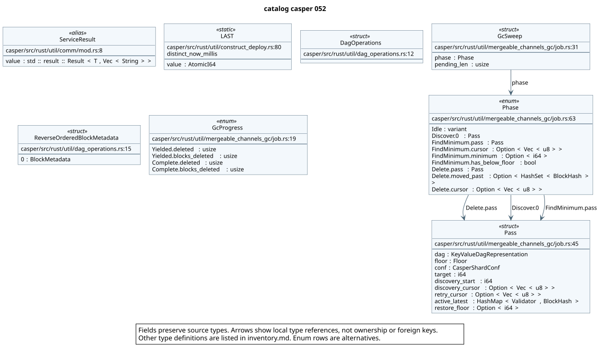

# catalog casper 052

[Inventory](inventory.md) | [PlantUML](catalog-casper-052.puml)

## Cross-Page References

- `Pass: active_latest -> BlockHash [catalog-models-027.svg]`
- `Pass: conf -> CasperShardConf [catalog-casper-020.svg]`
- `Pass: dag -> KeyValueDagRepresentation [catalog-block-storage-001.svg]`
- `Pass: floor -> Floor [catalog-casper-032.svg]`
- `Phase: Delete.moved_past -> BlockHash [catalog-models-027.svg]`
- `ReverseOrderedBlockMetadata: 0 -> BlockMetadata [catalog-models-027.svg]`
