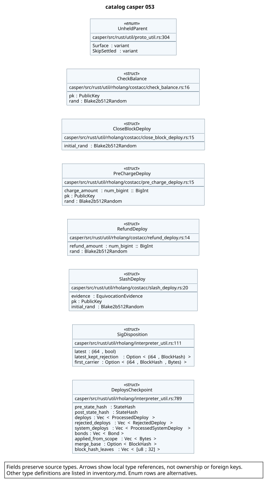

# catalog casper 053

[Inventory](inventory.md) | [PlantUML](catalog-casper-053.puml)

## Cross-Page References

- `CheckBalance: rand -> Blake2b512Random [catalog-crypto-001.svg]`
- `CloseBlockDeploy: initial_rand -> Blake2b512Random [catalog-crypto-001.svg]`
- `DeploysCheckpoint: bonds -> Bond [catalog-models-033.svg]`
- `DeploysCheckpoint: deploys -> ProcessedDeploy [catalog-models-032.svg]`
- `DeploysCheckpoint: merge_base -> BlockHash [catalog-models-027.svg]`
- `DeploysCheckpoint: post_state_hash -> StateHash [catalog-models-027.svg]`
- `DeploysCheckpoint: pre_state_hash -> StateHash [catalog-models-027.svg]`
- `DeploysCheckpoint: rejected_deploys -> RejectedDeploy [catalog-models-031.svg]`
- `DeploysCheckpoint: system_deploys -> ProcessedSystemDeploy [catalog-models-032.svg]`
- `PreChargeDeploy: rand -> Blake2b512Random [catalog-crypto-001.svg]`
- `RefundDeploy: rand -> Blake2b512Random [catalog-crypto-001.svg]`
- `SigDisposition: first_carrier -> BlockHash [catalog-models-027.svg]`
- `SigDisposition: latest_kept_rejection -> BlockHash [catalog-models-027.svg]`
- `SlashDeploy: evidence -> EquivocationEvidence [catalog-models-032.svg]`
- `SlashDeploy: initial_rand -> Blake2b512Random [catalog-crypto-001.svg]`
