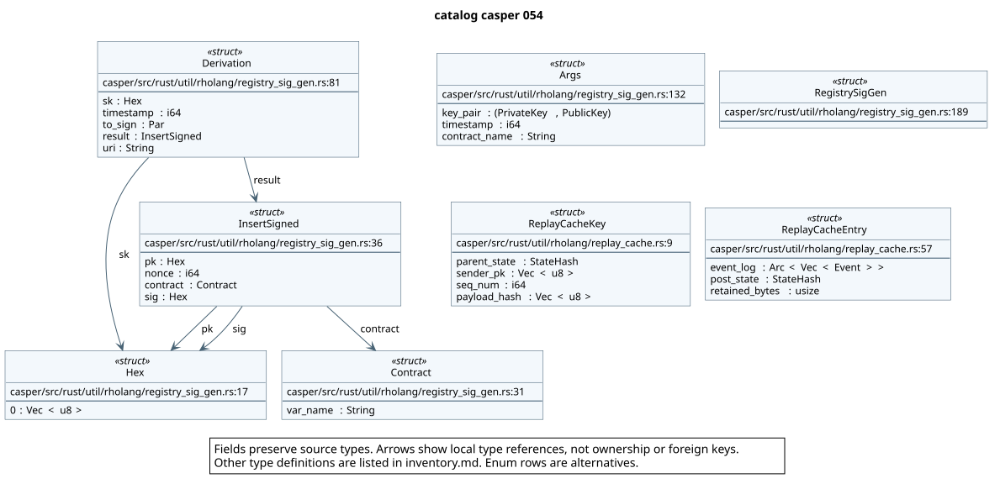

# catalog casper 054

[Inventory](inventory.md) | [PlantUML](catalog-casper-054.puml)

## Cross-Page References

- `Args: key_pair -> PrivateKey [catalog-crypto-001.svg]`
- `ReplayCacheEntry: post_state -> StateHash [catalog-models-027.svg]`
- `ReplayCacheKey: parent_state -> StateHash [catalog-models-027.svg]`
