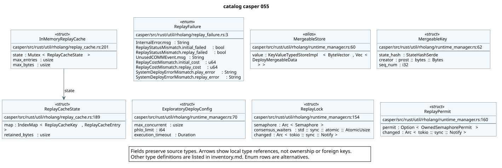

# catalog casper 055

[Inventory](inventory.md) | [PlantUML](catalog-casper-055.puml)

## Cross-Page References

- `MergeableKey: state_hash -> StateHashSerde [catalog-models-027.svg]`
- `MergeableStore: value -> ByteVector [catalog-shared-002.svg]`
- `MergeableStore: value -> DeployMergeableData [catalog-rholang-028.svg]`
- `MergeableStore: value -> KeyValueTypedStoreImpl [catalog-shared-007.svg]`
- `ReplayCacheState: map -> ReplayCacheEntry [catalog-casper-054.svg]`
- `ReplayCacheState: map -> ReplayCacheKey [catalog-casper-054.svg]`
