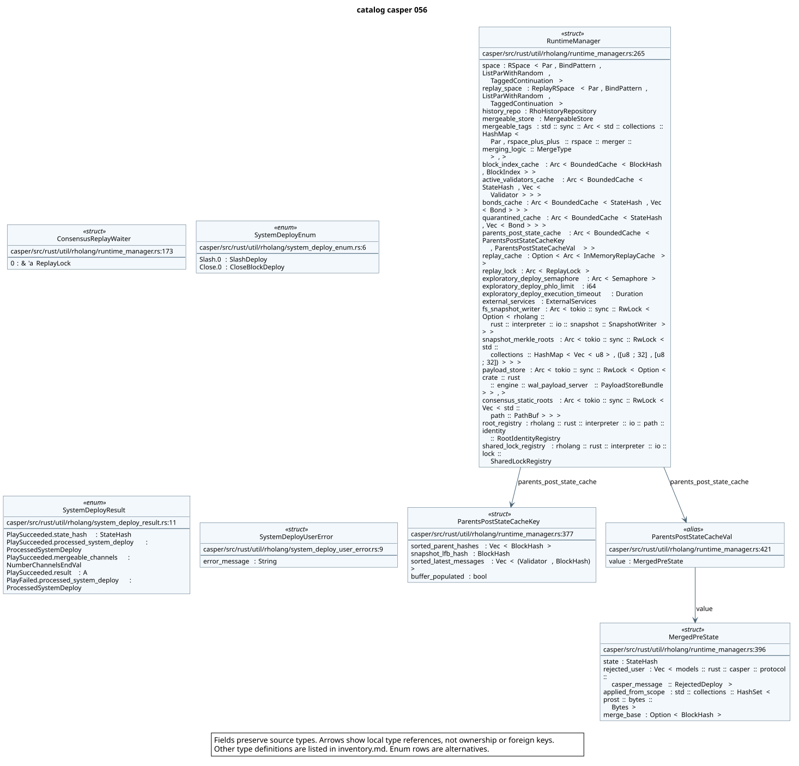

# catalog casper 056

[Inventory](inventory.md) | [PlantUML](catalog-casper-056.puml)

## Cross-Page References

- `ConsensusReplayWaiter: 0 -> ReplayLock [catalog-casper-055.svg]`
- `MergedPreState: merge_base -> BlockHash [catalog-models-027.svg]`
- `MergedPreState: rejected_user -> RejectedDeploy [catalog-models-031.svg]`
- `MergedPreState: state -> StateHash [catalog-models-027.svg]`
- `ParentsPostStateCacheKey: snapshot_lfb_hash -> BlockHash [catalog-models-027.svg]`
- `ParentsPostStateCacheKey: sorted_latest_messages -> BlockHash [catalog-models-027.svg]`
- `ParentsPostStateCacheKey: sorted_parent_hashes -> BlockHash [catalog-models-027.svg]`
- `RuntimeManager: active_validators_cache -> BoundedCache [catalog-casper-050.svg]`
- `RuntimeManager: active_validators_cache -> StateHash [catalog-models-027.svg]`
- `RuntimeManager: block_index_cache -> BlockHash [catalog-models-027.svg]`
- `RuntimeManager: block_index_cache -> BlockIndex [catalog-casper-037.svg]`
- `RuntimeManager: block_index_cache -> BoundedCache [catalog-casper-050.svg]`
- `RuntimeManager: bonds_cache -> Bond [catalog-models-033.svg]`
- `RuntimeManager: bonds_cache -> BoundedCache [catalog-casper-050.svg]`
- `RuntimeManager: bonds_cache -> StateHash [catalog-models-027.svg]`
- `RuntimeManager: external_services -> ExternalServices [catalog-rholang-006.svg]`
- `RuntimeManager: fs_snapshot_writer -> SnapshotWriter [catalog-rholang-024.svg]`
- `RuntimeManager: history_repo -> RhoHistoryRepository [catalog-rholang-040.svg]`
- `RuntimeManager: mergeable_store -> MergeableStore [catalog-casper-055.svg]`
- `RuntimeManager: mergeable_tags -> MergeType [catalog-rspacepp-011.svg]`
- `RuntimeManager: parents_post_state_cache -> BoundedCache [catalog-casper-050.svg]`
- `RuntimeManager: payload_store -> PayloadStoreBundle [catalog-casper-029.svg]`
- `RuntimeManager: quarantined_cache -> Bond [catalog-models-033.svg]`
- `RuntimeManager: quarantined_cache -> BoundedCache [catalog-casper-050.svg]`
- `RuntimeManager: quarantined_cache -> StateHash [catalog-models-027.svg]`
- `RuntimeManager: replay_cache -> InMemoryReplayCache [catalog-casper-055.svg]`
- `RuntimeManager: replay_lock -> ReplayLock [catalog-casper-055.svg]`
- `RuntimeManager: replay_space -> ReplayRSpace [catalog-rspacepp-012.svg]`
- `RuntimeManager: root_registry -> RootIdentityRegistry [catalog-rholang-023.svg]`
- `RuntimeManager: shared_lock_registry -> SharedLockRegistry [catalog-rholang-022.svg]`
- `RuntimeManager: space -> RSpace [catalog-rspacepp-014.svg]`
- `SystemDeployEnum: Close.0 -> CloseBlockDeploy [catalog-casper-053.svg]`
- `SystemDeployEnum: Slash.0 -> SlashDeploy [catalog-casper-053.svg]`
- `SystemDeployResult: PlayFailed.processed_system_deploy -> ProcessedSystemDeploy [catalog-models-032.svg]`
- `SystemDeployResult: PlaySucceeded.mergeable_channels -> NumberChannelsEndVal [catalog-rspacepp-011.svg]`
- `SystemDeployResult: PlaySucceeded.processed_system_deploy -> ProcessedSystemDeploy [catalog-models-032.svg]`
- `SystemDeployResult: PlaySucceeded.state_hash -> StateHash [catalog-models-027.svg]`
