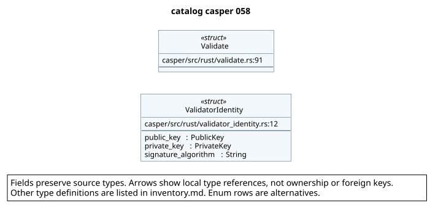

# catalog casper 058

[Inventory](inventory.md) | [PlantUML](catalog-casper-058.puml)

## Cardinality and Size

[Method, units, limits, and runtime evidence](sizing.md). These are declaration-level assessments, not measured live counts.

### Validate

Cardinality: 0..n live values. Current count and owner-level limits are not derivable from this declaration.

Size: Sum of field inline layouts plus compiler padding, then uniquely owned allocations. repr and custom implementations can change layout.

| Field or variant | Cardinality | Inline bytes or layout | Additional storage or wire encoding |
| --- | --- | --- | --- |
| No declared fields | 0 field payloads | Compiler layout required | No field-owned allocations |

### ValidatorIdentity

Cardinality: 0..n live values. Current count and owner-level limits are not derivable from this declaration.

Size: Sum of field inline layouts plus compiler padding, then uniquely owned allocations. repr and custom implementations can change layout.

| Field or variant | Cardinality | Inline bytes or layout | Additional storage or wire encoding |
| --- | --- | --- | --- |
| `public_key` | 1 value | Compiler layout required | Follow the referenced declaration or external implementation. No allocation bound established. |
| `private_key` | 1 value | Compiler layout required | Follow the referenced declaration or external implementation. No allocation bound established. |
| `signature_algorithm` | 0..n UTF-8 bytes | 24 B. String header on the generator target | capacity() bytes, excluding allocator overhead. UTF-8 byte length is not character count |

## Cross-Page References

- `ValidatorIdentity: private_key -> PrivateKey [catalog-crypto-001.svg]`
