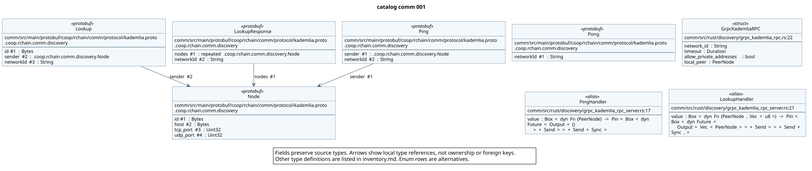

# catalog comm 001

[Inventory](inventory.md) | [PlantUML](catalog-comm-001.puml)

## Cross-Page References

- `GrpcKademliaRPC: local_peer -> PeerNode [catalog-comm-003.svg]`
- `LookupHandler: value -> PeerNode [catalog-comm-003.svg]`
- `PingHandler: value -> PeerNode [catalog-comm-003.svg]`
