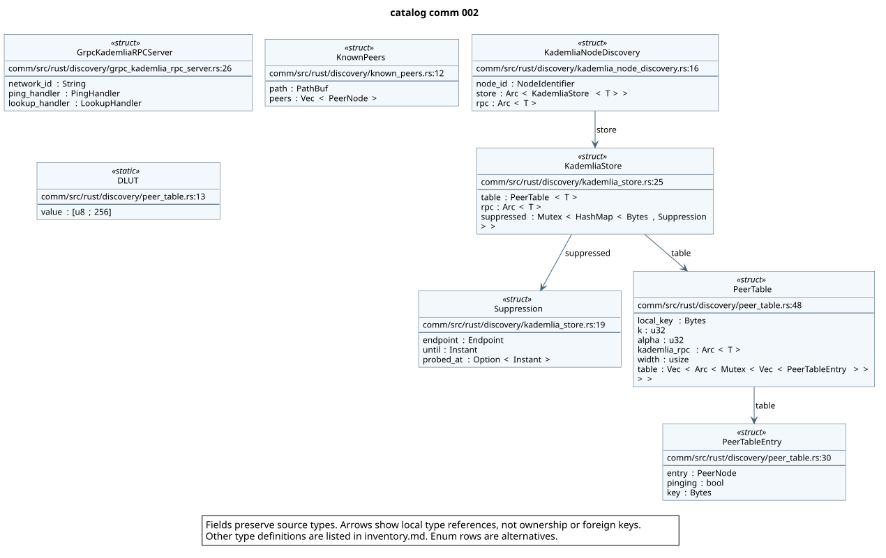

# catalog comm 002

[Inventory](inventory.md) | [PlantUML](catalog-comm-002.puml)

## Cardinality and Size

[Method, units, limits, and runtime evidence](sizing.md). These are declaration-level assessments, not measured live counts.

### GrpcKademliaRPCServer

Cardinality: 0..n live values. Current count and owner-level limits are not derivable from this declaration.

Size: Sum of field inline layouts plus compiler padding, then uniquely owned allocations. repr and custom implementations can change layout.

| Field or variant | Cardinality | Inline bytes or layout | Additional storage or wire encoding |
| --- | --- | --- | --- |
| `network_id` | 0..n UTF-8 bytes | 24 B. String header on the generator target | capacity() bytes, excluding allocator overhead. UTF-8 byte length is not character count |
| `ping_handler` | 1 value | Compiler layout required | Follow the referenced declaration or external implementation. No allocation bound established. |
| `lookup_handler` | 1 value | Compiler layout required | Follow the referenced declaration or external implementation. No allocation bound established. |

### KademliaNodeDiscovery

Cardinality: 0..n live values. Current count and owner-level limits are not derivable from this declaration.

Size: Sum of field inline layouts plus compiler padding, then uniquely owned allocations. repr and custom implementations can change layout.

| Field or variant | Cardinality | Inline bytes or layout | Additional storage or wire encoding |
| --- | --- | --- | --- |
| `node_id` | 1 value | Compiler layout required | Follow the referenced declaration or external implementation. No allocation bound established. |
| `store` | 1 shared strong reference | Pointer or fat pointer, depending on target type | One shared allocation holds the target, counters and alignment. Count it once across all handles |
| `rpc` | 1 shared strong reference | Pointer or fat pointer, depending on target type | One shared allocation holds the target, counters and alignment. Count it once across all handles |

### Suppression

Cardinality: 0..n live values. Current count and owner-level limits are not derivable from this declaration.

Size: Sum of field inline layouts plus compiler padding, then uniquely owned allocations. repr and custom implementations can change layout.

| Field or variant | Cardinality | Inline bytes or layout | Additional storage or wire encoding |
| --- | --- | --- | --- |
| `endpoint` | 1 value | Compiler layout required | Follow the referenced declaration or external implementation. No allocation bound established. |
| `until` | 1 value | Compiler layout required | Follow the referenced declaration or external implementation. No allocation bound established. |
| `probed_at` | 0..1 present payload | Option layout includes any tag or niche optimization. Do not assume I(T) + 1 | None when absent. Present payload: 1 value. Follow the referenced declaration or external implementation. No allocation bound established. |

### KademliaStore

Cardinality: 0..n live values. Current count and owner-level limits are not derivable from this declaration.

Size: Sum of field inline layouts plus compiler padding, then uniquely owned allocations. repr and custom implementations can change layout.

| Field or variant | Cardinality | Inline bytes or layout | Additional storage or wire encoding |
| --- | --- | --- | --- |
| `table` | 1 value | Compiler layout required | Follow the referenced declaration or external implementation. No allocation bound established. |
| `rpc` | 1 shared strong reference | Pointer or fat pointer, depending on target type | One shared allocation holds the target, counters and alignment. Count it once across all handles |
| `suppressed` | 1 wrapper slot | Wrapper implementation and payload layout required | Payload allocations and any lock/waiter allocations. Once and lazy payloads can be uninitialized |

### KnownPeers

Cardinality: 0..n live values. Current count and owner-level limits are not derivable from this declaration.

Size: Sum of field inline layouts plus compiler padding, then uniquely owned allocations. repr and custom implementations can change layout.

| Field or variant | Cardinality | Inline bytes or layout | Additional storage or wire encoding |
| --- | --- | --- | --- |
| `path` | 1 value | Compiler layout required | Follow the referenced declaration or external implementation. No allocation bound established. |
| `peers` | 0..n elements | 24 B. Vec header on the generator target | capacity * I(element), plus live element-owned allocations. Zero-sized elements need no backing allocation. Element: Follow the referenced declaration or external implementation. No allocation bound established. |

### DLUT

Cardinality: One slot per linked process instance. Lazy payload can be uninitialized.

Size: Declared slot or lazy wrapper layout plus initialized owned allocations.

| Field or variant | Cardinality | Inline bytes or layout | Additional storage or wire encoding |
| --- | --- | --- | --- |
| `value` | 256 elements | 256 B. 256 * I(element), inline array | Sum of element-owned allocations. Element: None |

### PeerTableEntry

Cardinality: 0..n live values. Current count and owner-level limits are not derivable from this declaration.

Size: Sum of field inline layouts plus compiler padding, then uniquely owned allocations. repr and custom implementations can change layout.

| Field or variant | Cardinality | Inline bytes or layout | Additional storage or wire encoding |
| --- | --- | --- | --- |
| `entry` | 1 value | Compiler layout required | Follow the referenced declaration or external implementation. No allocation bound established. |
| `pinging` | 1 scalar | 1 B | None |
| `key` | 1 value | Compiler layout required | Follow the referenced declaration or external implementation. No allocation bound established. |

### PeerTable

Cardinality: 0..n live values. Current count and owner-level limits are not derivable from this declaration.

Size: Sum of field inline layouts plus compiler padding, then uniquely owned allocations. repr and custom implementations can change layout.

| Field or variant | Cardinality | Inline bytes or layout | Additional storage or wire encoding |
| --- | --- | --- | --- |
| `local_key` | 1 value | Compiler layout required | Follow the referenced declaration or external implementation. No allocation bound established. |
| `k` | 1 scalar | 4 B | None |
| `alpha` | 1 scalar | 4 B | None |
| `kademlia_rpc` | 1 shared strong reference | Pointer or fat pointer, depending on target type | One shared allocation holds the target, counters and alignment. Count it once across all handles |
| `width` | 1 scalar | 8 B | None |
| `table` | 0..n elements | 24 B. Vec header on the generator target | capacity * I(element), plus live element-owned allocations. Zero-sized elements need no backing allocation. Element: One shared allocation holds the target, counters and alignment. Count it once across all handles |

## Cross-Page References

- `GrpcKademliaRPCServer: lookup_handler -> LookupHandler [catalog-comm-001.svg]`
- `GrpcKademliaRPCServer: ping_handler -> PingHandler [catalog-comm-001.svg]`
- `KademliaNodeDiscovery: node_id -> NodeIdentifier [catalog-comm-003.svg]`
- `KnownPeers: peers -> PeerNode [catalog-comm-003.svg]`
- `PeerTableEntry: entry -> PeerNode [catalog-comm-003.svg]`
- `Suppression: endpoint -> Endpoint [catalog-comm-003.svg]`
