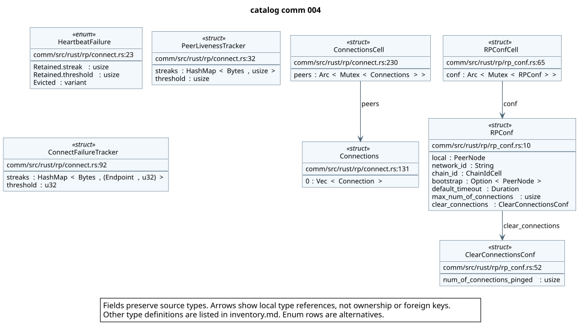

# catalog comm 004

[Inventory](inventory.md) | [PlantUML](catalog-comm-004.puml)

## Cross-Page References

- `ConnectFailureTracker: streaks -> Endpoint [catalog-comm-003.svg]`
- `Connections: 0 -> Connection [catalog-comm-003.svg]`
- `RPConf: bootstrap -> PeerNode [catalog-comm-003.svg]`
- `RPConf: chain_id -> ChainIdCell [catalog-comm-003.svg]`
- `RPConf: local -> PeerNode [catalog-comm-003.svg]`
