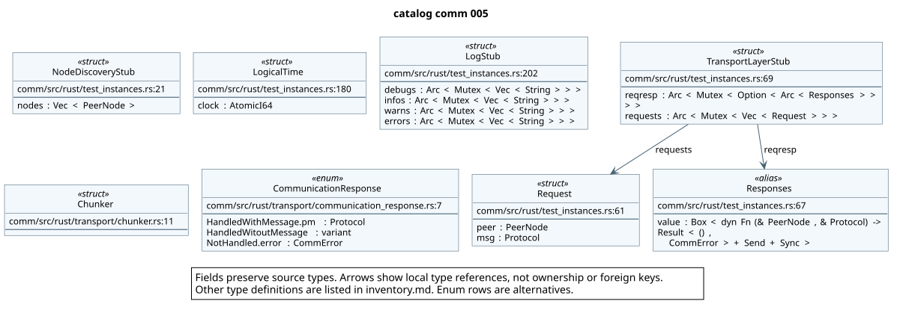

# catalog comm 005

[Inventory](inventory.md) | [PlantUML](catalog-comm-005.puml)

## Cross-Page References

- `CommunicationResponse: NotHandled.error -> CommError [catalog-comm-003.svg]`
- `NodeDiscoveryStub: nodes -> PeerNode [catalog-comm-003.svg]`
- `Request: peer -> PeerNode [catalog-comm-003.svg]`
- `Responses: value -> CommError [catalog-comm-003.svg]`
- `Responses: value -> PeerNode [catalog-comm-003.svg]`
