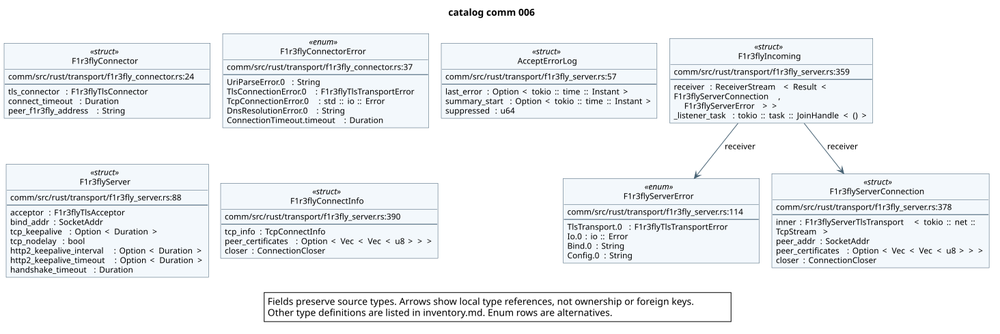

# catalog comm 006

[Inventory](inventory.md) | [PlantUML](catalog-comm-006.puml)

## Cardinality and Size

[Method, units, limits, and runtime evidence](sizing.md). These are declaration-level assessments, not measured live counts.

### F1r3flyConnector

Cardinality: 0..n live values. Current count and owner-level limits are not derivable from this declaration.

Size: Sum of field inline layouts plus compiler padding, then uniquely owned allocations. repr and custom implementations can change layout.

| Field or variant | Cardinality | Inline bytes or layout | Additional storage or wire encoding |
| --- | --- | --- | --- |
| `tls_connector` | 1 value | Compiler layout required | Follow the referenced declaration or external implementation. No allocation bound established. |
| `connect_timeout` | 1 value | Compiler layout required | Follow the referenced declaration or external implementation. No allocation bound established. |
| `peer_f1r3fly_address` | 0..n UTF-8 bytes | 24 B. String header on the generator target | capacity() bytes, excluding allocator overhead. UTF-8 byte length is not character count |

### F1r3flyConnectorError

Cardinality: 0..n live values. Current count and owner-level limits are not derivable from this declaration.

Size: Compiler enum layout plus allocations of the active variant only. Do not sum alternative variants.

| Field or variant | Cardinality | Inline bytes or layout | Additional storage or wire encoding |
| --- | --- | --- | --- |
| `UriParseError.0` | 0..n UTF-8 bytes when this variant is active | 24 B. String header on the generator target | capacity() bytes, excluding allocator overhead. UTF-8 byte length is not character count |
| `TlsConnectionError.0` | 1 value when this variant is active | Compiler layout required | Follow the referenced declaration or external implementation. No allocation bound established. |
| `TcpConnectionError.0` | 1 value when this variant is active | Compiler layout required | Follow the referenced declaration or external implementation. No allocation bound established. |
| `DnsResolutionError.0` | 0..n UTF-8 bytes when this variant is active | 24 B. String header on the generator target | capacity() bytes, excluding allocator overhead. UTF-8 byte length is not character count |
| `ConnectionTimeout.timeout` | 1 value when this variant is active | Compiler layout required | Follow the referenced declaration or external implementation. No allocation bound established. |

### AcceptErrorLog

Cardinality: 0..n live values. Current count and owner-level limits are not derivable from this declaration.

Size: Sum of field inline layouts plus compiler padding, then uniquely owned allocations. repr and custom implementations can change layout.

| Field or variant | Cardinality | Inline bytes or layout | Additional storage or wire encoding |
| --- | --- | --- | --- |
| `last_error` | 0..1 present payload | Option layout includes any tag or niche optimization. Do not assume I(T) + 1 | None when absent. Present payload: 1 value. Follow the referenced declaration or external implementation. No allocation bound established. |
| `summary_start` | 0..1 present payload | Option layout includes any tag or niche optimization. Do not assume I(T) + 1 | None when absent. Present payload: 1 value. Follow the referenced declaration or external implementation. No allocation bound established. |
| `suppressed` | 1 scalar | 8 B | None |

### F1r3flyServer

Cardinality: 0..n live values. Current count and owner-level limits are not derivable from this declaration.

Size: Sum of field inline layouts plus compiler padding, then uniquely owned allocations. repr and custom implementations can change layout.

| Field or variant | Cardinality | Inline bytes or layout | Additional storage or wire encoding |
| --- | --- | --- | --- |
| `acceptor` | 1 value | Compiler layout required | Follow the referenced declaration or external implementation. No allocation bound established. |
| `bind_addr` | 1 value | Compiler layout required | Follow the referenced declaration or external implementation. No allocation bound established. |
| `tcp_keepalive` | 0..1 present payload | Option layout includes any tag or niche optimization. Do not assume I(T) + 1 | None when absent. Present payload: 1 value. Follow the referenced declaration or external implementation. No allocation bound established. |
| `tcp_nodelay` | 1 scalar | 1 B | None |
| `http2_keepalive_interval` | 0..1 present payload | Option layout includes any tag or niche optimization. Do not assume I(T) + 1 | None when absent. Present payload: 1 value. Follow the referenced declaration or external implementation. No allocation bound established. |
| `http2_keepalive_timeout` | 0..1 present payload | Option layout includes any tag or niche optimization. Do not assume I(T) + 1 | None when absent. Present payload: 1 value. Follow the referenced declaration or external implementation. No allocation bound established. |
| `handshake_timeout` | 1 value | Compiler layout required | Follow the referenced declaration or external implementation. No allocation bound established. |

### F1r3flyServerError

Cardinality: 0..n live values. Current count and owner-level limits are not derivable from this declaration.

Size: Compiler enum layout plus allocations of the active variant only. Do not sum alternative variants.

| Field or variant | Cardinality | Inline bytes or layout | Additional storage or wire encoding |
| --- | --- | --- | --- |
| `TlsTransport.0` | 1 value when this variant is active | Compiler layout required | Follow the referenced declaration or external implementation. No allocation bound established. |
| `Io.0` | 1 value when this variant is active | Compiler layout required | Follow the referenced declaration or external implementation. No allocation bound established. |
| `Bind.0` | 0..n UTF-8 bytes when this variant is active | 24 B. String header on the generator target | capacity() bytes, excluding allocator overhead. UTF-8 byte length is not character count |
| `Config.0` | 0..n UTF-8 bytes when this variant is active | 24 B. String header on the generator target | capacity() bytes, excluding allocator overhead. UTF-8 byte length is not character count |

### F1r3flyIncoming

Cardinality: 0..n live values. Current count and owner-level limits are not derivable from this declaration.

Size: Sum of field inline layouts plus compiler padding, then uniquely owned allocations. repr and custom implementations can change layout.

| Field or variant | Cardinality | Inline bytes or layout | Additional storage or wire encoding |
| --- | --- | --- | --- |
| `receiver` | 1 value | Compiler layout required | Follow the referenced declaration or external implementation. No allocation bound established. |
| `_listener_task` | 1 value | Compiler layout required | Follow the referenced declaration or external implementation. No allocation bound established. |

### F1r3flyServerConnection

Cardinality: 0..n live values. Current count and owner-level limits are not derivable from this declaration.

Size: Sum of field inline layouts plus compiler padding, then uniquely owned allocations. repr and custom implementations can change layout.

| Field or variant | Cardinality | Inline bytes or layout | Additional storage or wire encoding |
| --- | --- | --- | --- |
| `inner` | 1 value | Compiler layout required | Follow the referenced declaration or external implementation. No allocation bound established. |
| `peer_addr` | 1 value | Compiler layout required | Follow the referenced declaration or external implementation. No allocation bound established. |
| `peer_certificates` | 0..1 present payload | Option layout includes any tag or niche optimization. Do not assume I(T) + 1 | None when absent. Present payload: 0..n elements. capacity * I(element), plus live element-owned allocations. Zero-sized elements need no backing allocation. Element: capacity * I(element), plus live element-owned allocations. Zero-sized elements need no backing allocation. Element: None |
| `closer` | 1 value | Compiler layout required | Follow the referenced declaration or external implementation. No allocation bound established. |

### F1r3flyConnectInfo

Cardinality: 0..n live values. Current count and owner-level limits are not derivable from this declaration.

Size: Sum of field inline layouts plus compiler padding, then uniquely owned allocations. repr and custom implementations can change layout.

| Field or variant | Cardinality | Inline bytes or layout | Additional storage or wire encoding |
| --- | --- | --- | --- |
| `tcp_info` | 1 value | Compiler layout required | Follow the referenced declaration or external implementation. No allocation bound established. |
| `peer_certificates` | 0..1 present payload | Option layout includes any tag or niche optimization. Do not assume I(T) + 1 | None when absent. Present payload: 0..n elements. capacity * I(element), plus live element-owned allocations. Zero-sized elements need no backing allocation. Element: capacity * I(element), plus live element-owned allocations. Zero-sized elements need no backing allocation. Element: None |
| `closer` | 1 value | Compiler layout required | Follow the referenced declaration or external implementation. No allocation bound established. |

## Cross-Page References

- `F1r3flyConnectInfo: closer -> ConnectionCloser [catalog-comm-007.svg]`
- `F1r3flyConnector: tls_connector -> F1r3flyTlsConnector [catalog-comm-007.svg]`
- `F1r3flyConnectorError: TlsConnectionError.0 -> F1r3flyTlsTransportError [catalog-comm-008.svg]`
- `F1r3flyServer: acceptor -> F1r3flyTlsAcceptor [catalog-comm-007.svg]`
- `F1r3flyServerConnection: closer -> ConnectionCloser [catalog-comm-007.svg]`
- `F1r3flyServerConnection: inner -> F1r3flyServerTlsTransport [catalog-comm-007.svg]`
- `F1r3flyServerError: TlsTransport.0 -> F1r3flyTlsTransportError [catalog-comm-008.svg]`
