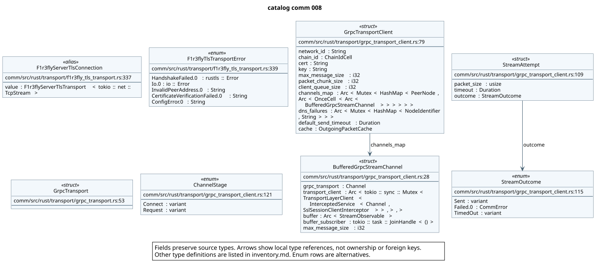

# catalog comm 008

[Inventory](inventory.md) | [PlantUML](catalog-comm-008.puml)

## Cross-Page References

- `BufferedGrpcStreamChannel: buffer -> StreamObservable [catalog-comm-013.svg]`
- `BufferedGrpcStreamChannel: transport_client -> SslSessionClientInterceptor [catalog-comm-012.svg]`
- `F1r3flyServerTlsConnection: value -> F1r3flyServerTlsTransport [catalog-comm-007.svg]`
- `GrpcTransportClient: cache -> OutgoingPacketCache [catalog-comm-012.svg]`
- `GrpcTransportClient: chain_id -> ChainIdCell [catalog-comm-003.svg]`
- `GrpcTransportClient: channels_map -> PeerNode [catalog-comm-003.svg]`
- `GrpcTransportClient: dns_failures -> NodeIdentifier [catalog-comm-003.svg]`
- `StreamOutcome: Failed.0 -> CommError [catalog-comm-003.svg]`
