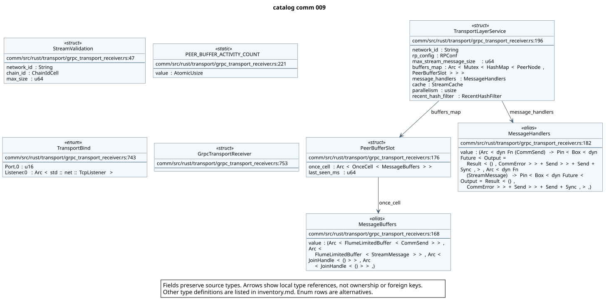

# catalog comm 009

[Inventory](inventory.md) | [PlantUML](catalog-comm-009.puml)

## Cardinality and Size

[Method, units, limits, and runtime evidence](sizing.md). These are declaration-level assessments, not measured live counts.

### StreamValidation

Cardinality: 0..n live values. Current count and owner-level limits are not derivable from this declaration.

Size: Sum of field inline layouts plus compiler padding, then uniquely owned allocations. repr and custom implementations can change layout.

| Field or variant | Cardinality | Inline bytes or layout | Additional storage or wire encoding |
| --- | --- | --- | --- |
| `network_id` | 0..n UTF-8 bytes | 24 B. String header on the generator target | capacity() bytes, excluding allocator overhead. UTF-8 byte length is not character count |
| `chain_id` | 1 value | Compiler layout required | Follow the referenced declaration or external implementation. No allocation bound established. |
| `max_size` | 1 scalar | 8 B | None |

### MessageBuffers

Cardinality: Alias, not a separate allocation. Count values of the target type.

Size: Same layout and allocations as target. Do not add alias bytes again.

| Field or variant | Cardinality | Inline bytes or layout | Additional storage or wire encoding |
| --- | --- | --- | --- |
| `value` | 4 component values | Sum of component inline sizes plus compiler padding | Sum of component-owned allocations |

### PeerBufferSlot

Cardinality: 0..n live values. Current count and owner-level limits are not derivable from this declaration.

Size: Sum of field inline layouts plus compiler padding, then uniquely owned allocations. repr and custom implementations can change layout.

| Field or variant | Cardinality | Inline bytes or layout | Additional storage or wire encoding |
| --- | --- | --- | --- |
| `once_cell` | 1 shared strong reference | Pointer or fat pointer, depending on target type | One shared allocation holds the target, counters and alignment. Count it once across all handles |
| `last_seen_ms` | 1 scalar | 8 B | None |

### MessageHandlers

Cardinality: Alias, not a separate allocation. Count values of the target type.

Size: Same layout and allocations as target. Do not add alias bytes again.

| Field or variant | Cardinality | Inline bytes or layout | Additional storage or wire encoding |
| --- | --- | --- | --- |
| `value` | 2 component values | Sum of component inline sizes plus compiler padding | Sum of component-owned allocations |

### TransportLayerService

Cardinality: 0..n live values. Current count and owner-level limits are not derivable from this declaration.

Size: Sum of field inline layouts plus compiler padding, then uniquely owned allocations. repr and custom implementations can change layout.

| Field or variant | Cardinality | Inline bytes or layout | Additional storage or wire encoding |
| --- | --- | --- | --- |
| `network_id` | 0..n UTF-8 bytes | 24 B. String header on the generator target | capacity() bytes, excluding allocator overhead. UTF-8 byte length is not character count |
| `rp_config` | 1 value | Compiler layout required | Follow the referenced declaration or external implementation. No allocation bound established. |
| `max_stream_message_size` | 1 scalar | 8 B | None |
| `buffers_map` | 1 shared strong reference | Pointer or fat pointer, depending on target type | One shared allocation holds the target, counters and alignment. Count it once across all handles |
| `message_handlers` | 1 value | Compiler layout required | Follow the referenced declaration or external implementation. No allocation bound established. |
| `cache` | 1 value | Compiler layout required | Follow the referenced declaration or external implementation. No allocation bound established. |
| `parallelism` | 1 scalar | 8 B | None |
| `recent_hash_filter` | 1 value | Compiler layout required | Follow the referenced declaration or external implementation. No allocation bound established. |

### PEER_BUFFER_ACTIVITY_COUNT

Cardinality: One slot per linked process instance. Lazy payload can be uninitialized.

Size: Declared slot or lazy wrapper layout plus initialized owned allocations.

| Field or variant | Cardinality | Inline bytes or layout | Additional storage or wire encoding |
| --- | --- | --- | --- |
| `value` | 1 atomic value | Target atomic layout required | None for the atomic value itself |

### TransportBind

Cardinality: 0..n live values. Current count and owner-level limits are not derivable from this declaration.

Size: Compiler enum layout plus allocations of the active variant only. Do not sum alternative variants.

| Field or variant | Cardinality | Inline bytes or layout | Additional storage or wire encoding |
| --- | --- | --- | --- |
| `Port.0` | 1 scalar when this variant is active | 2 B | None |
| `Listener.0` | 1 shared strong reference when this variant is active | Pointer or fat pointer, depending on target type | One shared allocation holds the target, counters and alignment. Count it once across all handles |

### GrpcTransportReceiver

Cardinality: 0..n live values. Current count and owner-level limits are not derivable from this declaration.

Size: Sum of field inline layouts plus compiler padding, then uniquely owned allocations. repr and custom implementations can change layout.

| Field or variant | Cardinality | Inline bytes or layout | Additional storage or wire encoding |
| --- | --- | --- | --- |
| No declared fields | 0 field payloads | Compiler layout required | No field-owned allocations |

## Cross-Page References

- `MessageBuffers: value -> FlumeLimitedBuffer [catalog-comm-011.svg]`
- `MessageBuffers: value -> StreamMessage [catalog-comm-011.svg]`
- `MessageHandlers: value -> CommError [catalog-comm-003.svg]`
- `MessageHandlers: value -> StreamMessage [catalog-comm-011.svg]`
- `StreamValidation: chain_id -> ChainIdCell [catalog-comm-003.svg]`
- `TransportLayerService: buffers_map -> PeerNode [catalog-comm-003.svg]`
- `TransportLayerService: cache -> StreamCache [catalog-comm-011.svg]`
- `TransportLayerService: recent_hash_filter -> RecentHashFilter [catalog-shared-006.svg]`
- `TransportLayerService: rp_config -> RPConf [catalog-comm-004.svg]`
