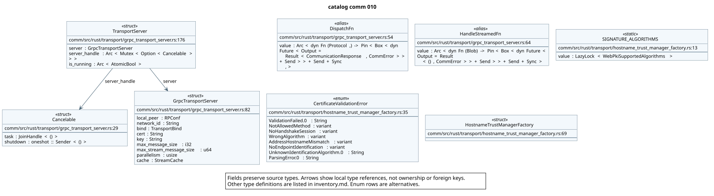

# catalog comm 010

[Inventory](inventory.md) | [PlantUML](catalog-comm-010.puml)

## Cardinality and Size

[Method, units, limits, and runtime evidence](sizing.md). These are declaration-level assessments, not measured live counts.

### Cancelable

Cardinality: 0..n live values. Current count and owner-level limits are not derivable from this declaration.

Size: Sum of field inline layouts plus compiler padding, then uniquely owned allocations. repr and custom implementations can change layout.

| Field or variant | Cardinality | Inline bytes or layout | Additional storage or wire encoding |
| --- | --- | --- | --- |
| `task` | 1 value | Compiler layout required | Follow the referenced declaration or external implementation. No allocation bound established. |
| `shutdown` | 1 value | Compiler layout required | Follow the referenced declaration or external implementation. No allocation bound established. |

### DispatchFn

Cardinality: Alias, not a separate allocation. Count values of the target type.

Size: Same layout and allocations as target. Do not add alias bytes again.

| Field or variant | Cardinality | Inline bytes or layout | Additional storage or wire encoding |
| --- | --- | --- | --- |
| `value` | 1 shared strong reference | Pointer or fat pointer, depending on target type | One shared allocation holds the target, counters and alignment. Count it once across all handles |

### HandleStreamedFn

Cardinality: Alias, not a separate allocation. Count values of the target type.

Size: Same layout and allocations as target. Do not add alias bytes again.

| Field or variant | Cardinality | Inline bytes or layout | Additional storage or wire encoding |
| --- | --- | --- | --- |
| `value` | 1 shared strong reference | Pointer or fat pointer, depending on target type | One shared allocation holds the target, counters and alignment. Count it once across all handles |

### GrpcTransportServer

Cardinality: 0..n live values. Current count and owner-level limits are not derivable from this declaration.

Size: Sum of field inline layouts plus compiler padding, then uniquely owned allocations. repr and custom implementations can change layout.

| Field or variant | Cardinality | Inline bytes or layout | Additional storage or wire encoding |
| --- | --- | --- | --- |
| `local_peer` | 1 value | Compiler layout required | Follow the referenced declaration or external implementation. No allocation bound established. |
| `network_id` | 0..n UTF-8 bytes | 24 B. String header on the generator target | capacity() bytes, excluding allocator overhead. UTF-8 byte length is not character count |
| `bind` | 1 value | Compiler layout required | Follow the referenced declaration or external implementation. No allocation bound established. |
| `cert` | 0..n UTF-8 bytes | 24 B. String header on the generator target | capacity() bytes, excluding allocator overhead. UTF-8 byte length is not character count |
| `key` | 0..n UTF-8 bytes | 24 B. String header on the generator target | capacity() bytes, excluding allocator overhead. UTF-8 byte length is not character count |
| `max_message_size` | 1 scalar | 4 B | None |
| `max_stream_message_size` | 1 scalar | 8 B | None |
| `parallelism` | 1 scalar | 8 B | None |
| `cache` | 1 value | Compiler layout required | Follow the referenced declaration or external implementation. No allocation bound established. |

### TransportServer

Cardinality: 0..n live values. Current count and owner-level limits are not derivable from this declaration.

Size: Sum of field inline layouts plus compiler padding, then uniquely owned allocations. repr and custom implementations can change layout.

| Field or variant | Cardinality | Inline bytes or layout | Additional storage or wire encoding |
| --- | --- | --- | --- |
| `server` | 1 value | Compiler layout required | Follow the referenced declaration or external implementation. No allocation bound established. |
| `server_handle` | 1 shared strong reference | Pointer or fat pointer, depending on target type | One shared allocation holds the target, counters and alignment. Count it once across all handles |
| `is_running` | 1 shared strong reference | Pointer or fat pointer, depending on target type | One shared allocation holds the target, counters and alignment. Count it once across all handles |

### SIGNATURE_ALGORITHMS

Cardinality: One slot per linked process instance. Lazy payload can be uninitialized.

Size: Declared slot or lazy wrapper layout plus initialized owned allocations.

| Field or variant | Cardinality | Inline bytes or layout | Additional storage or wire encoding |
| --- | --- | --- | --- |
| `value` | 1 wrapper slot | Wrapper implementation and payload layout required | Payload allocations and any lock/waiter allocations. Once and lazy payloads can be uninitialized |

### CertificateValidationError

Cardinality: 0..n live values. Current count and owner-level limits are not derivable from this declaration.

Size: Compiler enum layout plus allocations of the active variant only. Do not sum alternative variants.

| Field or variant | Cardinality | Inline bytes or layout | Additional storage or wire encoding |
| --- | --- | --- | --- |
| `ValidationFailed.0` | 0..n UTF-8 bytes when this variant is active | 24 B. String header on the generator target | capacity() bytes, excluding allocator overhead. UTF-8 byte length is not character count |
| `NotAllowedMethod` | 1 mutually exclusive alternative | No payload. Enum discriminant layout required | None for this unit variant |
| `NoHandshakeSession` | 1 mutually exclusive alternative | No payload. Enum discriminant layout required | None for this unit variant |
| `WrongAlgorithm` | 1 mutually exclusive alternative | No payload. Enum discriminant layout required | None for this unit variant |
| `AddressHostnameMismatch` | 1 mutually exclusive alternative | No payload. Enum discriminant layout required | None for this unit variant |
| `NoEndpointIdentification` | 1 mutually exclusive alternative | No payload. Enum discriminant layout required | None for this unit variant |
| `UnknownIdentificationAlgorithm.0` | 0..n UTF-8 bytes when this variant is active | 24 B. String header on the generator target | capacity() bytes, excluding allocator overhead. UTF-8 byte length is not character count |
| `ParsingError.0` | 0..n UTF-8 bytes when this variant is active | 24 B. String header on the generator target | capacity() bytes, excluding allocator overhead. UTF-8 byte length is not character count |

### HostnameTrustManagerFactory

Cardinality: 0..n live values. Current count and owner-level limits are not derivable from this declaration.

Size: Sum of field inline layouts plus compiler padding, then uniquely owned allocations. repr and custom implementations can change layout.

| Field or variant | Cardinality | Inline bytes or layout | Additional storage or wire encoding |
| --- | --- | --- | --- |
| No declared fields | 0 field payloads | Compiler layout required | No field-owned allocations |

## Cross-Page References

- `DispatchFn: value -> CommError [catalog-comm-003.svg]`
- `DispatchFn: value -> CommunicationResponse [catalog-comm-005.svg]`
- `GrpcTransportServer: bind -> TransportBind [catalog-comm-009.svg]`
- `GrpcTransportServer: cache -> StreamCache [catalog-comm-011.svg]`
- `GrpcTransportServer: local_peer -> RPConf [catalog-comm-004.svg]`
- `HandleStreamedFn: value -> Blob [catalog-comm-014.svg]`
- `HandleStreamedFn: value -> CommError [catalog-comm-003.svg]`
