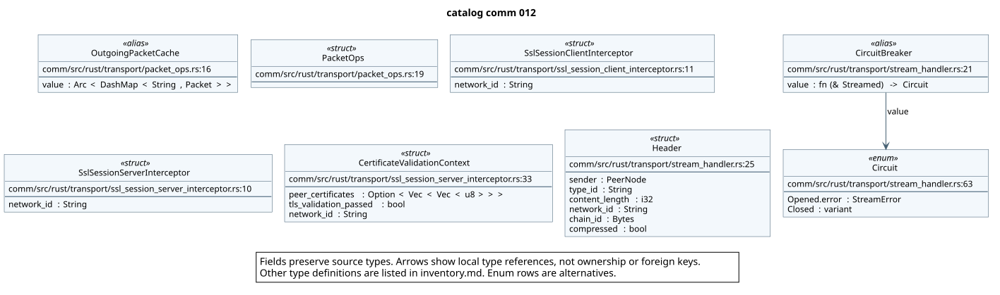

# catalog comm 012

[Inventory](inventory.md) | [PlantUML](catalog-comm-012.puml)

## Cross-Page References

- `Circuit: Opened.error -> StreamError [catalog-comm-013.svg]`
- `CircuitBreaker: value -> Streamed [catalog-comm-013.svg]`
- `Header: sender -> PeerNode [catalog-comm-003.svg]`
